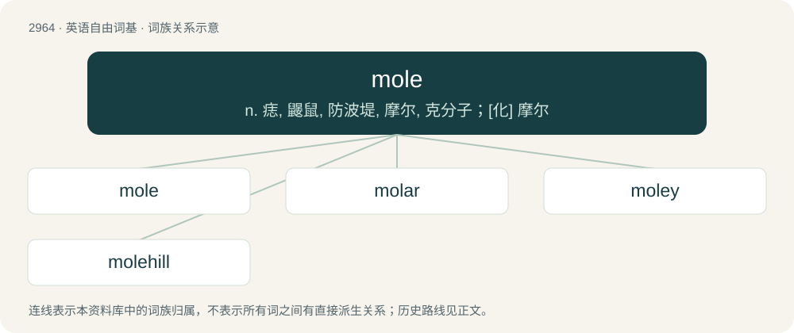

# 3068 · mole — n. 痣, 鼹鼠, 防波堤, 摩尔, 克分子；\[化\] 摩尔

[总目录](../00_总目录_按常用程度.md)

**类型**：英语自由词基　｜　**来源语言**：见词源记录

## 核心含义与来源

- 核心含义：n. 痣, 鼹鼠, 防波堤, 摩尔, 克分子；\[化\] 摩尔
- 英文含义：A naevus, a pigmented, slightly raised, and sometimes hairy spot on the skin.
- 词形：mole

**多个词源／构词路径**：同一拼写可能有不同来源；以下按词性和含义分别列出。

**来源记录 1**（名词；A naevus, a pigmented, slightly raised, and sometimes hairy spot on the skin.）

From Middle English mole, mool, from Old English māl (“a mole, spot, mark, blemish”), from Proto-West Germanic \*mail, from Proto-Germanic \*mailą (“spot, wrinkle”), from Proto-Indo-European \*mel-, \*melw- (“dark, dirty”), from Proto-Indo-European \*mey-, \*my- (“to soil, sully”). Cognate with Scots mail (“spot, stain”), Saterland Frisian Moal (“scar”), German dialectal Meil (“spot, stain, blemish”), Gothic 𐌼𐌰𐌹𐌻 (mail, “spot, blemish”).

**来源记录 2**（名词；Any of several small, burrowing, insectivorous mammals of the family Talpidae.）

From Middle English molle, molde, mole (“mole”), ultimately from Proto-West Germanic \*mol(h), from Proto-Germanic \*mulaz, \*mulhaz (“mole, salamander”), from Proto-Indo-European \*molg-, \*molk- (“slug, salamander”), from Proto-Indo-European \*(s)melw- (“to grind, crush, beat”). Cognate with North Frisian mull (“mole”), Saterland Frisian Molle (“mole”), Dutch mol (“mole”), German Low German Mol, Mul, Mull (“mole”), German Molch (“salamander, newt”), Old Russian смолжь (smolžʹ, “snail”), Czech mlž (“clam”). Derivation as an abbreviation of Middle English molewarpe, a variation of moldewarpe, moldwerp (“mole”) in Middle English is unexplained and probably unlikely due to the simultaneous occurrence of both words. See mouldwarp.

**来源记录 3**（名词；A moll, a bitch, a slut.）

From moll (from Moll, an archaic nickname for Mary), influenced by the spelling of the word mole (“an internal spy”), and due to /mɒl/ and /məʊl/ merging as \[ˈmɔʊɫ\] in the Australian accent.

**来源记录 4**（名词；A massive structure, usually of stone, used as a pier, breakwater or junction between places separated by water.）

From French môle or Latin mōles (“mass, heap, rock”).

**来源记录 5**（名词；In the International System of Units, the base unit of amount of substance; the amount of substance of a system which contains exactly 6.02214076×10²³ elementary entities (atoms, ions, molecules, etc.). Symbol: mol. The number of atoms is known as Avogadro’s number.）

Calqued from German Mol; spelled as if it had come directly from molecule or Latin moles (the ultimate source of Mol and molecule in any event).

**来源记录 6**（名词；A hemorrhagic mass of tissue in the uterus caused by a dead ovum.）

In English since before the 20th century. From French môle f, from Latin mola (“millstone”), because it is a hardened mass.

**来源记录 7**（名词；Any of several spicy sauces typical of the cuisine of Mexico and neighboring Central America countries, especially one that contains chocolate and is used in cooking main dishes, not desserts.）

From Spanish mole, from Classical Nahuatl mōlli (“sauce; stew; something ground”).

## 词族图

## 单词速览（常用到不常用）

| 单词 | 音标 | 释义 |
|---|---|---|
| [mole](#w-1) | 英 /məʊl/；美 /mol/ | n. 痣, 鼹鼠, 防波堤, 摩尔, 克分子；\[化\] 摩尔 |
| [molar](#w-2) | 英 /məʊlə(ɹ)/；美 /ˈmoʊlɚ/ | 【英文】Of, relating to, or being a solution containing one mole of solute per litre of solution. |
| [moley](#w-3) |  | 【英文】Pertaining to, full of, or characteristic of moles (burrowing insectivores). |
| [molehill](#w-4) | /ˈməʊlhɪl/ | n. 鼹鼠丘, 琐事 |

## 逐词详解

### 1. mole

**词性**：名词　｜　**音标**：英 /məʊl/；美 /mol/

**中文释义**：n. 痣, 鼹鼠, 防波堤, 摩尔, 克分子；\[化\] 摩尔

**英文义项**：A naevus, a pigmented, slightly raised, and sometimes hairy spot on the skin.

**词源与演化**：

From Middle English mole, mool, from Old English māl (“a mole, spot, mark, blemish”), from Proto-West Germanic \*mail, from Proto-Germanic \*mailą (“spot, wrinkle”), from Proto-Indo-European \*mel-, \*melw- (“dark, dirty”), from Proto-Indo-European \*mey-, \*my- (“to soil, sully”). Cognate with Scots mail (“spot, stain”), Saterland Frisian Moal (“scar”), German dialectal Meil (“spot, stain, blemish”), Gothic 𐌼𐌰𐌹𐌻 (mail, “spot, blemish”).

**例句**：

> I don't think people should make a mountain of a mole hill.

### 2. molar

**词性**：形容词　｜　**音标**：英 /məʊlə(ɹ)/；美 /ˈmoʊlɚ/

**英文义项**：Of, relating to, or being a solution containing one mole of solute per litre of solution. / Of or relating to a complete body of matter as distinct from its molecular or atomic constituents.

**构词拆分**：mol(e) + -ar

**词源与演化**：

From mol(e) + -ar in the chemistry usage.

### 3. moley

**词性**：形容词

**英文义项**：Pertaining to, full of, or characteristic of moles (burrowing insectivores). / Having numerous moles (naevi)

**构词拆分**：mole + -y

**词源与演化**：

From mole + -y.

### 4. molehill

**词性**：名词　｜　**音标**：/ˈməʊlhɪl/

**中文释义**：n. 鼹鼠丘, 琐事

**英文义项**：A small mound of earth created by a mole's burrowing underneath the surface of the ground.

**构词拆分**：mole + hill

**词源与演化**：

From mole + hill. The verb sense comes from the idiom make a mountain out of a molehill.

**例句**：

> She is probably just making a mountain out of a molehill again.
