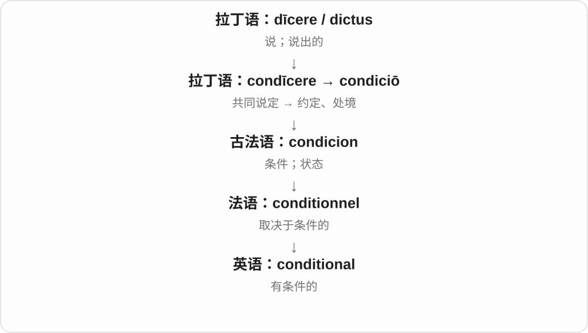
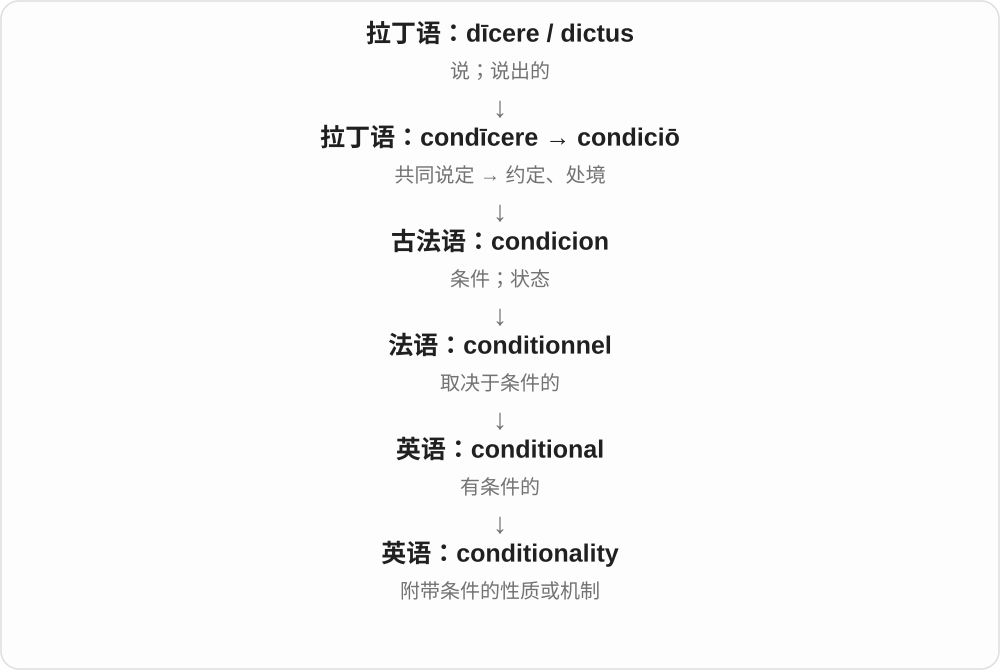
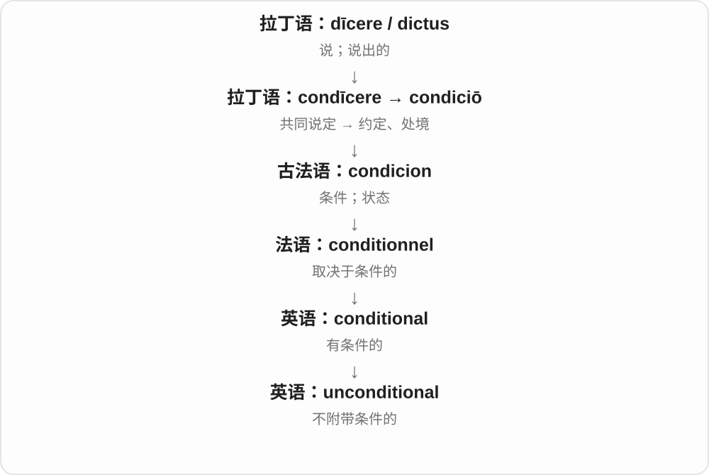

# 3070 · conditional — 条件作为前提，副词与否定说明是否附带要求

[逐词精讲目录](../00_逐词精讲目录.md) · [总目录](../00_总目录_按常用程度.md)

## 核心词根与来源

批准、数学结论、关系表达都可能有条件。词先说明依赖结构，具体门槛再由 if、under、provided 等上下文交代。

**CONDITIONAL：这件事成立，但先得满足那件事**

conditional → conditionally、unconditional、conditionality，性质、方式、否定与抽象名词分开。

- **条件性质、方式与抽象名词**：conditional · conditionally · conditionality
- **不附条件**：unconditional

## 词形与演化规律

condition + -al → conditional；-ly 方式；un- 否定条件性；-ity 抽象性质。

## 单词速览（按词族由简到繁）

同一基础词的相关扩展放在一起，先读基础形式，再读扩展；各组之间优先读常用的。具体词源关系见各词讲解。

| 单词 | 音标 | 核心意思 |
|---|---|---|
| [conditional](#w-1) | /kənˈdɪʃənəl/ | 有条件的；条件式的 |
| [conditionally](#w-3) | /kənˈdɪʃənəli/ | 有条件地；在某些条件下 |
| [conditionality](#w-4) | /kənˌdɪʃəˈnæləti/ | 附带条件的性质；所附条件机制 |
| [unconditional](#w-2) | /ˌʌnkənˈdɪʃənəl/ | 无条件的 |

## 逐词讲解

### 1. conditional — 有条件的；条件式的

**音标**：/kənˈdɪʃənəl/

**先抓住这个画面**

“可以，但先得满足这一点。”conditional 说的不是直接答应，而是把决定系在某个条件上。

**怎么拆**

经法语 conditionnel / condicionel 传入，现代可按 condition + -al 理解。

**怎么变成今天的意思**

conditional approval 是满足附带条件才有效的批准。语法中的 conditional sentence 则讨论 if 等结构表达的条件关系。

**常见搭配与例句**

conditional on…；conditional approval；a conditional offer；a conditional sentence。

> The offer is conditional on your passing the final exam.

这份录取或聘用要约以你通过期末考试为条件。

> The council gave conditional approval to the plan.

委员会有条件地批准了这个计划。

**别混淆**

conditional 是有条件；conditioned 更常是已经受训练、处理或环境影响。

### 2. conditionally — 有条件地；在某些条件下

**音标**：/kənˈdɪʃənəli/

**先抓住这个画面**

先给一个可以，但前面还有“只要……”，就是 conditionally。条件满足才继续成立，所以不是一句不附带要求的 yes。

**怎么拆**

conditional + -ly → conditionally，原词末 l 再接 -ly，拼写 ll。副词把以条件为前提的性质放进批准、接受、成立等动作。

**怎么变成今天的意思**

**condition 条件 → conditional**  
以相应条件为前提的性质

↓

**conditional + -ly → conditionally**  
在满足所列条件时，带条件地

conditionally accepted 有条件接收；conditionally approved 有条件批准；conditionally true 在特定条件下成立。

**常见搭配与例句**

conditionally accepted；conditionally approved。

> The proposal was conditionally accepted.

提案被有条件接收。

> The result is conditionally true under the stated assumptions.

在列明假设下，这个结论有条件地成立。

**别混淆**

conditionally 与 unconditionally 相反；前者需看附带条件，而不是程度上有一点批准。

### 3. conditionality — 附带条件的性质；所附条件机制

**音标**：/kənˌdɪʃəˈnæləti/

**先抓住这个画面**

不是只问“给不给”，而是讨论“给这件事之前，要满足哪些要求”。conditionality 把附带条件这套安排当成话题。

**怎么拆**

conditional + -ity，把“有条件的”变成抽象名词。

**怎么变成今天的意思**

常用于正式政策、援助和贷款讨论，谈某项支持与哪些要求挂钩。日常只说某个简单条件，用 condition 更清楚。

**常见搭配与例句**

aid conditionality；loan conditionality；the conditionality of an offer。

> The paper examines the conditionality attached to foreign aid.

论文研究了对外援助所附带的条件机制。

> Both sides debated the conditionality of the proposed support.

双方讨论了拟议支持方案所附条件的问题。

**别混淆**

condition 是一项条件；conditionality 常谈附条件的原则、机制或整体性质。

### 4. unconditional — 无条件的

**音标**：/ˌʌnkənˈdɪʃənəl/

**先抓住这个画面**

“不需要你先做到什么，我也会这样。”unconditional 去掉了附带的前提。

**怎么拆**

un-（没有）+ conditional（有条件的）。

**怎么变成今天的意思**

它可以形容支持、承诺，也可说 unconditional surrender“无条件投降”。具体范围仍由所谈的事情决定，不表示生活中从此没有任何界限。

**常见搭配与例句**

unconditional support；unconditional love；unconditional surrender。

> She offered him unconditional support.

她向他提供了无条件的支持。

> The agreement called for an unconditional surrender.

协议要求无条件投降。

**别混淆**

unconditional 说没有附带条件；unlimited 说没有数量或范围上限。这两件事不同。

## 这一组要分清什么

conditionally 不是批准程度低一点，而是附有前提；unconditional 则否定这层条件限制。

## 串起来练习

The conditional offer was accepted conditionally, after the details were clarified.

细节澄清后，那份附带条件的提议被有条件地接受。
