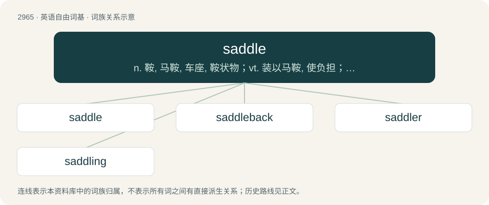

# 3070 · saddle — n. 鞍, 马鞍, 车座, 鞍状物；vt. 装以马鞍, 使负担；vi. 跨上马鞍

[总目录](../00_总目录_按常用程度.md)

**类型**：英语自由词基　｜　**来源语言**：见词源记录

## 核心含义与来源

- 核心含义：n. 鞍, 马鞍, 车座, 鞍状物；vt. 装以马鞍, 使负担；vi. 跨上马鞍
- 英文含义：A seat for a rider, typically made of leather and raised in the front and rear, placed on the back of a horse or other animal, and secured by a strap around the animal's body.
- 词形：saddle

**多个词源／构词路径**：同一拼写可能有不同来源；以下按词性和含义分别列出。

**来源记录 1**（名词；A seat for a rider, typically made of leather and raised in the front and rear, placed on the back of a horse or other animal, and secured by a strap around the animal's body.）

From Middle English sadel, from Old English sadol, from Proto-West Germanic \*sadul, from Proto-Germanic \*sadulaz (“saddle”). Further etymology uncertain, perhaps from Proto-Indo-European \*sod-dʰlo-, from \*sed- (“to sit”) + \*-dʰlom (a variant of \*-trom (suffix forming nouns denoting instruments or tools)), though the Oxford English Dictionary says this “presents formal difficulties”. Cognates \* Danish sadel \* Dutch zadel \* German Sattel \* Icelandic söðull \* Low German Sadel \* Russian седло́ (sedló) \* Saterland Frisian Soadel \* Scots sadil \* Swedish sadel \* West Frisian seal

**来源记录 2**（动词；To put a saddle (noun sense 1) on (an animal).）

From Middle English sadelen (“to put a saddle on (an animal), to saddle”) \[and other forms\], from Old English sadolian, sadelian, sadilian (“to saddle”), from Proto-Germanic \*sadulōną (“to saddle”), from \*sadulaz (“a saddle”, noun) (see further at etymology 1) + \*-ōną (suffix forming denominative verbs from nouns). Cognates \* Middle Dutch sādelen (modern Dutch zadelen) \* Middle Low German sādelen \* Old Danish sathlæ (modern Danish sadle) \* Old High German satalōn, satulōn (Middle High German satelen, sateln, German satteln) \* Old Norse sǫðla \* Old Swedish saþla (modern Swedish sadla)

## 词族图

## 单词速览（常用到不常用）

| 单词 | 音标 | 释义 |
|---|---|---|
| [saddle](#w-1) | 英 /ˈsædl̩/；美 /ˈsæd(ə)l/ | n. 鞍, 马鞍, 车座, 鞍状物；vt. 装以马鞍, 使负担；vi. 跨上马鞍 |
| [saddleback](#w-2) | /ˈsædlbæk/ | n. 鞍状峰, 鞍形屋顶, 鞍背鸟 |
| [saddler](#w-3) | 英 /ˈsadlə/；美 /ˈsædlɚ/ | n. 制造马鞍的人, 马具商, 骑用马 |
| [saddling](#w-4) | /ˈsædliŋ/ | \[冶\]鞍锻 |

## 逐词详解

### 1. saddle

**词性**：名词　｜　**音标**：英 /ˈsædl̩/；美 /ˈsæd(ə)l/

**中文释义**：n. 鞍, 马鞍, 车座, 鞍状物；vt. 装以马鞍, 使负担；vi. 跨上马鞍

**英文义项**：A seat for a rider, typically made of leather and raised in the front and rear, placed on the back of a horse or other animal, and secured by a strap around the animal's body. / A similar implement used to secure goods to animals; a packsaddle.

**词源与演化**：

From Middle English sadel, from Old English sadol, from Proto-West Germanic \*sadul, from Proto-Germanic \*sadulaz (“saddle”). Further etymology uncertain, perhaps from Proto-Indo-European \*sod-dʰlo-, from \*sed- (“to sit”) + \*-dʰlom (a variant of \*-trom (suffix forming nouns denoting instruments or tools)), though the Oxford English Dictionary says this “presents formal difficulties”. Cognates \* Danish sadel \* Dutch zadel \* German Sattel \* Icelandic söðull \* Low German Sadel \* Russian седло́ (sedló) \* Saterland Frisian Soadel \* Scots sadil \* Swedish sadel \* West Frisian seal

**例句**：

> Among her graduation gifts were a new saddle, halter and riding boots.

### 2. saddleback

**词性**：名词　｜　**音标**：/ˈsædlbæk/

**中文释义**：n. 鞍状峰, 鞍形屋顶, 鞍背鸟

**英文义项**：A saddle-shaped ridge forming a shallow pass between two peaks. / A roof in the same shape, having a gable at each end.

**构词拆分**：From saddle + back.

**词源与演化**：

From saddle + back.

### 3. saddler

**词性**：名词　｜　**音标**：英 /ˈsadlə/；美 /ˈsædlɚ/

**中文释义**：n. 制造马鞍的人, 马具商, 骑用马

**英文义项**：Someone who makes, repairs and sells saddles, harnesses etc. / The harp seal.

**构词拆分**：saddle + -er

**词源与演化**：

From Middle English sadeler, sadelere, equivalent to saddle + -er. Cognate with Old Norse sǫðlari (“saddler”).

### 4. saddling

**词性**：名词　｜　**音标**：/ˈsædliŋ/

**中文释义**：\[冶\]鞍锻

**英文义项**：The act of placing a saddle on an animal.

**构词拆分**：saddle (verb) + -ing

**词源与演化**：

From saddle (verb) + -ing. Compare Middle English saddyllynge, sadyllynge (“a saddlecloth or horsecloth”).

**例句**：

> Courage is being scared to death, but saddling up anyway.
