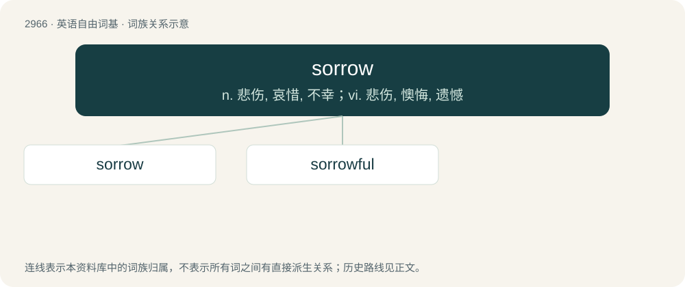

# 3071 · sorrow — n. 悲伤, 哀惜, 不幸；vi. 悲伤, 懊悔, 遗憾

[总目录](../00_总目录_按常用程度.md)

**类型**：英语自由词基　｜　**来源语言**：见词源记录

## 核心含义与来源

- 核心含义：n. 悲伤, 哀惜, 不幸；vi. 悲伤, 懊悔, 遗憾
- 英文含义：unhappiness, woe
- 词形：sorrow

**来源记录 1**（名词；unhappiness, woe）

From Middle English sorwe, sorow, sorewe, from Old English sorg, sorh (“care, anxiety, sorrow, grief”), from Proto-West Germanic \*sorgu, from Proto-Germanic \*surgō (compare West Frisian soarch, Dutch zorg, German Sorge, Danish, Swedish and Norwegian sorg), from Proto-Indo-European \*swergʰ- (“watch over, worry; be ill, suffer”) (compare Old Irish serg (“sickness”), Tocharian B sark (“sickness”), Lithuanian sirgti (“be sick”), Sanskrit सूर्क्षति (sū́rkṣati, “worry”). Despite the similarity in form and meaning, not historically related to sorry and sore.

## 词族图

## 单词速览（常用到不常用）

| 单词 | 音标 | 释义 |
|---|---|---|
| [sorrow](#w-1) | 英 /ˈsɒɹəʊ/；美 /ˈsɑɹoʊ/ | n. 悲伤, 哀惜, 不幸；vi. 悲伤, 懊悔, 遗憾 |
| [sorrowful](#w-2) | 英 /ˈsɒɹəʊfəl/；美 /ˈsɑɹoʊfəl/ | a. 悲伤的 |

## 逐词详解

### 1. sorrow

**词性**：名词　｜　**音标**：英 /ˈsɒɹəʊ/；美 /ˈsɑɹoʊ/

**中文释义**：n. 悲伤, 哀惜, 不幸；vi. 悲伤, 懊悔, 遗憾

**英文义项**：unhappiness, woe / (usually in plural) An instance or cause of unhappiness.

**词源与演化**：

From Middle English sorwe, sorow, sorewe, from Old English sorg, sorh (“care, anxiety, sorrow, grief”), from Proto-West Germanic \*sorgu, from Proto-Germanic \*surgō (compare West Frisian soarch, Dutch zorg, German Sorge, Danish, Swedish and Norwegian sorg), from Proto-Indo-European \*swergʰ- (“watch over, worry; be ill, suffer”) (compare Old Irish serg (“sickness”), Tocharian B sark (“sickness”), Lithuanian sirgti (“be sick”), Sanskrit सूर्क्षति (sū́rkṣati, “worry”). Despite the similarity in form and meaning, not historically related to sorry and sore.

**例句**：

> Parting is such sweet sorrow.

该用例对应义项：(usually in plural) An instance or cause of unhappiness.

### 2. sorrowful

**词性**：形容词　｜　**音标**：英 /ˈsɒɹəʊfəl/；美 /ˈsɑɹoʊfəl/

**中文释义**：a. 悲伤的

**英文义项**：exhibiting sorrow; dejected; distraught; sad. (of a person) / Producing sorrow; causing grief.

**构词拆分**：sorrow + -ful

**词源与演化**：

From Middle English sorweful, from Old English sorhful, sorgful (“full of care; anxious; sorrowful”), from Proto-Germanic \*surgafullaz (“full of care; anxious”), equivalent to sorrow + -ful. Cognate with Old High German sorgfol (“careful; anxious”), Norwegian sorgfull (“sorrowful”), Icelandic sorgfullur (“lamentable”).

**用法示例／搭配（非完整句）**：

> sorrowful accident

该用例对应义项：Producing sorrow; causing grief.
