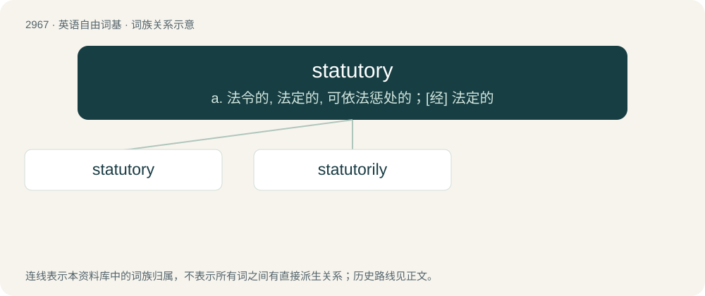

# 3072 · statutory — a. 法令的, 法定的, 可依法惩处的；\[经\] 法定的

[总目录](../00_总目录_按常用程度.md)

**类型**：英语自由词基　｜　**来源语言**：见词源记录

## 核心含义与来源

- 核心含义：a. 法令的, 法定的, 可依法惩处的；\[经\] 法定的
- 英文含义：Of, relating to, enacted or regulated by a statute.
- 词形：statutory

**来源记录 1**（形容词；Of, relating to, enacted or regulated by a statute.）

From statute + -ory.

## 词族图

## 单词速览（常用到不常用）

| 单词 | 音标 | 释义 |
|---|---|---|
| [statutory](#w-1) | 英 /ˈstætjʊt(ə)ɹɪ/；美 /ˈstæt͡ʃəˌtɔɹi/ | a. 法令的, 法定的, 可依法惩处的；\[经\] 法定的 |
| [statutorily](#w-2) | /ˈstætjutərili/ | adv. 根据法律条文地 |

## 逐词详解

### 1. statutory

**词性**：形容词　｜　**音标**：英 /ˈstætjʊt(ə)ɹɪ/；美 /ˈstæt͡ʃəˌtɔɹi/

**中文释义**：a. 法令的, 法定的, 可依法惩处的；\[经\] 法定的

**英文义项**：Of, relating to, enacted or regulated by a statute.

**构词拆分**：statute + -ory

**词源与演化**：

From statute + -ory.

**例句**：

> A statutory age limit.

该用例对应义项：prescribed or authorized by or punishable under a statute

### 2. statutorily

**词性**：副词　｜　**音标**：/ˈstætjutərili/

**中文释义**：adv. 根据法律条文地

**英文义项**：In a statutory manner; according to statute; lawfully.

**构词拆分**：statutory + -ly

**词源与演化**：

From statutory + -ly.

**例句**：

> Placed statutorily under the council's supervision.

该用例对应义项：according to statute
