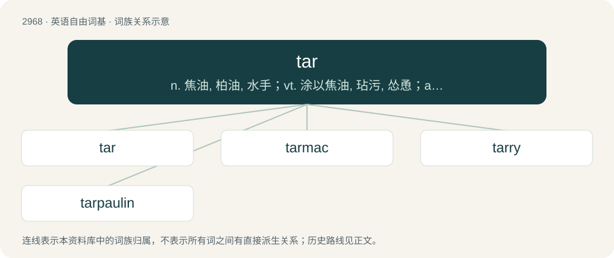

# 3073 · tar — n. 焦油, 柏油, 水手；vt. 涂以焦油, 玷污, 怂恿；a. 焦油的

[总目录](../00_总目录_按常用程度.md)

**类型**：英语自由词基　｜　**来源语言**：见词源记录

## 核心含义与来源

- 核心含义：n. 焦油, 柏油, 水手；vt. 涂以焦油, 玷污, 怂恿；a. 焦油的
- 英文含义：Coal tar.
- 词形：tar

**多个词源／构词路径**：同一拼写可能有不同来源；以下按词性和含义分别列出。

**来源记录 1**（名词；Coal tar.）

From Middle English ter, terr, tarr, from Old English teoru, from Proto-West Germanic \*teru, from Proto-Germanic \*terwą, from Proto-Indo-European \*derwo-, from \*dóru (“tree”). See also Saterland Frisian Taar, West Frisian tarre, tar, Dutch teer, German Teer; also Welsh derw (“oaks”), Lithuanian dervà (“pinewood, resin”), Russian де́рево (dérevo, “tree”), Bulgarian дърво́ (dărvó, “tree”). More at tree.

**来源记录 2**（名词；A program for archiving files, common on Unix systems.）

Abbreviation of tape archive.

**来源记录 3**（名词；A Persian long-necked, waisted string instrument, shared by many cultures and countries in the Middle East and the Caucasus.）

Borrowed from Persian تار (târ). Doublet of tantra.

**来源记录 4**（名词；A single-headed round frame drum originating in North Africa and the Middle East.）

Borrowed from Arabic طار (ṭār).

## 词族图

## 单词速览（常用到不常用）

| 单词 | 音标 | 释义 |
|---|---|---|
| [tar](#w-1) | 英 /tɑː/；美 /tɑɹ/ | n. 焦油, 柏油, 水手；vt. 涂以焦油, 玷污, 怂恿；a. 焦油的 |
| [tarmac](#w-2) | /ˈtɑː(ɹ)mæk/ | n. 柏油碎石, 柏油碎石路 |
| [tarry](#w-3) | /ˈtɑː.ɹi/ | 【英文】Resembling tar. |
| [tarpaulin](#w-4) | 英 /tɑˈpɔː.lɪn/；美 /ˈtɑːɹpəlɪn/ | n. 柏油帆布, 油布衣, 防水帽；\[医\] 帆布 |

## 逐词详解

### 1. tar

**词性**：动词　｜　**音标**：英 /tɑː/；美 /tɑɹ/

**中文释义**：n. 焦油, 柏油, 水手；vt. 涂以焦油, 玷污, 怂恿；a. 焦油的

**英文义项**：To coat with tar. / To besmirch.

**词源与演化**：

From Middle English ter, terr, tarr, from Old English teoru, from Proto-West Germanic \*teru, from Proto-Germanic \*terwą, from Proto-Indo-European \*derwo-, from \*dóru (“tree”). See also Saterland Frisian Taar, West Frisian tarre, tar, Dutch teer, German Teer; also Welsh derw (“oaks”), Lithuanian dervà (“pinewood, resin”), Russian де́рево (dérevo, “tree”), Bulgarian дърво́ (dărvó, “tree”). More at tree.

**例句**：

> The components obtained by distillation of coal tar are as shown below.

### 2. tarmac

**词性**：名词　｜　**音标**：/ˈtɑː(ɹ)mæk/

**中文释义**：n. 柏油碎石, 柏油碎石路

**英文义项**：Tarmacadam. / Any bituminous road surfacing material.

**构词拆分**：tar + macadam (“crushed stones”)

**词源与演化**：

Clipping of tarmacadam, which is from tar + macadam (“crushed stones”). Originally a trademark owned by its inventor, Edgar Hooley.

**例句**：

> The sun was beating down, and the tarmac on the roads was blistering in the heat.

### 3. tarry

**词性**：形容词　｜　**音标**：/ˈtɑː.ɹi/

**英文义项**：Resembling tar. / Covered with tar.

**构词拆分**：tar + -y

**词源与演化**：

From Middle English terrie, equivalent to tar + -y.

### 4. tarpaulin

**词性**：名词　｜　**音标**：英 /tɑˈpɔː.lɪn/；美 /ˈtɑːɹpəlɪn/

**中文释义**：n. 柏油帆布, 油布衣, 防水帽；\[医\] 帆布

**英文义项**：A heavy, waterproof sheet of material, often cloth or plastic sheet, used as a cover or blanket (often as weatherproofing, or to keep loose cargo from blowing off a lorry).

**构词拆分**：tar + pall + -ing

**词源与演化**：

From tar + pall (“heavy canvas”) + -ing. The sailor sense reflects that sailors of centuries past often wore garments made of tarred cloth (for weatherproofing).

**例句**：

> Throw a tarpaulin over that woodpile before it gets wet.

该用例对应义项：A heavy, waterproof sheet of material, often cloth or plastic sheet, used as a cover or blanket (often as weatherproofing, or to keep loose cargo from blowing off a lorry).
