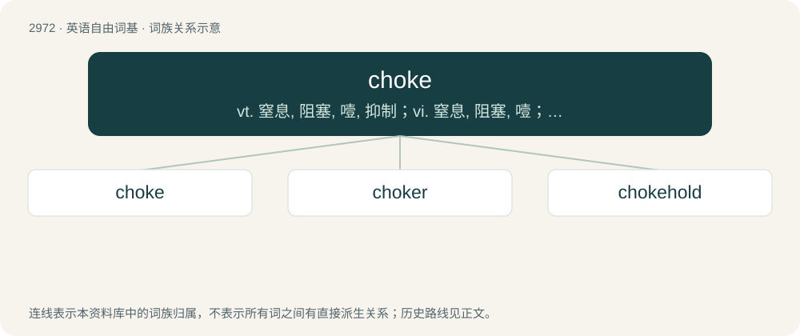

# 3074 · choke — vt. 窒息, 阻塞, 噎, 抑制；vi. 窒息, 阻塞, 噎；n. 窒息, 噎, 阻气门

[总目录](../00_总目录_按常用程度.md)

**类型**：英语自由词基　｜　**来源语言**：见词源记录

## 核心含义与来源

- 核心含义：vt. 窒息, 阻塞, 噎, 抑制；vi. 窒息, 阻塞, 噎；n. 窒息, 噎, 阻气门
- 英文含义：To be unable to breathe because of obstruction of the windpipe (for instance food or other objects that go down the wrong way, or fumes or particles in the air that cause the throat to constrict).
- 词形：choke

**多个词源／构词路径**：同一拼写可能有不同来源；以下按词性和含义分别列出。

**来源记录 1**（动词；To be unable to breathe because of obstruction of the windpipe (for instance food or other objects that go down the wrong way, or fumes or particles in the air that cause the throat to constrict).）

From Middle English choken (also cheken), from earlier acheken, from Old English āċēocian (“to choke”), probably derived from Old English ċēoce, ċēace (“jaw, cheek”), see cheek. Cognate with Icelandic kok (“throat”), koka (“to gulp”). See also achoke.

**来源记录 2**（名词；The mass of immature florets in the centre of the bud of an artichoke.）

Back-formation from artichoke.

## 词族图

## 单词速览（常用到不常用）

| 单词 | 音标 | 释义 |
|---|---|---|
| [choke](#w-1) | 英 /t͡ʃəʊk/；美 /t͡ʃoʊk/ | vt. 窒息, 阻塞, 噎, 抑制；vi. 窒息, 阻塞, 噎；n. 窒息, 噎, 阻气门 |
| [choker](#w-2) | 英 /ˈtʃəʊkə/；美 /ˈt͡ʃoʊkɚ/ | n. 噎住的人, 窒息物, 宽领带 |
| [chokehold](#w-3) | 英 /ˈt͡ʃəʊkhəʊld/；美 /ˈt͡ʃoʊkˌ(h)oʊld/ | n. 掐脖子; 压制 |

## 逐词详解

### 1. choke

**词性**：动词　｜　**音标**：英 /t͡ʃəʊk/；美 /t͡ʃoʊk/

**中文释义**：vt. 窒息, 阻塞, 噎, 抑制；vi. 窒息, 阻塞, 噎；n. 窒息, 噎, 阻气门

**英文义项**：To be unable to breathe because of obstruction of the windpipe (for instance food or other objects that go down the wrong way, or fumes or particles in the air that cause the throat to constrict). / To prevent (someone) from breathing or talking by strangling or filling the windpipe.

**词源与演化**：

From Middle English choken (also cheken), from earlier acheken, from Old English āċēocian (“to choke”), probably derived from Old English ċēoce, ċēace (“jaw, cheek”), see cheek. Cognate with Icelandic kok (“throat”), koka (“to gulp”). See also achoke.

**例句**：

> He has a lot of talent, but he tends to choke under pressure.

该用例对应义项：To perform badly at a crucial stage of a competition, especially when one appears to be clearly winning.

### 2. choker

**词性**：名词　｜　**音标**：英 /ˈtʃəʊkə/；美 /ˈt͡ʃoʊkɚ/

**中文释义**：n. 噎住的人, 窒息物, 宽领带

**英文义项**：A piece of jewelry or ornamental fabric, worn as a necklace or neckerchief, tight to the throat. / One who, or that which, chokes or strangles.

**构词拆分**：choke + -er

**词源与演化**：

From choke + -er.

**例句**：

> I lost £100 on the horses today — what a choker!

该用例对应义项：Any disappointing or upsetting circumstance.

### 3. chokehold

**词性**：名词　｜　**音标**：英 /ˈt͡ʃəʊkhəʊld/；美 /ˈt͡ʃoʊkˌ(h)oʊld/

**中文释义**：n. 掐脖子; 压制

**英文义项**：A grappling hold around a person's neck, especially one in which the neck is grasped tightly from behind with an arm, cutting off the flow of blood to the brain and restricting breathing. / A powerful and restrictive control or influence over something.

**构词拆分**：choke (verb) + hold (noun)

**词源与演化**：

The noun is derived from choke (verb) + hold (noun). The verb is derived from the noun.

**例句**：

> One country has a chokehold on another country's economy.

该用例对应义项：A powerful and restrictive control or influence over something.
