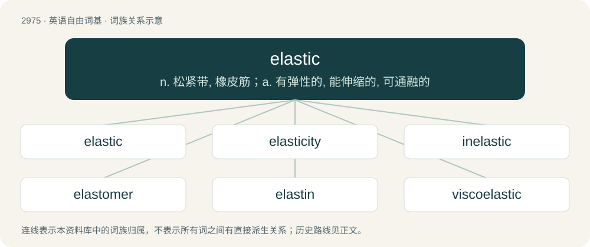

# 3077 · elastic — n. 松紧带, 橡皮筋；a. 有弹性的, 能伸缩的, 可通融的

[总目录](../00_总目录_按常用程度.md)

**类型**：英语自由词基　｜　**来源语言**：见词源记录

## 核心含义与来源

- 核心含义：n. 松紧带, 橡皮筋；a. 有弹性的, 能伸缩的, 可通融的
- 英文含义：Capable of stretching; particularly, capable of stretching so as to return to an original shape or size when force is released.
- 词形：elastic

**来源记录 1**（形容词；Capable of stretching; particularly, capable of stretching so as to return to an original shape or size when force is released.）

From French élastique, from New Latin elasticus (“elastic”), from Ancient Greek ἐλαστός (elastós), alternative form of ἐλατός (elatós, “ductile”) (cf. ἐλατήρ (elatḗr, “a driver, hurler”)), from ἐλαύνω (elaúnō, “to drive, set in motion, push, strike, beat out”).

## 词族图

## 单词速览（常用到不常用）

| 单词 | 音标 | 释义 |
|---|---|---|
| [elastic](#w-1) | 英 /ɪˈlɑːstɪk/；美 /ə-/ | n. 松紧带, 橡皮筋；a. 有弹性的, 能伸缩的, 可通融的 |
| [elasticity](#w-2) | 英 /ɪ.læsˈtɪs.ɪ.ti/；美 /ɪ.læsˈtɪs.ɪ.ti/ | n. 弹力, 弹性；\[化\] 弹性 |
| [inelastic](#w-3) | 美 /ˌɪnəˈlæstɪk/ | a. 无弹性的, 无弹力的, 无适应性的；\[医\] 无弹性的 |
| [elastomer](#w-4) | /ɪˈlæstəmə(ɹ)/ | \[化\] 高弹体; 弹性体 |
| [elastin](#w-5) | /iˈlæstin/ | n. 弹性蛋白；\[化\] 弹性蛋白 |
| [viscoelastic](#w-6) | /,viskəuiˈlæstik/ | a. 粘弹性的 |

## 逐词详解

### 1. elastic

**词性**：形容词　｜　**音标**：英 /ɪˈlɑːstɪk/；美 /ə-/

**中文释义**：n. 松紧带, 橡皮筋；a. 有弹性的, 能伸缩的, 可通融的

**英文义项**：Capable of stretching; particularly, capable of stretching so as to return to an original shape or size when force is released. / Made of elastic.

**词源与演化**：

From French élastique, from New Latin elasticus (“elastic”), from Ancient Greek ἐλαστός (elastós), alternative form of ἐλατός (elatós, “ductile”) (cf. ἐλατήρ (elatḗr, “a driver, hurler”)), from ἐλαύνω (elaúnō, “to drive, set in motion, push, strike, beat out”).

**例句**：

> The rope is somewhat elastic, so expect it to give when you pull on it.

该用例对应义项：Capable of stretching; particularly, capable of stretching so as to return to an original shape or size when force is released.

### 2. elasticity

**词性**：名词　｜　**音标**：英 /ɪ.læsˈtɪs.ɪ.ti/；美 /ɪ.læsˈtɪs.ɪ.ti/

**中文释义**：n. 弹力, 弹性；\[化\] 弹性

**英文义项**：The property by virtue of which a material deformed under load can regain its original dimensions when unloaded / The sensitivity of changes in a quantity with respect to changes in another quantity.

**构词拆分**：elastic + -ity

**词源与演化**：

From elastic + -ity.

**例句**：

> If the sales of an item drop by 5% when the price increases by 10%, its price elasticity is −0.5.

该用例对应义项：The sensitivity of changes in a quantity with respect to changes in another quantity.

### 3. inelastic

**词性**：形容词　｜　**音标**：美 /ˌɪnəˈlæstɪk/

**中文释义**：a. 无弹性的, 无弹力的, 无适应性的；\[医\] 无弹性的

**英文义项**：Lacking elasticity; inflexible, unyielding. / Insensitive to changes in price.

**构词拆分**：in- + elastic

**词源与演化**：

From in- + elastic.

**用法示例／搭配（非完整句）**：

> perfectly inelastic supply

该用例对应义项：Insensitive to changes in price.

### 4. elastomer

**词性**：名词　｜　**音标**：/ɪˈlæstəmə(ɹ)/

**中文释义**：\[化\] 高弹体; 弹性体

**英文义项**：Any polymer having the elastic properties of rubber.

**构词拆分**：elastic + -mer

**词源与演化**：

From elastic + -mer.

### 5. elastin

**词性**：名词　｜　**音标**：/iˈlæstin/

**中文释义**：n. 弹性蛋白；\[化\] 弹性蛋白

**英文义项**：A protein, similar to collagen, found in connective tissue, that has elastic properties.

**构词拆分**：elastic + -in

**词源与演化**：

From elastic + -in.

**例句**：

> Medical experts say the only possible negative repercussion of using laboratory-produced elastin to repair tissue, is that it could cause inflammation or calcification.

### 6. viscoelastic

**词性**：形容词　｜　**音标**：/,viskəuiˈlæstik/

**中文释义**：a. 粘弹性的

**英文义项**：Viscous and elastic.

**构词拆分**：visco- + elastic

**词源与演化**：

From visco- + elastic.
