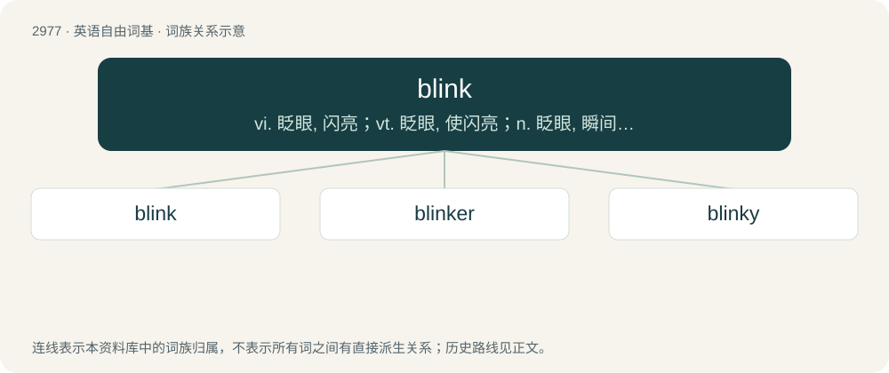

# 3078 · blink — vi. 眨眼, 闪亮；vt. 眨眼, 使闪亮；n. 眨眼, 瞬间, 闪光, 闪烁

[总目录](../00_总目录_按常用程度.md)

**类型**：英语自由词基　｜　**来源语言**：见词源记录

## 核心含义与来源

- 核心含义：vi. 眨眼, 闪亮；vt. 眨眼, 使闪亮；n. 眨眼, 瞬间, 闪光, 闪烁
- 英文含义：To close and reopen both eyes quickly.
- 词形：blink

**来源记录 1**（动词；To close and reopen both eyes quickly.）

From Middle English blynken, blenken, from Old English \*blincan (suggested by causative verb blenċan (“to deceive”); &gt; English blench), from Proto-Germanic \*blinkaną, a variant of \*blīkaną (“to gleam, shine”). Cognate with Dutch blinken (“to glitter, shine”), German blinken (“to flash, blink”), Danish blinke (“to flash, twinkle, wink, blink”), Swedish blinka (“to flash, blink, twinkle, wink, blink”). Related to blank, blick, blike, bleak.

## 词族图

## 单词速览（常用到不常用）

| 单词 | 音标 | 释义 |
|---|---|---|
| [blink](#w-1) | /ˈblɪŋk/ | vi. 眨眼, 闪亮；vt. 眨眼, 使闪亮；n. 眨眼, 瞬间, 闪光, 闪烁 |
| [blinker](#w-2) | 英 /ˈblɪŋkə/；美 /ˈblɪŋkəɹ/ | n. 眨眼睛的人, 闪光交通灯 |
| [blinky](#w-3) | /ˈblɪŋki/ | a. \[美国方言\](牛奶)酸的 |

## 逐词详解

### 1. blink

**词性**：动词　｜　**音标**：/ˈblɪŋk/

**中文释义**：vi. 眨眼, 闪亮；vt. 眨眼, 使闪亮；n. 眨眼, 瞬间, 闪光, 闪烁

**英文义项**：To close and reopen both eyes quickly. / To close and reopen one's eyes to remove (something) from on or around the eyes.

**词源与演化**：

From Middle English blynken, blenken, from Old English \*blincan (suggested by causative verb blenċan (“to deceive”); &gt; English blench), from Proto-Germanic \*blinkaną, a variant of \*blīkaną (“to gleam, shine”). Cognate with Dutch blinken (“to glitter, shine”), German blinken (“to flash, blink”), Danish blinke (“to flash, twinkle, wink, blink”), Swedish blinka (“to flash, blink, twinkle, wink, blink”). Related to blank, blick, blike, bleak.

**例句**：

> An urban legend claims that gang members will attack anyone who blinks them.

该用例对应义项：To flash headlights on a car at.

### 2. blinker

**词性**：名词　｜　**音标**：英 /ˈblɪŋkə/；美 /ˈblɪŋkəɹ/

**中文释义**：n. 眨眼睛的人, 闪光交通灯

**英文义项**：Anything that blinks. / The turn signal of an automobile.

**构词拆分**：blink + -er

**词源与演化**：

From blink + -er.

**例句**：

> She was a frequent blinker, always on the verge of tears.

该用例对应义项：Anything that blinks.

### 3. blinky

**词性**：名词　｜　**音标**：/ˈblɪŋki/

**中文释义**：a. \[美国方言\](牛奶)酸的

**英文义项**：in digital photography, a flashing pixel.

**构词拆分**：blink + -y

**词源与演化**：

From blink + -y.
