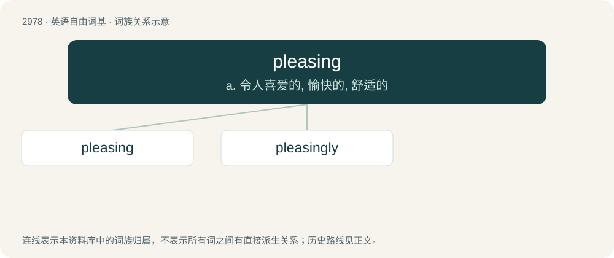

# 3080 · pleasing — a. 令人喜爱的, 愉快的, 舒适的

[总目录](../00_总目录_按常用程度.md)

**类型**：英语自由词基　｜　**来源语言**：见词源记录

## 核心含义与来源

- 核心含义：a. 令人喜爱的, 愉快的, 舒适的
- 英文含义：Agreeable; giving pleasure, cheer, enjoyment or gratification.
- 词形：pleasing

**多个词源／构词路径**：同一拼写可能有不同来源；以下按词性和含义分别列出。

**来源记录 1**（形容词；Agreeable; giving pleasure, cheer, enjoyment or gratification.）

From Middle English plesynge, pleizinge, plesende (present participle), equivalent to please + -ing.

**来源记录 2**（名词；pleasure or satisfaction, as in the phrase "to someone's pleasing."）

From Middle English plesing, plesinge (“satisfaction; pleasing”), equivalent to please + -ing.

## 词族图

## 单词速览（常用到不常用）

| 单词 | 音标 | 释义 |
|---|---|---|
| [pleasing](#w-1) | 英 /ˈpliːzɪŋ/；美 /ˈplizɪŋ/ | a. 令人喜爱的, 愉快的, 舒适的 |
| [pleasingly](#w-2) | /ˈpliːziŋli/ | adv. 高兴地；喜欢地 |

## 逐词详解

### 1. pleasing

**词性**：形容词　｜　**音标**：英 /ˈpliːzɪŋ/；美 /ˈplizɪŋ/

**中文释义**：a. 令人喜爱的, 愉快的, 舒适的

**英文义项**：Agreeable; giving pleasure, cheer, enjoyment or gratification.

**构词拆分**：please + -ing

**词源与演化**：

From Middle English plesynge, pleizinge, plesende (present participle), equivalent to please + -ing.

**例句**：

> A pleasing piece of news.

该用例对应义项：giving pleasure and satisfaction

### 2. pleasingly

**词性**：副词　｜　**音标**：/ˈpliːziŋli/

**中文释义**：adv. 高兴地；喜欢地

**英文义项**：In a pleasing manner; agreeably; favourably.

**构词拆分**：pleasing + -ly

**词源与演化**：

From Middle English plesingliche; equivalent to pleasing + -ly.

**例句**：

> The room was pleasingly large.

该用例对应义项：in a pleasing manner
