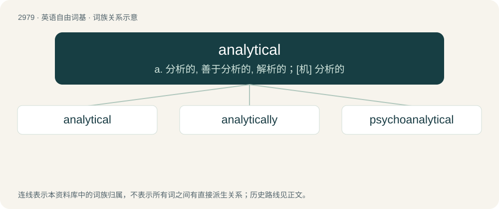

# 3081 · analytical — a. 分析的, 善于分析的, 解析的；\[机\] 分析的

[总目录](../00_总目录_按常用程度.md)

**类型**：英语自由词基　｜　**来源语言**：见词源记录

## 核心含义与来源

- 核心含义：a. 分析的, 善于分析的, 解析的；\[机\] 分析的
- 英文含义：Of or pertaining to analysis; resolving into elements or constituent parts
- 词形：analytical

**来源记录 1**（形容词；Of or pertaining to analysis; resolving into elements or constituent parts）

Compare with French analytique. See analysis.

## 词族图

## 单词速览（常用到不常用）

| 单词 | 音标 | 释义 |
|---|---|---|
| [analytical](#w-1) | 英 /ˌæn.əˈlɪt.ɪ.kəl/；美 /ˌæn.əˈlɪt.ɪ.kəl/ | a. 分析的, 善于分析的, 解析的；\[机\] 分析的 |
| [analytically](#w-2) | 英 /ˌæn.əˈlɪt.ɪ.kli/；美 /ˌæn.əˈlɪt.ɪ.kli/ | \[机\] 分析上 |
| [psychoanalytical](#w-3) |  | a. 精神分析的 |

## 逐词详解

### 1. analytical

**词性**：形容词　｜　**音标**：英 /ˌæn.əˈlɪt.ɪ.kəl/；美 /ˌæn.əˈlɪt.ɪ.kəl/

**中文释义**：a. 分析的, 善于分析的, 解析的；\[机\] 分析的

**英文义项**：Of or pertaining to analysis; resolving into elements or constituent parts / Using analytic reasoning as opposed to synthetic.

**词源与演化**：

Compare with French analytique. See analysis.

**用法示例／搭配（非完整句）**：

> an analytical experiment

该用例对应义项：Of or pertaining to analysis; resolving into elements or constituent parts

### 2. analytically

**词性**：副词　｜　**音标**：英 /ˌæn.əˈlɪt.ɪ.kli/；美 /ˌæn.əˈlɪt.ɪ.kli/

**中文释义**：\[机\] 分析上

**英文义项**：In an analytical manner.

**构词拆分**：analytical + -ly

**词源与演化**：

From analytical + -ly.

**例句**：

> Analytically, "hominoid" should mean the same thing as "humanoid." But it's actual usage that determines the meaning of a word.

### 3. psychoanalytical

**词性**：形容词

**中文释义**：a. 精神分析的

**英文义项**：Of or pertaining to psychoanalysis.

**构词拆分**：psycho- + analytical

**词源与演化**：

From psycho- + analytical.
