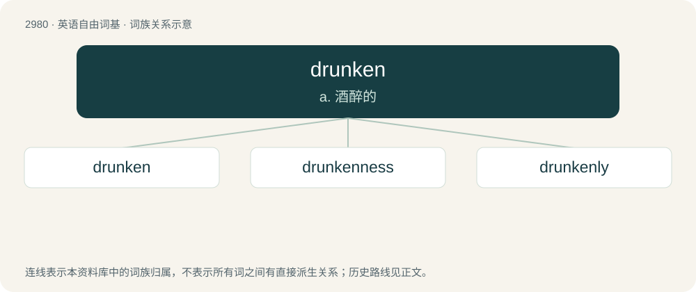

# 3082 · drunken — a. 酒醉的

[总目录](../00_总目录_按常用程度.md)

**类型**：英语自由词基　｜　**来源语言**：见词源记录

## 核心含义与来源

- 核心含义：a. 酒醉的
- 英文含义：Drunk, in the state of intoxication after having drunk an alcoholic beverage.
- 词形：drunken

**多个词源／构词路径**：同一拼写可能有不同来源；以下按词性和含义分别列出。

**来源记录 1**（形容词；Drunk, in the state of intoxication after having drunk an alcoholic beverage.）

From Middle English drunken, ydronken, idrunken, from Old English druncen, ġedruncen (“drunk; drunken”), from Proto-Germanic \*drunkanaz (“drunken”), past participle of Proto-Germanic \*drinkaną (“to drink”), equivalent to drink + -en. Cognate with West Frisian dronken (“drunk; drunken”), Dutch dronken (“drunk; drunken”), German betrunken (“drunk; drunken”), Swedish drucken (“drunk; drunken”).

**来源记录 2**（动词；To make or become drunk or drunken; to intoxicate.）

From Middle English dronknen, drunkenen, drunknen, from Old English druncnian (“to drown; get drunk”), from Proto-Germanic \*drunkanōną (“to get drunk”), from Proto-Germanic \*drunkanaz (“drunk; intoxicated”). Cognate with Norwegian drukne, drukna, Icelandic drukna.

## 词族图

## 单词速览（常用到不常用）

| 单词 | 音标 | 释义 |
|---|---|---|
| [drunken](#w-1) | /ˈdɹʌŋkən/ | a. 酒醉的 |
| [drunkenness](#w-2) | /ˈdɹʌŋkən.nəs/ | \[医\] 醉酒, 酒醉 |
| [drunkenly](#w-3) |  | adv. 酒醉地, 常喝醉地 |

## 逐词详解

### 1. drunken

**词性**：形容词　｜　**音标**：/ˈdɹʌŋkən/

**中文释义**：a. 酒醉的

**英文义项**：Drunk, in the state of intoxication after having drunk an alcoholic beverage. / Given to habitual excessive use of alcohol.

**构词拆分**：drink + -en

**词源与演化**：

From Middle English drunken, ydronken, idrunken, from Old English druncen, ġedruncen (“drunk; drunken”), from Proto-Germanic \*drunkanaz (“drunken”), past participle of Proto-Germanic \*drinkaną (“to drink”), equivalent to drink + -en. Cognate with West Frisian dronken (“drunk; drunken”), Dutch dronken (“drunk; drunken”), German betrunken (“drunk; drunken”), Swedish drucken (“drunk; drunken”).

**用法示例／搭配（非完整句）**：

> a drunken display of crude exuberance

该用例对应义项：Characterized by or resulting from drunkenness.

### 2. drunkenness

**词性**：名词　｜　**音标**：/ˈdɹʌŋkən.nəs/

**中文释义**：\[医\] 醉酒, 酒醉

**英文义项**：A state of being drunk.

**构词拆分**：drunken + -ness

**词源与演化**：

From drunken + -ness.

**例句**：

> Drunkenness should be an aggravating factor when you commit a crime.

### 3. drunkenly

**词性**：副词

**中文释义**：adv. 酒醉地, 常喝醉地

**英文义项**：In a drunken manner.

**构词拆分**：drunken + -ly

**词源与演化**：

From drunken + -ly.

**例句**：

> Alcohol sloshed out of his cup as he drunkenly stumbled through the crowded hallway.
