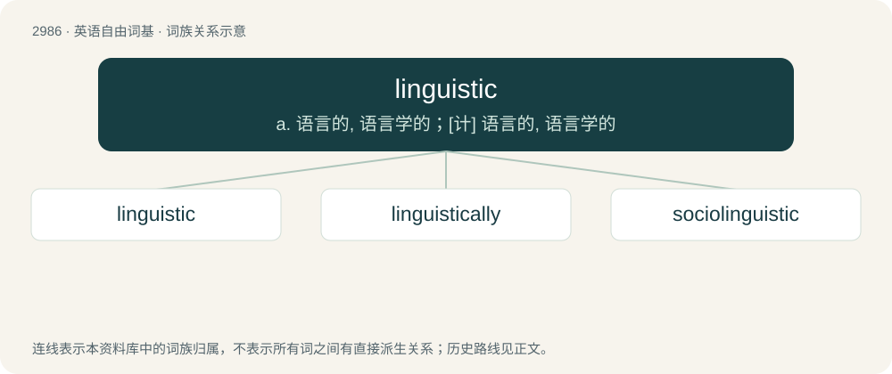

# 3088 · linguistic — a. 语言的, 语言学的；\[计\] 语言的, 语言学的

[总目录](../00_总目录_按常用程度.md)

**类型**：英语自由词基　｜　**来源语言**：见词源记录

## 核心含义与来源

- 核心含义：a. 语言的, 语言学的；\[计\] 语言的, 语言学的
- 英文含义：Of or relating to language.
- 词形：linguistic

**来源记录 1**（形容词；Of or relating to language.）

Borrowed from German linguistisch, equivalent to linguist + -ic. Compare linguistics. Ultimately from Latin lingua (“tongue, language”). Attested in English since 1825.

## 词族图

## 单词速览（常用到不常用）

| 单词 | 音标 | 释义 |
|---|---|---|
| [linguistic](#w-1) | 英 /lɪŋˈɡwɪstɪk/ | a. 语言的, 语言学的；\[计\] 语言的, 语言学的 |
| [linguistically](#w-2) | 美 /lɪŋˈɡwɪstɪk(ə)li/ | adv. 语言学方面 |
| [sociolinguistic](#w-3) | /ˌsəʊsi.əʊlɪŋˈɡwɪstɪk/ | 社会语言学的 |

## 逐词详解

### 1. linguistic

**词性**：形容词　｜　**音标**：英 /lɪŋˈɡwɪstɪk/

**中文释义**：a. 语言的, 语言学的；\[计\] 语言的, 语言学的

**英文义项**：Of or relating to language. / Of or relating to linguistics.

**构词拆分**：linguist + -ic

**词源与演化**：

Borrowed from German linguistisch, equivalent to linguist + -ic. Compare linguistics. Ultimately from Latin lingua (“tongue, language”). Attested in English since 1825.

**例句**：

> My life had no linguistic meaning... until the day I met Saeb.

### 2. linguistically

**词性**：副词　｜　**音标**：美 /lɪŋˈɡwɪstɪk(ə)li/

**中文释义**：adv. 语言学方面

**英文义项**：In the manner of linguistics. / From a linguistic perspective.

**构词拆分**：linguistical + -ly；linguistic + -ally

**词源与演化**：

From linguistical + -ly or from linguistic + -ally.

**例句**：

> It would be depressing if this country were to become linguistically homogeneous.

### 3. sociolinguistic

**词性**：形容词　｜　**音标**：/ˌsəʊsi.əʊlɪŋˈɡwɪstɪk/

**中文释义**：社会语言学的

**英文义项**：Pertaining to sociolinguistics.

**构词拆分**：socio- + linguistic

**词源与演化**：

From socio- + linguistic.
