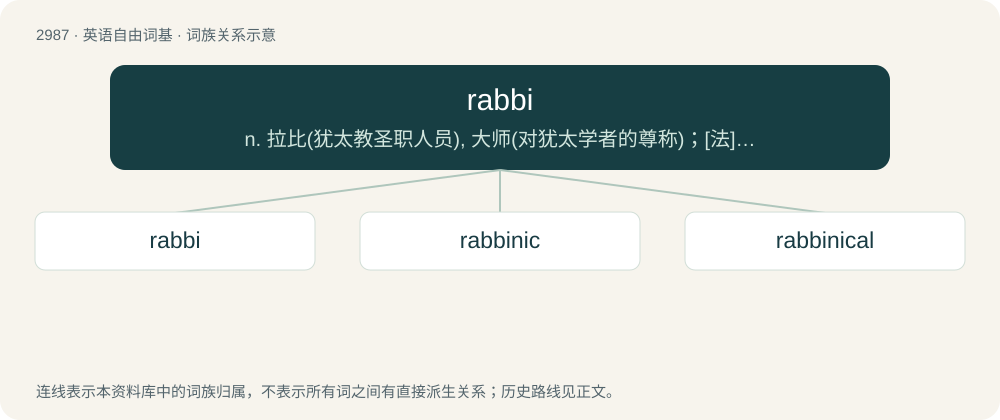

# 3090 · rabbi — n. 拉比(犹太教圣职人员), 大师(对犹太学者的尊称)；\[法\] 犹太教的法学博士, 老师, 犹太教教士

[总目录](../00_总目录_按常用程度.md)

**类型**：英语自由词基　｜　**来源语言**：见词源记录

## 核心含义与来源

- 核心含义：n. 拉比(犹太教圣职人员), 大师(对犹太学者的尊称)；\[法\] 犹太教的法学博士, 老师, 犹太教教士
- 英文含义：A Jewish scholar or teacher of halacha (Jewish law), capable of making halachic decisions.
- 词形：rabbi

**来源记录 1**（名词；A Jewish scholar or teacher of halacha (Jewish law), capable of making halachic decisions.）

From Middle English raby, from Ecclesiastical Latin rabbi, and its source Koine Greek ῥαββί (rhabbí), from (post-Tanakh) Hebrew רַבִּי (rabbi, “my master”), from רַב (rav, “master”) + ־ִי (-í, “my”). Compare late Old English rabbi. Doublet of rebbe and related to rav.

## 词族图

## 单词速览（常用到不常用）

| 单词 | 音标 | 释义 |
|---|---|---|
| [rabbi](#w-1) | 美 /ˈɹæ.baɪ/ | n. 拉比(犹太教圣职人员), 大师(对犹太学者的尊称)；\[法\] 犹太教的法学博士, 老师, 犹太教教士 |
| [rabbinic](#w-2) | /ɹəˈbɪnɪk/ | \[法\] 犹太教法学博士的, 犹太法学博士的教义 |
| [rabbinical](#w-3) | /ɹəˈbɪnəkəl/ | a. 希伯莱语的 |

## 逐词详解

### 1. rabbi

**词性**：名词　｜　**音标**：美 /ˈɹæ.baɪ/

**中文释义**：n. 拉比(犹太教圣职人员), 大师(对犹太学者的尊称)；\[法\] 犹太教的法学博士, 老师, 犹太教教士

**英文义项**：A Jewish scholar or teacher of halacha (Jewish law), capable of making halachic decisions. / A Jew who is the leader or is qualified to be the leader of a Jewish congregation.

**词源与演化**：

From Middle English raby, from Ecclesiastical Latin rabbi, and its source Koine Greek ῥαββί (rhabbí), from (post-Tanakh) Hebrew רַבִּי (rabbi, “my master”), from רַב (rav, “master”) + ־ִי (-í, “my”). Compare late Old English rabbi. Doublet of rebbe and related to rav.

**例句**：

> Rabbi Akiva recited the Shema as he was flayed by the Romans.

### 2. rabbinic

**词性**：形容词　｜　**音标**：/ɹəˈbɪnɪk/

**中文释义**：\[法\] 犹太教法学博士的, 犹太法学博士的教义

**英文义项**：Relating to rabbis. / Formulated or enacted by rabbis.

**构词拆分**：rabbi + -n- + -ic

**词源与演化**：

From rabbi + -n- + -ic.

**例句**：

> Yoni was hired as the shul's cantor, but he has a very rabbinic attitude.

该用例对应义项：Relating to rabbis.

### 3. rabbinical

**词性**：形容词　｜　**音标**：/ɹəˈbɪnəkəl/

**中文释义**：a. 希伯莱语的

**英文义项**：Of or relating to rabbis, their writings, or their work.

**构词拆分**：rabbi + -n- + -ical

**词源与演化**：

From rabbi + -n- + -ical.
