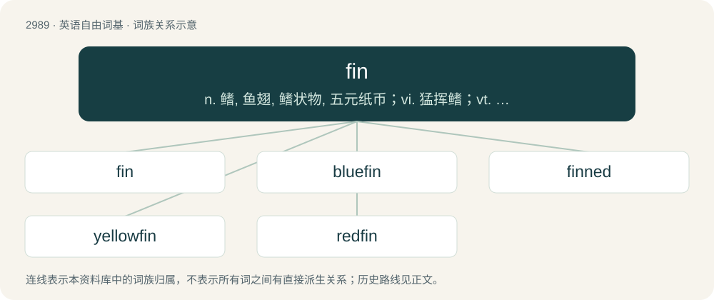

# 3092 · fin — n. 鳍, 鱼翅, 鳍状物, 五元纸币；vi. 猛挥鳍；vt. 装上翅, 切除鳍

[总目录](../00_总目录_按常用程度.md)

**类型**：英语自由词基　｜　**来源语言**：见词源记录

## 核心含义与来源

- 核心含义：n. 鳍, 鱼翅, 鳍状物, 五元纸币；vi. 猛挥鳍；vt. 装上翅, 切除鳍
- 英文含义：One of the appendages of a fish, used to propel itself and to manoeuvre/maneuver.
- 词形：fin

**多个词源／构词路径**：同一拼写可能有不同来源；以下按词性和含义分别列出。

**来源记录 1**（名词；One of the appendages of a fish, used to propel itself and to manoeuvre/maneuver.）

From Middle English fin, from Old English finn, from Proto-Germanic \*finnō, \*finǭ (“dorsal fin”) (compare Dutch vin, German Finne, Swedish finne, fena), from Proto-Indo-European \*(s)pīn- (“backbone, dorsal fin”) (compare Old Irish ind (“end, point”), Latin pinna (“feather, wing, fin”), Tocharian A spin (“hook”).

**来源记录 2**（名词；a five-pound (£5) note; the sum of five pounds.）

From Yiddish פֿינף (finf, “five”). Doublet of cinque, finnuf, five, pimp (“five”), ponzu, punch (“beverage”), and sengi (“currency”).

**来源记录 3**（名词；finasteride）

Clipping of finasteride.

## 词族图

## 单词速览（常用到不常用）

| 单词 | 音标 | 释义 |
|---|---|---|
| [fin](#w-1) | /fɪn/ | n. 鳍, 鱼翅, 鳍状物, 五元纸币；vi. 猛挥鳍；vt. 装上翅, 切除鳍 |
| [bluefin](#w-2) | /ˈbluːfin/ | n. 金枪鱼 |
| [finned](#w-3) | /fɪnd/ | a. 有鳍的 |
| [yellowfin](#w-4) | /ˈjeləjfin/ | tuna\[鱼\]黄鳍金枪鱼(亦作yellowfin) |
| [redfin](#w-5) | /ˈredfin/ | n. \[鱼\]红鳍淡水■鱼 |

## 逐词详解

### 1. fin

**词性**：名词　｜　**音标**：/fɪn/

**中文释义**：n. 鳍, 鱼翅, 鳍状物, 五元纸币；vi. 猛挥鳍；vt. 装上翅, 切除鳍

**英文义项**：One of the appendages of a fish, used to propel itself and to manoeuvre/maneuver. / A similar appendage of a cetacean or other marine animal.

**词源与演化**：

From Middle English fin, from Old English finn, from Proto-Germanic \*finnō, \*finǭ (“dorsal fin”) (compare Dutch vin, German Finne, Swedish finne, fena), from Proto-Indo-European \*(s)pīn- (“backbone, dorsal fin”) (compare Old Irish ind (“end, point”), Latin pinna (“feather, wing, fin”), Tocharian A spin (“hook”).

**例句**：

> The fin stabilises the plane in flight.

该用例对应义项：A thin, rigid component of an aircraft, extending from the fuselage and used to stabilise and steer the aircraft.

### 2. bluefin

**词性**：名词　｜　**音标**：/ˈbluːfin/

**中文释义**：n. 金枪鱼

**英文义项**：bluefin tuna, any of a number of types of tuna characterised by their blue fins.

**构词拆分**：blue + fin

**词源与演化**：

From blue + fin.

**例句**：

> Bluefin tuna can live up to 40 years.

### 3. finned

**词性**：形容词　｜　**音标**：/fɪnd/

**中文释义**：a. 有鳍的

**英文义项**：Having fins, or a particular type of fins.

**构词拆分**：From fin + -ed.

**词源与演化**：

From fin + -ed.

### 4. yellowfin

**词性**：名词　｜　**音标**：/ˈjeləjfin/

**中文释义**：tuna\[鱼\]黄鳍金枪鱼(亦作yellowfin)

**英文义项**：Any of various fish with yellow fins. / especially, yellowfin tuna (Thunnus albacares, in family Scombridae)

**构词拆分**：yellow + fin

**词源与演化**：

From yellow + fin.

### 5. redfin

**词性**：名词　｜　**音标**：/ˈredfin/

**中文释义**：n. \[鱼\]红鳍淡水■鱼

**英文义项**：A common shiner, a small North American dace of species Luxilus cornutus. / A redfin shiner (Lythrurus umbratilis), of the central US.

**构词拆分**：red + fin

**词源与演化**：

From red + fin, having a red dorsal fin, especially males in the breeding season.
