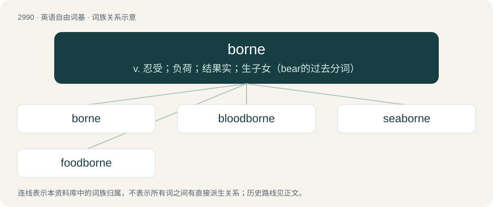

# 3093 · borne — v. 忍受；负荷；结果实；生子女（bear的过去分词）

[总目录](../00_总目录_按常用程度.md)

**类型**：英语自由词基　｜　**来源语言**：见词源记录

## 核心含义与来源

- 核心含义：v. 忍受；负荷；结果实；生子女（bear的过去分词）
- 英文含义：carried, supported.
- 词形：borne

**来源记录 1**（形容词；carried, supported.）

From Middle English boren, iborne, from Old English boren, ġeboren, past participle of Old English beran (“to carry, bear”).

## 词族图

## 单词速览（常用到不常用）

| 单词 | 音标 | 释义 |
|---|---|---|
| [borne](#w-1) | 英 /bɔːn/；美 /boɹn/ | v. 忍受；负荷；结果实；生子女（bear的过去分词） |
| [bloodborne](#w-2) |  | 【英文】Usually of a pathogen: carried in the bloodstream and other body fluids. |
| [seaborne](#w-3) | /ˈsiːbɒːn/ | a. 海上的, 漂流的；\[经\] 海运的, 由海轮装运的 |
| [foodborne](#w-4) | /ˈfuːdbɔːn/ | \[医\]食物传播的, 食物传染的 |

## 逐词详解

### 1. borne

**词性**：形容词　｜　**音标**：英 /bɔːn/；美 /boɹn/

**中文释义**：v. 忍受；负荷；结果实；生子女（bear的过去分词）

**英文义项**：carried, supported.

**词源与演化**：

From Middle English boren, iborne, from Old English boren, ġeboren, past participle of Old English beran (“to carry, bear”).

**例句**：

> An elephant's burden should be borne only by an elephant.

### 2. bloodborne

**词性**：形容词

**英文义项**：Usually of a pathogen: carried in the bloodstream and other body fluids.

**构词拆分**：blood + borne

**词源与演化**：

From blood + borne.

**例句**：

> As far as Tom was concerned, Bloodborne was his Game of the Year.

### 3. seaborne

**词性**：形容词　｜　**音标**：/ˈsiːbɒːn/

**中文释义**：a. 海上的, 漂流的；\[经\] 海运的, 由海轮装运的

**英文义项**：Transported on the sea or ocean, especially by floating on the sea.

**构词拆分**：sea + borne (“carried, supported”)

**词源与演化**：

From sea + borne (“carried, supported”).

### 4. foodborne

**词性**：形容词　｜　**音标**：/ˈfuːdbɔːn/

**中文释义**：\[医\]食物传播的, 食物传染的

**英文义项**：Transmitted through food.

**构词拆分**：food + borne

**词源与演化**：

From food + borne.

**例句**：

> Many people become ill by ingesting foodborne bacteria.

该用例对应义项：Transmitted through food.
