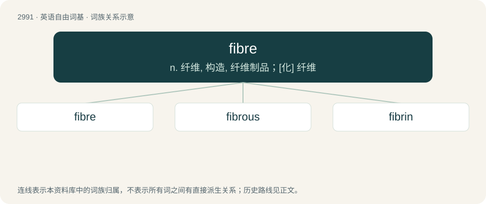

# 3094 · fibre — n. 纤维, 构造, 纤维制品；\[化\] 纤维

[总目录](../00_总目录_按常用程度.md)

**类型**：英语自由词基　｜　**来源语言**：见词源记录

## 核心含义与来源

- 核心含义：n. 纤维, 构造, 纤维制品；\[化\] 纤维
- 英文含义：A single piece of a given material, elongated and roughly round in cross-section, often twisted with other fibres to form thread.
- 词形：fibre

**来源记录 1**（名词；A single piece of a given material, elongated and roughly round in cross-section, often twisted with other fibres to form thread.）

From French fibre, from Old French, from Latin fibra.

## 词族图

## 单词速览（常用到不常用）

| 单词 | 音标 | 释义 |
|---|---|---|
| [fibre](#w-1) | 英 /ˈfaɪ.bə(ɹ)/ | n. 纤维, 构造, 纤维制品；\[化\] 纤维 |
| [fibrous](#w-2) | /ˈfaɪbɹəs/ | a. 纤维的, 纤维性的；\[医\] 纤维性 |
| [fibrin](#w-3) | /ˈfaɪbɹɪn/ | n. 纤维蛋白；\[化\] 血纤蛋白; 血纤维蛋白 |

## 逐词详解

### 1. fibre

**词性**：名词　｜　**音标**：英 /ˈfaɪ.bə(ɹ)/

**中文释义**：n. 纤维, 构造, 纤维制品；\[化\] 纤维

**英文义项**：A single piece of a given material, elongated and roughly round in cross-section, often twisted with other fibres to form thread. / Material in the form of fibres.

**词源与演化**：

From French fibre, from Old French, from Latin fibra.

**例句**：

> Under this map, any two values in the fibre of a given point on the circle differ by 2π.

该用例对应义项：The preimage of a given point in the range of a map.

### 2. fibrous

**词性**：形容词　｜　**音标**：/ˈfaɪbɹəs/

**中文释义**：a. 纤维的, 纤维性的；\[医\] 纤维性

**英文义项**：Of or pertaining to fibre. / Containing many fibres - referring mainly to food.

**构词拆分**：fibre + -ous

**词源与演化**：

From fibre + -ous.

**例句**：

> Keratin is one of a family of fibrous structural proteins known as scleroproteins.

### 3. fibrin

**词性**：名词　｜　**音标**：/ˈfaɪbɹɪn/

**中文释义**：n. 纤维蛋白；\[化\] 血纤蛋白; 血纤维蛋白

**英文义项**：A white, albuminous, fibrous substance, formed in the coagulation of the blood. / An elastic, insoluble, whitish protein produced by the action of thrombin on fibrinogen and forming an interlacing fibrous network in the coagulation of blood.

**构词拆分**：fibre + -in

**词源与演化**：

From fibre + -in (used to form chemical names of proteins, etc).
