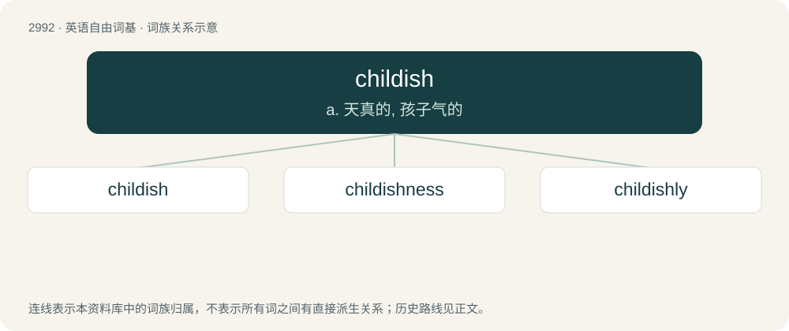

# 3095 · childish — a. 天真的, 孩子气的

[总目录](../00_总目录_按常用程度.md)

**类型**：英语自由词基　｜　**来源语言**：见词源记录

## 核心含义与来源

- 核心含义：a. 天真的, 孩子气的
- 英文含义：Immature in thought or behaviour.
- 词形：childish

**来源记录 1**（形容词；Immature in thought or behaviour.）

From Middle English childisch, from Old English ċildisċ. By surface analysis, child + -ish.

## 词族图

## 单词速览（常用到不常用）

| 单词 | 音标 | 释义 |
|---|---|---|
| [childish](#w-1) | /ˈt͡ʃaɪldɪʃ/ | a. 天真的, 孩子气的 |
| [childishness](#w-2) | 美 /ˈt͡ʃaɪld.ɪʃ.nəs/ | 童心；稚气；童稚；孩子气 |
| [childishly](#w-3) | /ˈtʃaɪldɪʃlɪ/ | adv. 天真地, 幼小地; 幼稚地 |

## 逐词详解

### 1. childish

**词性**：形容词　｜　**音标**：/ˈt͡ʃaɪldɪʃ/

**中文释义**：a. 天真的, 孩子气的

**英文义项**：Immature in thought or behaviour. / Suitable for or expected of a child.

**词源与演化**：

From Middle English childisch, from Old English ċildisċ. By surface analysis, child + -ish.

**例句**：

> Your childish temper tantrums are not going to change my decision on this matter.

该用例对应义项：Immature in thought or behaviour.

### 2. childishness

**词性**：名词　｜　**音标**：美 /ˈt͡ʃaɪld.ɪʃ.nəs/

**中文释义**：童心；稚气；童稚；孩子气

**英文义项**：The state or characteristic of being childish. / Childish behaviour.

**构词拆分**：childish + -ness

**词源与演化**：

From Middle English childishnes, childisnes, equivalent to childish + -ness.

**例句**：

> Do you mean to annoy me again with some childishness, you little villain?

### 3. childishly

**词性**：副词　｜　**音标**：/ˈtʃaɪldɪʃlɪ/

**中文释义**：adv. 天真地, 幼小地; 幼稚地

**英文义项**：In a childish manner.

**构词拆分**：childish + -ly

**词源与演化**：

From childish + -ly.

**例句**：

> He acted very childishly.

该用例对应义项：in a childlike manner
