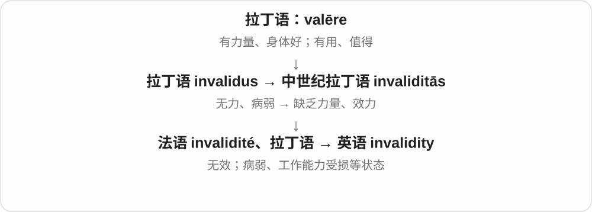

# 3096 · invalid — 无效；不成立；使失效

[逐词精讲目录](../00_逐词精讲目录.md) · [总目录](../00_总目录_按常用程度.md)

## 核心词根与来源

invalid 的无效形容词联系 in- 否定与 valid 有效。invalidate 是使失效，invalidity 是无效性；另有人物名词的历史用法和不同重音，逐词讲解区分。

**INVALID：没有满足有效成立的条件**

车票过期，论证规则不满足，或某个数值不在允许范围内。

- **有效性的否定**：invalid · invalidity
- **使其失效**：invalidate

## 词形与演化规律

形容词常读 /ɪnˈvælɪd/；invalid argument、invalidate a result、the invalidity of a claim。不要因同拼写忽略名词读音。

## 单词速览（按词族由简到繁）

同一基础词的相关扩展放在一起，先读基础形式，再读扩展；各组之间优先读常用的。具体词源关系见各词讲解。

| 单词 | 音标 | 核心意思 |
|---|---|---|
| [invalid](#w-1) | 无效义：英、美 /ɪnˈvælɪd/；病弱者及相关动词：英、美 /ˈɪnvəlɪd/ | 无效、不成立的；病弱者〔旧用语〕；因病伤使退役 |
| [invalidate](#w-2) | 英、美 /ɪnˈvælɪdeɪt/ | 使无效；推翻、否定效力 |
| [invalidity](#w-3) | 英、美 /ˌɪnvəˈlɪdəti/ | 无效性；不成立；病弱、失能状态〔部分制度用语〕 |

## 逐词讲解

### 1. invalid — 无效、不成立的；病弱者〔旧用语〕；因病伤使退役

**音标**：无效义：英、美 /ɪnˈvælɪd/；病弱者及相关动词：英、美 /ˈɪnvəlɪd/

**先抓住这个画面**

两支都可追到“没有力量”：一支是证件或论证没有效力；另一支是身体病弱。现代读音用不同重音把它们分开。

**怎么拆**

拉丁语 in-“不” + validus“强健、有力”；无效义与病弱义分别发展，病弱支也受法语 invalide 影响。

**怎么变成今天的意思**

invalid password 是无效密码，重音在 val。旧书里的 an invalid 指长期病弱的人，重音在开头；现代一般按具体状况说 person with an illness 等，避免拿它笼统称呼残障者。be invalided out of the army 是因伤病退役。

**常见搭配与例句**

an invalid ticket；an invalid argument；be invalided out of…。

> The system rejected the invalid date.

系统拒绝了这个无效日期。

> In the old novel, the aunt is described as an invalid.

那部旧小说把姑妈描述为长期病弱的人。

> He was invalided out of the army after the injury.

他受伤后因伤退役。

**别混淆**

invalid“无效”不等于 illegal“违法”；一张过期票无效，不表示买票行为违法。

### 2. invalidate — 使无效；推翻、否定效力

**音标**：英、美 /ɪnˈvælɪdeɪt/

**先抓住这个画面**

原先看起来能成立，某个错误、新证据或违规让它失去了成立的条件。

**怎么拆**

现代可拆 invalid + -ate，也可联系 in- + validate；历史词典还记录法语 invalider 的借入路线。

**怎么变成今天的意思**

invalidate a ticket 是使票无效；invalidate a conclusion 是破坏结论所需的依据。它通常带使役动作，不只是描述当前状态。

**常见搭配与例句**

invalidate a result；invalidate a claim；invalidate an agreement。

> The missing control group may invalidate the conclusion.

缺少对照组可能使这个结论无法成立。

> Any alteration to the ticket will invalidate it.

对票据作任何改动都会使其失效。

**别混淆**

invalid 是无效的状态；invalidate 是导致或认定它无效的动作。

### 3. invalidity — 无效性；不成立；病弱、失能状态〔部分制度用语〕

**音标**：英、美 /ˌɪnvəˈlɪdəti/

**先抓住这个画面**

同一老词根留下两个名词用法：文件或论证站不住；人因身体状况不能正常工作。

**怎么拆**

经法语 invalidité 或中世纪拉丁语 invaliditās 借入；历史上不是只由现代英语 invalid 加 -ity 产生。

**怎么变成今天的意思**

the invalidity of an argument 是论证不成立；invalidity benefit 等搭配是一些制度中的失能福利名称，需按制度背景翻译，不要译成“无效福利”。

**常见搭配与例句**

the invalidity of a claim；invalidity benefit；establish invalidity。

> The report explains the invalidity of the original calculation.

报告解释了原先计算为何不成立。

> The archive contains records of applications for invalidity benefit.

档案中保存着失能福利金申请记录。

**别混淆**

invalidity 是无效或某种失能状态；invalidation 是使某物无效、宣布无效的动作。

## 这一组要分清什么

invalid 不等于只是看起来不喜欢；技术、逻辑或规则中通常有具体成立条件。

## 串起来练习

One invalid assumption may invalidate the whole argument.

一个无效前提可能使整个论证不成立。
