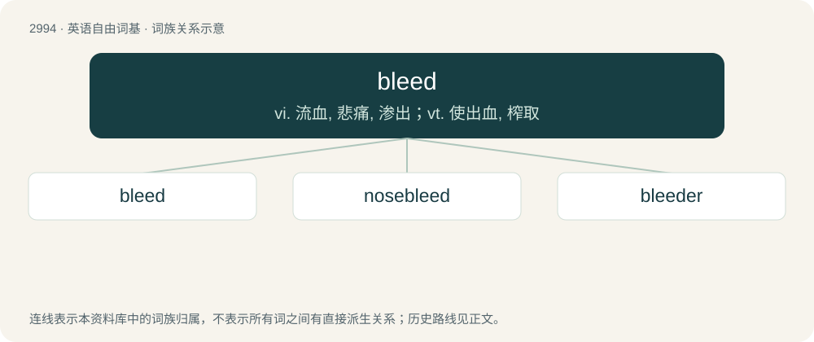

# 3098 · bleed — vi. 流血, 悲痛, 渗出；vt. 使出血, 榨取

[总目录](../00_总目录_按常用程度.md)

**类型**：英语自由词基　｜　**来源语言**：见词源记录

## 核心含义与来源

- 核心含义：vi. 流血, 悲痛, 渗出；vt. 使出血, 榨取
- 英文含义：To shed blood through an injured blood vessel.
- 词形：bleed

**来源记录 1**（动词；To shed blood through an injured blood vessel.）

From Middle English bleden, from Old English blēdan (“to bleed”), from Proto-West Germanic \*blōdijan, from Proto-Germanic \*blōdijaną (“to bleed”), from \*blōþą (“blood”). Cognates Cognate with Scots blede, bleid (“to bleed”), Saterland Frisian bläide (“to bleed”), West Frisian bliede (“to bleed”), Dutch bloeden (“to bleed”), Low German blöden (“to bleed”), German bluten (“to bleed”), Danish bløde (“to bleed”), Swedish blöda (“to bleed”).

## 词族图

## 单词速览（常用到不常用）

| 单词 | 音标 | 释义 |
|---|---|---|
| [bleed](#w-1) | /ˈbliːd/ | vi. 流血, 悲痛, 渗出；vt. 使出血, 榨取 |
| [nosebleed](#w-2) | 英 /ˈnəʊzˌbliːd/；美 /ˈnoʊzˌblid/ | n. 鼻出血；\[医\] 鼻出血, 衄血 |
| [bleeder](#w-3) | 英 /ˈbliːdə/；美 /ˈblidɚ/ | n. 易出血的人, 血友病患者；\[化\] 泄放器 |

## 逐词详解

### 1. bleed

**词性**：动词　｜　**音标**：/ˈbliːd/

**中文释义**：vi. 流血, 悲痛, 渗出；vt. 使出血, 榨取

**英文义项**：To shed blood through an injured blood vessel. / To menstruate.

**词源与演化**：

From Middle English bleden, from Old English blēdan (“to bleed”), from Proto-West Germanic \*blōdijan, from Proto-Germanic \*blōdijaną (“to bleed”), from \*blōþą (“blood”). Cognates Cognate with Scots blede, bleid (“to bleed”), Saterland Frisian bläide (“to bleed”), West Frisian bliede (“to bleed”), Dutch bloeden (“to bleed”), Low German blöden (“to bleed”), German bluten (“to bleed”), Danish bløde (“to bleed”), Swedish blöda (“to bleed”).

**例句**：

> Most of the sectors are bleeding, particularly the resources sector.

该用例对应义项：To lose money.

### 2. nosebleed

**词性**：名词　｜　**音标**：英 /ˈnəʊzˌbliːd/；美 /ˈnoʊzˌblid/

**中文释义**：n. 鼻出血；\[医\] 鼻出血, 衄血

**英文义项**：Haemorrhage from the nose (usually, blood flow exiting the nostrils that originates from the nasal cavity). / Mental overload (usually attained as a result of having to comprehend new and/or complex concepts or languages that one is not particularly skilled with).

**构词拆分**：From nose + bleed.

**词源与演化**：

From nose + bleed.

**例句**：

> This is the first time I've ever had a nosebleed in winter.

### 3. bleeder

**词性**：名词　｜　**音标**：英 /ˈbliːdə/；美 /ˈblidɚ/

**中文释义**：n. 易出血的人, 血友病患者；\[化\] 泄放器

**英文义项**：A person who is easily made to bleed, or who bleeds in unusually large amounts, particularly a hemophiliac. / A blood vessel that requires cauterization etc. to stop it from bleeding during surgery.

**构词拆分**：bleed + -er

**词源与演化**：

From bleed + -er.
