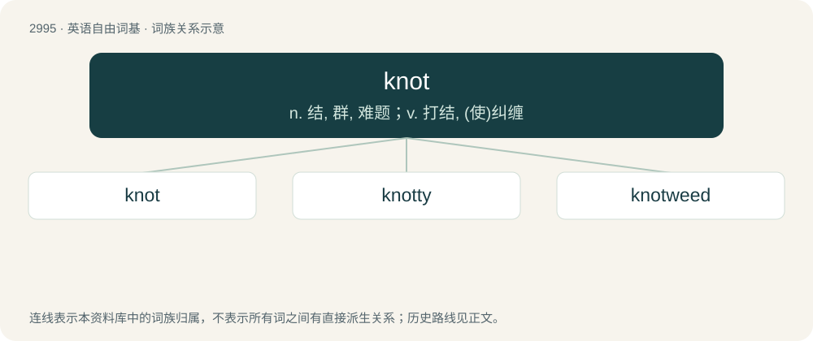

# 3099 · knot — n. 结, 群, 难题；v. 打结, (使)纠缠

[总目录](../00_总目录_按常用程度.md)

**类型**：英语自由词基　｜　**来源语言**：见词源记录

## 核心含义与来源

- 核心含义：n. 结, 群, 难题；v. 打结, (使)纠缠
- 英文含义：A looping of a piece of string or of any other long, flexible material that cannot be untangled without passing one or both ends of the material through its loops.
- 词形：knot

**多个词源／构词路径**：同一拼写可能有不同来源；以下按词性和含义分别列出。

**来源记录 1**（名词；A looping of a piece of string or of any other long, flexible material that cannot be untangled without passing one or both ends of the material through its loops.）

From Middle English knotte, from Old English cnotta, from Proto-West Germanic \*knottō, from Proto-Germanic \*knuttô, \*knudô (“knot”); probably ultimately from Proto-Indo-European \*gnod- (“to bind”). See also Old High German knoto (German Knoten, Dutch knot, Low German Knütte; also Old Norse knútr &gt; Danish knude, Swedish knut, Norwegian knute, Faroese knútur, Icelandic hnútur; also Latin nōdus and its Romance descendants. Doublet of knout, node, and nodus. \* (unit of speed): From the practice of counting the number of knots in the logline (as it is paid out) in a standard time. Traditionally spaced at one every ¹⁄₁₂₀ of a mile.

**来源记录 2**（名词；One of a variety of shore birds; red-breasted sandpiper (variously Calidris canutus or Tringa canutus).）

Supposed to be derived from the name of King Canute, with whom the bird was a favourite article of food. See the specific epithet canutus.

## 词族图

## 单词速览（常用到不常用）

| 单词 | 音标 | 释义 |
|---|---|---|
| [knot](#w-1) | 英 /nɒt/；美 /nɑt/ | n. 结, 群, 难题；v. 打结, (使)纠缠 |
| [knotty](#w-2) | 英 /ˈnɒti/；美 /ˈnɑti/ | a. 有结的, 多节的, 多瘤的, 棘手的 |
| [knotweed](#w-3) | /ˈnɔtwiːd/ | n. \[植\] 紫菀科植物, 蓼科杂草 |

## 逐词详解

### 1. knot

**词性**：名词　｜　**音标**：英 /nɒt/；美 /nɑt/

**中文释义**：n. 结, 群, 难题；v. 打结, (使)纠缠

**英文义项**：A looping of a piece of string or of any other long, flexible material that cannot be untangled without passing one or both ends of the material through its loops. / A tangled clump of hair or similar.

**词源与演化**：

From Middle English knotte, from Old English cnotta, from Proto-West Germanic \*knottō, from Proto-Germanic \*knuttô, \*knudô (“knot”); probably ultimately from Proto-Indo-European \*gnod- (“to bind”). See also Old High German knoto (German Knoten, Dutch knot, Low German Knütte; also Old Norse knútr &gt; Danish knude, Swedish knut, Norwegian knute, Faroese knútur, Icelandic hnútur; also Latin nōdus and its Romance descendants. Doublet of knout, node, and nodus. \* (unit of speed): From the practice of counting the number of knots in the logline (as it is paid out) in a standard time. Traditionally spaced at one every ¹⁄₁₂₀ of a mile.

**例句**：

> Climbers must make sure that all knots are both secure and of types that will not weaken the rope.

该用例对应义项：A looping of a piece of string or of any other long, flexible material that cannot be untangled without passing one or both ends of the material through its loops.

### 2. knotty

**词性**：形容词　｜　**音标**：英 /ˈnɒti/；美 /ˈnɑti/

**中文释义**：a. 有结的, 多节的, 多瘤的, 棘手的

**英文义项**：Of string or something stringlike: full of, or tied up, in knots. / Of a part of the body, a tree, etc.: full of knots (knobs or swellings); gnarled, knobbly.

**构词拆分**：knot + -y (suffix forming adjectives with the sense ‘having the quality of’)

**词源与演化**：

From Middle English knotti, knotty (“having a knot in it; full of knots; tied together (?); resembling a knot, knotlike; having knobs or protuberances; bulging, convex; of a tree, branch, etc.: full of knots, gnarled; of a plant cutting to be grafted or planted: full of buds or eyes; having joints (?); having swollen joints; of flesh: glandular; of flesh: granular, lumpy, especially, having many swellings; mangy, scurfy (?); having pimples (?); of cauterization: carried out on glandular tissue; (figuratively) of a question or problem: difficult, intricate”) \[and other forms\], from knotte (“knot; pattern of intersecting lines; coil of a snake”) (from Old English cnotta (“knot”), from Proto-Germanic \*knuttô (“knot”), possibly from Proto-Indo-European \*gned- (“to bind”)) + -i (suffix forming adjectives from nouns). The English word may be analysed as knot + -y (suffix forming adjectives with the sense ‘having the quality of’). Cognates \* Dutch knoestig (“knotty”) \* German knotig (“knotty”) \* Swedish knotig, knutig (“knotty”)

**用法示例／搭配（非完整句）**：

> a knotty problem

该用例对应义项：Complicated or tricky; complex, difficult.

### 3. knotweed

**词性**：名词　｜　**音标**：/ˈnɔtwiːd/

**中文释义**：n. \[植\] 紫菀科植物, 蓼科杂草

**英文义项**：Any of several plants of the genus Polygonum, with jointed stems and inconspicuous flowers

**构词拆分**：knot + weed

**词源与演化**：

From knot + weed.
