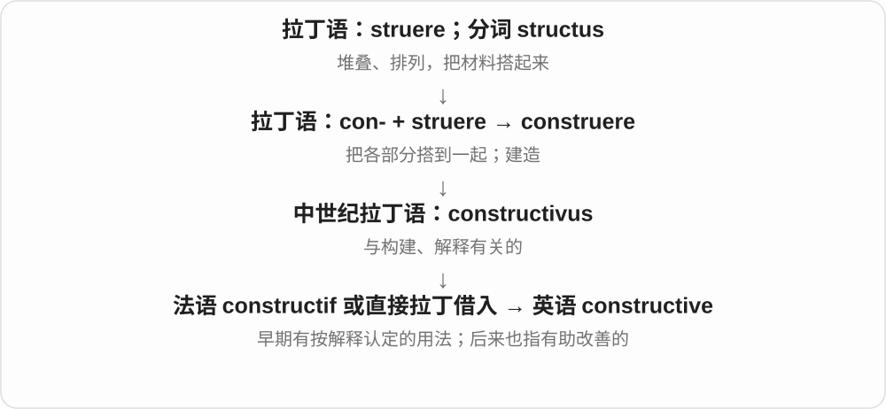
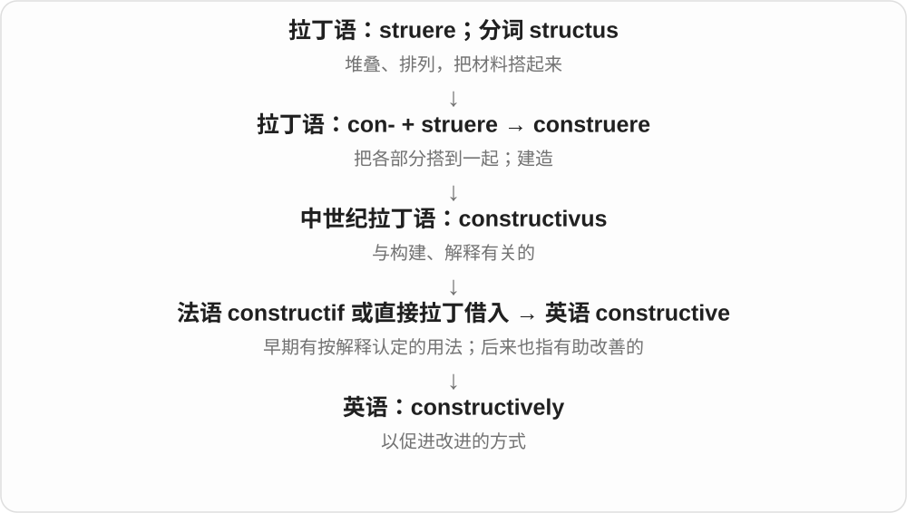
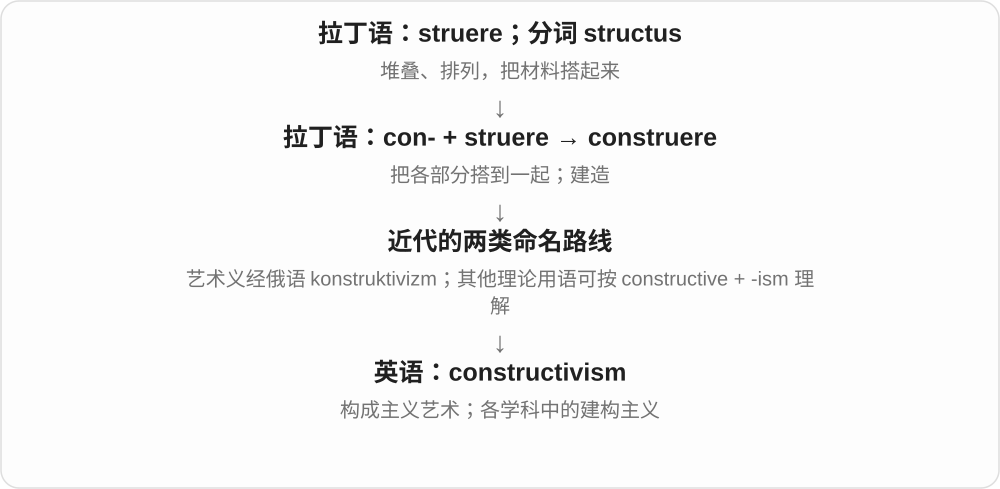
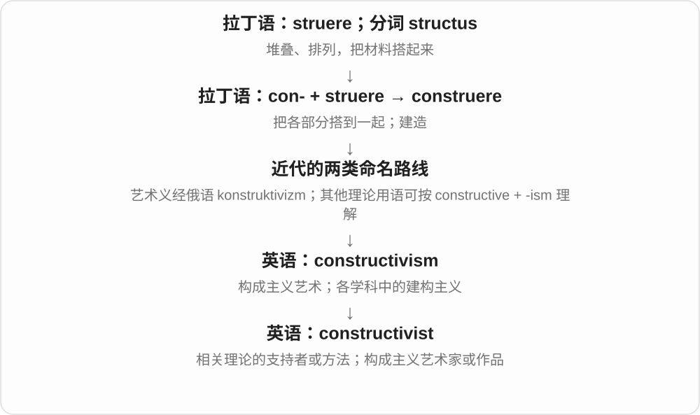

# 3101 · constructive — 建设性；建构主义

[逐词精讲目录](../00_逐词精讲目录.md) · [总目录](../00_总目录_按常用程度.md)

## 核心词根与来源

constructive 联系 construct 建构一支；constructively 是副词。constructivism、constructivist 是建构主义或构成主义等学科用语及相关人物，不能只按日常建设性解释。

**CONSTRUCTIVE：有助于建立改进，也进入理论命名**

批评可以指出问题，并帮助下一步做得更好。

- **有助改进**：constructive · constructively
- **理论与持有者**：constructivism · constructivist

## 词形与演化规律

constructive criticism、respond constructively；理论词在教育、哲学、艺术等领域有不同具体定义。

## 单词速览（按词族由简到繁）

同一基础词的相关扩展放在一起，先读基础形式，再读扩展；各组之间优先读常用的。具体词源关系见各词讲解。

| 单词 | 音标 | 核心意思 |
|---|---|---|
| [constructive](#w-1) | /kənˈstrʌktɪv/ | 有建设性的；有助改进的；法律上推定的 |
| [constructively](#w-2) | /kənˈstrʌktɪvli/ | 建设性地；有助解决问题地 |
| [constructivism](#w-4) | /kənˈstrʌktɪvɪzəm/ | 建构主义；构成主义艺术 |
| [constructivist](#w-3) | /kənˈstrʌktɪvɪst/ | 建构主义者；建构主义的；构成主义艺术的 |

## 逐词讲解

### 1. constructive — 有建设性的；有助改进的；法律上推定的

**音标**：/kənˈstrʌktɪv/

**先抓住这个画面**

constructive 的日常画面是：指出哪里不行，还帮忙把下一步搭起来。

**怎么拆**

经法语 constructif 或直接来自中世纪拉丁 constructivus；现代可分析成 construct + -ive。英语早期有“经解释推定”的用法，后来发展出促进改进的常用义。

**怎么变成今天的意思**

constructive criticism 不要求只说好话，关键是批评能帮助改善。法律术语里的 constructive 则可能表示依法推定或视为，不能照译成“有益的”。

**常见搭配与例句**

constructive criticism；constructive feedback；a constructive discussion。

> Her criticism was direct but constructive.

她的批评很直接，但有助于改进。

> We had a constructive discussion about the delays.

我们就延误问题进行了有建设性的讨论。

**别混淆**

positive 可以只是态度积极；constructive 更看是否帮助解决问题。constructional 则多谈建造或构造本身。

### 2. constructively — 建设性地；有助解决问题地

**音标**：/kənˈstrʌktɪvli/

**先抓住这个画面**

constructively 是把不满变成可用的建议，让讨论能往前走。

**怎么拆**

constructive + -ly，描写回应、讨论、处理问题的方式。

**怎么变成今天的意思**

respond constructively 可以包括明确反对，只要说明理由并推动改进；并不是一味顺着别人。

**常见搭配与例句**

respond constructively；work constructively；deal constructively with。

> She responded constructively to the negative feedback.

她以有助于改进的方式回应了负面反馈。

> The two teams worked constructively despite their differences.

两个团队虽然有分歧，仍以解决问题的态度合作。

**别混淆**

politely 只说明礼貌；constructively 说明这番话或这个做法有助于把事情做好。

### 3. constructivism — 建构主义；构成主义艺术

**音标**：/kənˈstrʌktɪvɪzəm/

**先抓住这个画面**

constructivism 抓住“搭建”这件事：有的理论谈人怎样搭起理解，有的艺术则直接用材料、几何形体搭出作品。

**怎么拆**

一般构词可看 constructive + -ism；俄国艺术运动名称则经俄语 konstruktivizm 借入。教育、数学、国际关系等领域的同名理论不能全部画成俄国艺术运动的后代。

**怎么变成今天的意思**

教育中的建构主义强调学习者通过经验主动形成理解；数学中的用法重视构造来确立存在；国际关系中关注身份、规范如何形成。艺术里的 Constructivism 通常译为构成主义，强调几何组织和现代材料。

**常见搭配与例句**

constructivism in education；social constructivism；Russian Constructivism。

> The course discusses constructivism as a theory of learning.

这门课把建构主义作为一种学习理论来讨论。

> The exhibition traces the influence of Russian Constructivism on design.

展览追溯了俄国构成主义对设计的影响。

**别混淆**

structuralism 偏向从关系系统理解现象；constructivism 各支更强调某种对象、知识或意义怎样被构建。必须先看学科再翻译。

### 4. constructivist — 建构主义者；建构主义的；构成主义艺术的

**音标**：/kənˈstrʌktɪvɪst/

**先抓住这个画面**

constructivist 的具体画面取决于场景：课堂里可能让学生亲自形成理解，美术馆里可能指几何材料构成的作品。

**怎么拆**

可分析为 constructive + -ist，与 constructivism 对应；艺术用法需连同俄语来源的运动名称理解，不能把所有义项都当成同一学派。

**怎么变成今天的意思**

a constructivist approach to learning 关注学习者主动建立知识；a Constructivist sculpture 则谈艺术风格。名词 a constructivist 指支持相关理论或艺术取向的人。

**常见搭配与例句**

a constructivist approach；constructivist teaching；a Constructivist artist。

> The teacher used a constructivist approach to the lesson.

老师采用建构主义取向来组织这堂课。

> The gallery displayed several Constructivist sculptures.

画廊展出了几件构成主义雕塑。

**别混淆**

constructive 是有助改善的日常评价；constructivist 是理论、方法或艺术流派标签，不是更长的“建设性”。

## 这一组要分清什么

constructive 不等于必须赞同，建设性批评仍可尖锐；constructivist 也不是普通施工人员。

## 串起来练习

The group responded constructively to constructive criticism.

小组积极回应了有助改进的批评。
