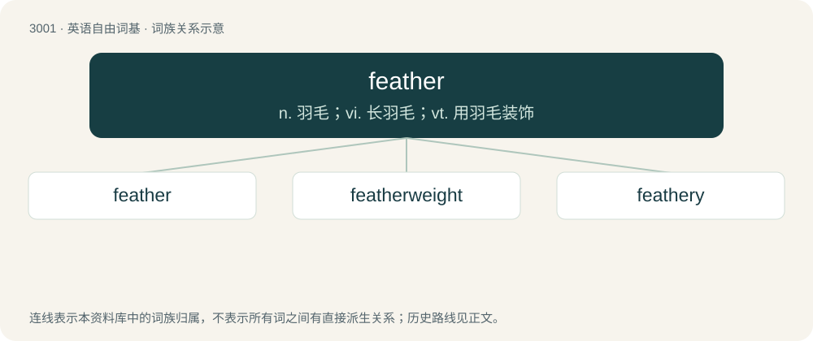

# 3104 · feather — n. 羽毛；vi. 长羽毛；vt. 用羽毛装饰

[总目录](../00_总目录_按常用程度.md)

**类型**：英语自由词基　｜　**来源语言**：见词源记录

## 核心含义与来源

- 核心含义：n. 羽毛；vi. 长羽毛；vt. 用羽毛装饰
- 英文含义：A branching, hair-like structure that grows on the bodies of birds, used for flight, swimming, protection and display.
- 词形：feather

**来源记录 1**（名词；A branching, hair-like structure that grows on the bodies of birds, used for flight, swimming, protection and display.）

From Middle English fethere, from Old English feþer, from Proto-West Germanic \*feþru, from Proto-Germanic \*feþrō, from Proto-Indo-European \*péth₂r̥ (“feather, wing”), from \*peth₂- (“to fly”). Cognate with West Frisian fear (“feather”), Cimbrian bèdara, fòdara (“pillowcase”), vèdara (“feather”), Dutch veder, veer (“feather”), German Feder (“feather”), German Low German Fedder (“feather”), Luxembourgish Fieder (“feather”), Vilamovian faoder (“feather”), Yiddish פֿעדער (feder, “feather”), Danish fjeder, fjer (“feather”), Faroese fjøður (“feather”), Icelandic fjöður (“feather”), Norwegian Bokmål fjær, fjør (“feather”), Norwegian Nynorsk fjøder, fjør (“feather”), Swedish fjäder (“feather”). Also Ancient Greek πέτομαι (pétomai, “to fly”), Albanian shpend (“bird”), Latin penna (“feather”), Old Armenian թիռ (tʻiṙ, “flight”). The sense correlated with splines and keys (noun sense 4) probably reflects analogy with the fletching sense (noun sense 3).

## 词族图

## 单词速览（常用到不常用）

| 单词 | 音标 | 释义 |
|---|---|---|
| [feather](#w-1) | 英 /ˈfɛðə/；美 /ˈfɛðɚ/ | n. 羽毛；vi. 长羽毛；vt. 用羽毛装饰 |
| [featherweight](#w-2) | 美 /ˈfɛðɚˌweɪt/ | n. 非常轻的人或物, 不重要的人, 轻量级选手 |
| [feathery](#w-3) | 美 /ˈfɛ.ðəɹ.i/ | a. 生有羽毛的, 柔软如羽毛的 |

## 逐词详解

### 1. feather

**词性**：动词　｜　**音标**：英 /ˈfɛðə/；美 /ˈfɛðɚ/

**中文释义**：n. 羽毛；vi. 长羽毛；vt. 用羽毛装饰

**英文义项**：To cover or furnish with feathers; (when of an arrow) to fletch. / To adorn, as if with feathers; to fringe.

**词源与演化**：

From Middle English fethere, from Old English feþer, from Proto-West Germanic \*feþru, from Proto-Germanic \*feþrō, from Proto-Indo-European \*péth₂r̥ (“feather, wing”), from \*peth₂- (“to fly”). Cognate with West Frisian fear (“feather”), Cimbrian bèdara, fòdara (“pillowcase”), vèdara (“feather”), Dutch veder, veer (“feather”), German Feder (“feather”), German Low German Fedder (“feather”), Luxembourgish Fieder (“feather”), Vilamovian faoder (“feather”), Yiddish פֿעדער (feder, “feather”), Danish fjeder, fjer (“feather”), Faroese fjøður (“feather”), Icelandic fjöður (“feather”), Norwegian Bokmål fjær, fjør (“feather”), Norwegian Nynorsk fjøder, fjør (“feather”), Swedish fjäder (“feather”). Also Ancient Greek πέτομαι (pétomai, “to fly”), Albanian shpend (“bird”), Latin penna (“feather”), Old Armenian թիռ (tʻiṙ, “flight”). The sense correlated with splines and keys (noun sense 4) probably reflects analogy with the fletching sense (noun sense 3).

**例句**：

> After striking the bird, the pilot feathered the damaged left engine’s propeller.

该用例对应义项：To streamline the blades of an aircraft's propeller by rotating them perpendicular to the axis of the propeller when the engine is shut down so that the propeller does not windmill during flight.

### 2. featherweight

**词性**：名词　｜　**音标**：美 /ˈfɛðɚˌweɪt/

**中文释义**：n. 非常轻的人或物, 不重要的人, 轻量级选手

**英文义项**：A weight class in many combat sports; e.g. in professional boxing of a maximum of 126 pounds or 57.2 kilograms. / A sportsman who fights in this division.

**构词拆分**：From feather + weight.

**词源与演化**：

From feather + weight.

### 3. feathery

**词性**：形容词　｜　**音标**：美 /ˈfɛ.ðəɹ.i/

**中文释义**：a. 生有羽毛的, 柔软如羽毛的

**英文义项**：Resembling feathers. / Covered with feathers.

**构词拆分**：feather + -y

**词源与演化**：

From feather + -y.

**例句**：

> The feathery congregation of jays.

该用例对应义项：characterized by a covering of feathers
