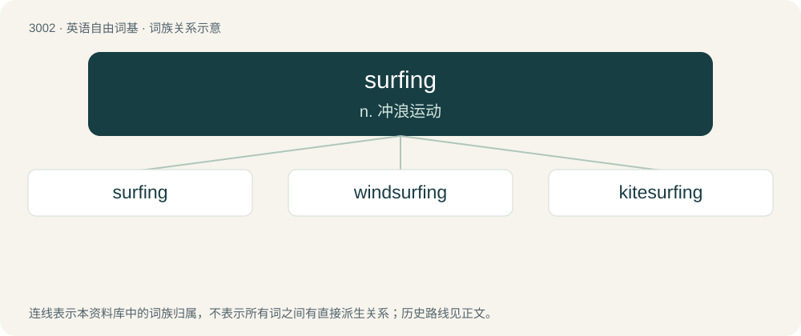

# 3106 · surfing — n. 冲浪运动

[总目录](../00_总目录_按常用程度.md)

**类型**：英语自由词基　｜　**来源语言**：见词源记录

## 核心含义与来源

- 核心含义：n. 冲浪运动
- 英文含义：The pastime or sport of riding surf on a surfboard.
- 词形：surfing

**来源记录 1**（名词；The pastime or sport of riding surf on a surfboard.）

From surf + -ing.

## 词族图

## 单词速览（常用到不常用）

| 单词 | 音标 | 释义 |
|---|---|---|
| [surfing](#w-1) | 美 /ˈsɝfɪŋ/ | n. 冲浪运动 |
| [windsurfing](#w-2) | /ˈwind.səːfiŋ/ | n. \[体\]帆板运动 |
| [kitesurfing](#w-3) |  | 【英文】A type of kiteboarding that happens in the water, where the rider is on a surfboard and is propelled by a power kite. |

## 逐词详解

### 1. surfing

**词性**：名词　｜　**音标**：美 /ˈsɝfɪŋ/

**中文释义**：n. 冲浪运动

**英文义项**：The pastime or sport of riding surf on a surfboard. / The activity of browsing the Internet.

**构词拆分**：surf + -ing

**词源与演化**：

From surf + -ing.

**例句**：

> How about going surfing at Hayama next Sunday if it is fine?

### 2. windsurfing

**词性**：名词　｜　**音标**：/ˈwind.səːfiŋ/

**中文释义**：n. \[体\]帆板运动

**英文义项**：A marine sport in which one stands on a floating board (typically 2 - 3 meters in length) to which a sail is attached. The board is steered by tilting the sail or banking the board. Some windsurfers use large waves to perform jumps and other stunts.

**构词拆分**：wind + surfing

**词源与演化**：

From wind + surfing.

**例句**：

> If you really want a challenge, you should try windsurfing.

### 3. kitesurfing

**词性**：名词

**英文义项**：A type of kiteboarding that happens in the water, where the rider is on a surfboard and is propelled by a power kite.

**构词拆分**：kite + surfing

**词源与演化**：

From kite + surfing.
