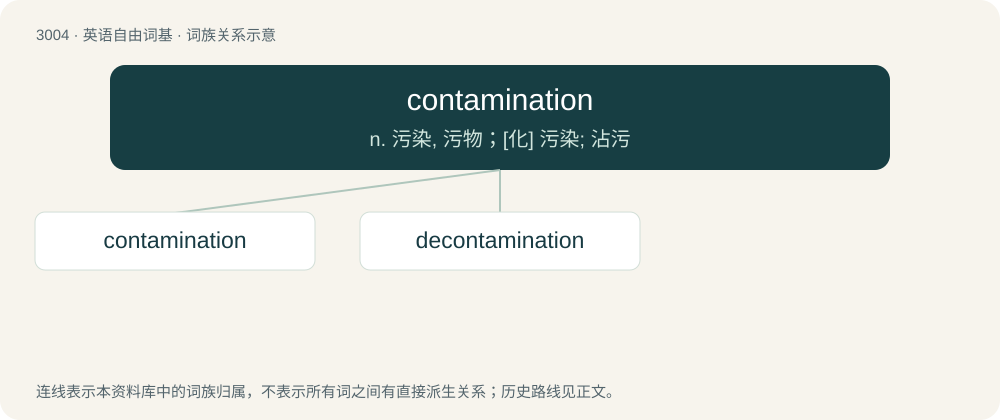

# 3108 · contamination — n. 污染, 污物；\[化\] 污染; 沾污

[总目录](../00_总目录_按常用程度.md)

**类型**：英语自由词基　｜　**来源语言**：见词源记录

## 核心含义与来源

- 核心含义：n. 污染, 污物；\[化\] 污染; 沾污
- 英文含义：The act or process of contaminating.
- 词形：contamination

**来源记录 1**（名词；The act or process of contaminating.）

From Latin contāminātiōnem.

## 词族图

## 单词速览（常用到不常用）

| 单词 | 音标 | 释义 |
|---|---|---|
| [contamination](#w-1) | 英 /kənˌtæm.ɪˈneɪ.ʃən/；美 /kənˌtæm.əˈneɪ.ʃən/ | n. 污染, 污物；\[化\] 污染; 沾污 |
| [decontamination](#w-2) | 英 /diːkənˌtæmɪˈneɪʃən/ | n. 净化, 排除污染；\[化\] 净化; 纯化; 清除放射性污染 |

## 逐词详解

### 1. contamination

**词性**：名词　｜　**音标**：英 /kənˌtæm.ɪˈneɪ.ʃən/；美 /kənˌtæm.əˈneɪ.ʃən/

**中文释义**：n. 污染, 污物；\[化\] 污染; 沾污

**英文义项**：The act or process of contaminating. / Something which contaminates.

**词源与演化**：

From Latin contāminātiōnem.

**例句**：

> It is essential to prevent salmonella contamination in hen egg production.

### 2. decontamination

**词性**：名词　｜　**音标**：英 /diːkənˌtæmɪˈneɪʃən/

**中文释义**：n. 净化, 排除污染；\[化\] 净化; 纯化; 清除放射性污染

**英文义项**：The process of removing contamination, particularly the cleaning off of dangerous materials.

**构词拆分**：de- + contamination

**词源与演化**：

From de- + contamination.

**例句**：

> The decontamination will involve testing and gathering affected soil and heating it to high temperature to burn off leftover dioxin.
