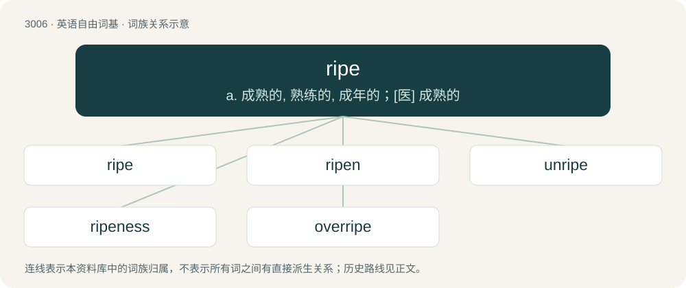

# 3109 · ripe — a. 成熟的, 熟练的, 成年的；\[医\] 成熟的

[总目录](../00_总目录_按常用程度.md)

**类型**：英语自由词基　｜　**来源语言**：见词源记录

## 核心含义与来源

- 核心含义：a. 成熟的, 熟练的, 成年的；\[医\] 成熟的
- 英文含义：Of a fruit, vegetable, seed, etc., ready for reaping or gathering; having attained perfection; mature.
- 词形：ripe

**多个词源／构词路径**：同一拼写可能有不同来源；以下按词性和含义分别列出。

**来源记录 1**（形容词；Of a fruit, vegetable, seed, etc., ready for reaping or gathering; having attained perfection; mature.）

From Middle English ripe, rype, from Old English rīpe (“ripe, mature”), from Proto-West Germanic \*rīpī, from Proto-Germanic \*rīpijaz, \*rīpiz, from Proto-Indo-European \*h₁reyb- (“to snatch”). Cognate with West Frisian ryp (“ripe”), Dutch rijp (“ripe”), German reif (“ripe”). Related to reap.

**来源记录 2**（名词；The bank of a river.）

From Middle English ripe, from Latin ripa.

**来源记录 3**（形容词；Rife）

An alteration of rife.

## 词族图

## 单词速览（常用到不常用）

| 单词 | 音标 | 释义 |
|---|---|---|
| [ripe](#w-1) | 英 /ɹaɪp/ | a. 成熟的, 熟练的, 成年的；\[医\] 成熟的 |
| [ripen](#w-2) | /ˈɹaɪpən/ | vt. 使成熟；vi. 成熟 |
| [unripe](#w-3) | /ˈʌnˈraip/ | a. 未熟的, 未成熟的, 生的, 未准备的, 不适时的 |
| [ripeness](#w-4) | /ˈraipnis/ | n. 成熟, 圆通, 完成 |
| [overripe](#w-5) | /ˈəuvəˈraip/ | a. 过熟的, 衰萎的, 颓废的 |

## 逐词详解

### 1. ripe

**词性**：形容词　｜　**音标**：英 /ɹaɪp/

**中文释义**：a. 成熟的, 熟练的, 成年的；\[医\] 成熟的

**英文义项**：Of a fruit, vegetable, seed, etc., ready for reaping or gathering; having attained perfection; mature. / Of a food, advanced to the state of fitness for use; mellow.

**词源与演化**：

From Middle English ripe, rype, from Old English rīpe (“ripe, mature”), from Proto-West Germanic \*rīpī, from Proto-Germanic \*rīpijaz, \*rīpiz, from Proto-Indo-European \*h₁reyb- (“to snatch”). Cognate with West Frisian ryp (“ripe”), Dutch rijp (“ripe”), German reif (“ripe”). Related to reap.

**用法示例／搭配（非完整句）**：

> ripe apples

该用例对应义项：Of a fruit, vegetable, seed, etc., ready for reaping or gathering; having attained perfection; mature.

### 2. ripen

**词性**：动词　｜　**音标**：/ˈɹaɪpən/

**中文释义**：vt. 使成熟；vi. 成熟

**英文义项**：Of grain, fruit, flowers, etc., to grow ripe; to become mature. / To approach or come to perfection.

**构词拆分**：ripe + -en (inchoative and factitive suffix)

**词源与演化**：

From Middle English \*ripenen, extended form of ripen, from Old English rīpian. In the modern form, equivalent to ripe + -en (inchoative and factitive suffix). As in several other verbs, the alteration seems to have occurred during the time when the infinitive and plural ending -en was in the process of being lost (and was thus open to reinterpretation). The earliest attestation is deverbal Middle English ripening (“causing ripeness, ripening”).

**例句**：

> The warm sun ripened the corn.

该用例对应义项：To cause (something) to mature; to make ripe.

### 3. unripe

**词性**：形容词　｜　**音标**：/ˈʌnˈraip/

**中文释义**：a. 未熟的, 未成熟的, 生的, 未准备的, 不适时的

**英文义项**：Not ripe. / Developing too early; premature.

**构词拆分**：un- + ripe

**词源与演化**：

From Old English unrīpe. Equivalent to un- + ripe.

**用法示例／搭配（非完整句）**：

> unripe fruit

该用例对应义项：Not ripe.

### 4. ripeness

**词性**：名词　｜　**音标**：/ˈraipnis/

**中文释义**：n. 成熟, 圆通, 完成

**英文义项**：The characteristic of being ripe.

**构词拆分**：ripe + -ness

**词源与演化**：

From Middle English ripenesse, rypenesse, rijpnesse, from Old English rīpness, equivalent to ripe + -ness.

**例句**：

> You can easily judge the ripeness of a banana by the color of its peel.

### 5. overripe

**词性**：形容词　｜　**音标**：/ˈəuvəˈraip/

**中文释义**：a. 过熟的, 衰萎的, 颓废的

**英文义项**：Excessively ripe; spoiled; gone bad.

**构词拆分**：over- + ripe

**词源与演化**：

From over- + ripe.

**例句**：

> Don't buy overripe fruit. It goes bad really fast.
