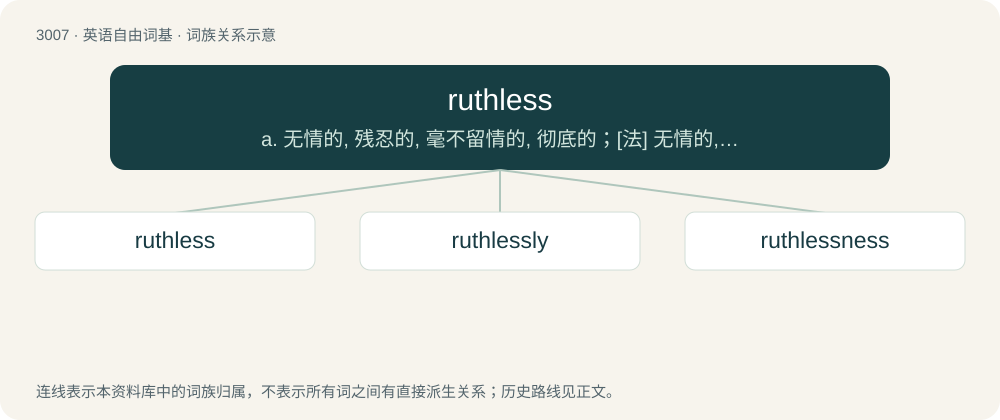

# 3110 · ruthless — a. 无情的, 残忍的, 毫不留情的, 彻底的；\[法\] 无情的, 残忍的

[总目录](../00_总目录_按常用程度.md)

**类型**：英语自由词基　｜　**来源语言**：见词源记录

## 核心含义与来源

- 核心含义：a. 无情的, 残忍的, 毫不留情的, 彻底的；\[法\] 无情的, 残忍的
- 英文含义：Without pity or compassion; cruel, pitiless.
- 词形：ruthless

**来源记录 1**（形容词；Without pity or compassion; cruel, pitiless.）

From Middle English reuþeles; equivalent to ruth + -less.

## 词族图

## 单词速览（常用到不常用）

| 单词 | 音标 | 释义 |
|---|---|---|
| [ruthless](#w-1) | /ˈɹuːθləs/ | a. 无情的, 残忍的, 毫不留情的, 彻底的；\[法\] 无情的, 残忍的 |
| [ruthlessly](#w-2) | 英 /ˈɹuːθ.ləs.li/ | adv. 无情地, 冷酷地, 残忍地 |
| [ruthlessness](#w-3) |  | n. 无情；冷酷；残忍 |

## 逐词详解

### 1. ruthless

**词性**：形容词　｜　**音标**：/ˈɹuːθləs/

**中文释义**：a. 无情的, 残忍的, 毫不留情的, 彻底的；\[法\] 无情的, 残忍的

**英文义项**：Without pity or compassion; cruel, pitiless. / Uncompromising; unrelenting.

**构词拆分**：ruth + -less

**词源与演化**：

From Middle English reuþeles; equivalent to ruth + -less.

**例句**：

> An act of ruthless ferocity.

该用例对应义项：without mercy or pity

### 2. ruthlessly

**词性**：副词　｜　**音标**：英 /ˈɹuːθ.ləs.li/

**中文释义**：adv. 无情地, 冷酷地, 残忍地

**英文义项**：In a ruthless manner; with cruelty; without pity or compassion.

**构词拆分**：ruthless + -ly

**词源与演化**：

From ruthless + -ly.

**例句**：

> The government has been urged to take immediate action to deal ruthlessly with the strikers.

该用例对应义项：in a ruthless manner

### 3. ruthlessness

**词性**：名词

**中文释义**：n. 无情；冷酷；残忍

**英文义项**：The property of being ruthless.

**构词拆分**：ruthless + -ness

**词源与演化**：

From ruthless + -ness.

**例句**：

> This series is a long essay on human malice, brazenness, and ruthlessness.
