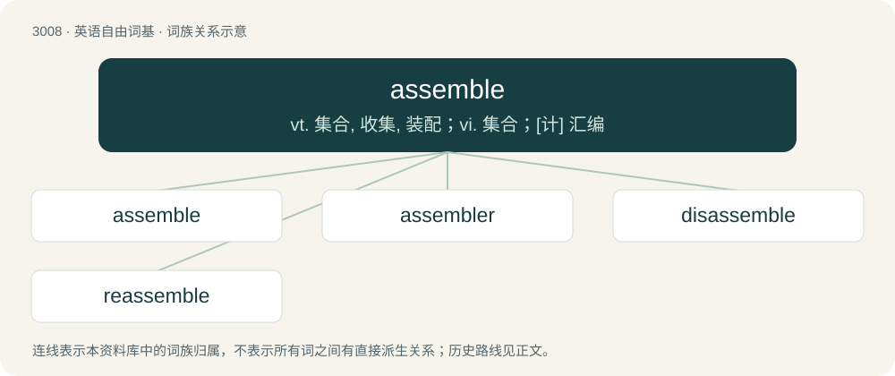

# 3111 · assemble — vt. 集合, 收集, 装配；vi. 集合；\[计\] 汇编

[总目录](../00_总目录_按常用程度.md)

**类型**：英语自由词基　｜　**来源语言**：见词源记录

## 核心含义与来源

- 核心含义：vt. 集合, 收集, 装配；vi. 集合；\[计\] 汇编
- 英文含义：To put together.
- 词形：assemble

**来源记录 1**（动词；To put together.）

From Middle English assemblen, from Old French assembler (“to assemble”), from Medieval Latin assimulāre (“to bring together”), from ad- + simulō (“copy, imitate”), from similis (“like, similar”), ultimately from Proto-Indo-European \*sem- (“together, one”). Doublet of assimilate.

## 词族图

## 单词速览（常用到不常用）

| 单词 | 音标 | 释义 |
|---|---|---|
| [assemble](#w-1) | /əˈsɛm.bəl/ | vt. 集合, 收集, 装配；vi. 集合；\[计\] 汇编 |
| [assembler](#w-2) | /əˈsɛmb(ə)lɚ/ | n. 装配工；\[计\] 汇编程序 |
| [disassemble](#w-3) | 英 /dɪs.əˈsɛm.bəl/ | vt. 解开, 拆开 |
| [reassemble](#w-4) | /ˌɹiːəˈsɛmbəl/ | vt. 重新召集, 重新装配；vi. 重新集合 |

## 逐词详解

### 1. assemble

**词性**：动词　｜　**音标**：/əˈsɛm.bəl/

**中文释义**：vt. 集合, 收集, 装配；vi. 集合；\[计\] 汇编

**英文义项**：To put together. / To gather as a group.

**词源与演化**：

From Middle English assemblen, from Old French assembler (“to assemble”), from Medieval Latin assimulāre (“to bring together”), from ad- + simulō (“copy, imitate”), from similis (“like, similar”), ultimately from Proto-Indo-European \*sem- (“together, one”). Doublet of assimilate.

**例句**：

> The factory now under construction will assemble 3,000 VCR units per day.

### 2. assembler

**词性**：名词　｜　**音标**：/əˈsɛmb(ə)lɚ/

**中文释义**：n. 装配工；\[计\] 汇编程序

**英文义项**：A program that reads source code written in assembly language and produces executable machine code, possibly together with information needed by linkers, debuggers and other tools. / Assembly language.

**构词拆分**：assemble + -er

**词源与演化**：

From assemble + -er.

**例句**：

> I wrote that program in assembler.

该用例对应义项：Assembly language.

### 3. disassemble

**词性**：动词　｜　**音标**：英 /dɪs.əˈsɛm.bəl/

**中文释义**：vt. 解开, 拆开

**英文义项**：To take to pieces; to reverse the process of assembly. / To convert machine code to a human-readable, mnemonic form.

**构词拆分**：dis- + assemble

**词源与演化**：

From dis- + assemble.

**例句**：

> To perform the repair it was necessary to disassemble most of the mechanism.

该用例对应义项：To take to pieces; to reverse the process of assembly.

### 4. reassemble

**词性**：动词　｜　**音标**：/ˌɹiːəˈsɛmbəl/

**中文释义**：vt. 重新召集, 重新装配；vi. 重新集合

**英文义项**：To assemble again. / To put back together; to reverse the process of disassembly.

**构词拆分**：re- + assemble

**词源与演化**：

From re- + assemble.

**例句**：

> I dropped this clay witch figure and it broke into pieces, but I was more or less able to reassemble it.
