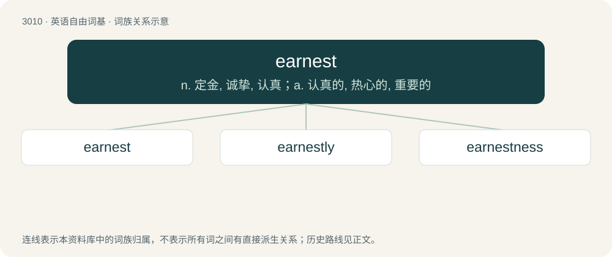

# 3114 · earnest — n. 定金, 诚挚, 认真；a. 认真的, 热心的, 重要的

[总目录](../00_总目录_按常用程度.md)

**类型**：英语自由词基　｜　**来源语言**：见词源记录

## 核心含义与来源

- 核心含义：n. 定金, 诚挚, 认真；a. 认真的, 热心的, 重要的
- 英文含义：Gravity; serious purpose; earnestness.
- 词形：earnest

**多个词源／构词路径**：同一拼写可能有不同来源；以下按词性和含义分别列出。

**来源记录 1**（名词；Gravity; serious purpose; earnestness.）

From Middle English ernest, eornest, from Old English eornest, eornost, eornust (“earnestness, zeal, seriousness, battle”), from Proto-Germanic \*ernustuz (“earnest, strength, solidity, struggle, fight”), a derivative of Proto-Germanic \*arniz (“efficient, capable, diligent, sure”), from Proto-Indo-European \*er- (“to cause to move, arouse, increase”). Cognate with West Frisian earnst (“earnest, seriousness”), Dutch ernst (“seriousness, gravity, earnest”), German Ernst (“seriousness, earnestness, zeal, vigour”), Icelandic ern (“brisk, vigorous”), Gothic 𐌰𐍂𐌽𐌹𐌱𐌰 (arniba, “secure, certain, sure”). The adjective is from Middle English eornest, from Old English eornoste (“earnest, zealous, serious”), from the noun. Cognate with North Frisian ernste (“earnest”), Middle Low German ernest, ernst (“serious, earnest”), German ernst (“serious, earnest”).

**来源记录 2**（名词；A sum of money paid in advance as a deposit; hence, a pledge, a guarantee, an indication of something to come.）

Uncertain; apparently related to erres. Compare also arles.

## 词族图

## 单词速览（常用到不常用）

| 单词 | 音标 | 释义 |
|---|---|---|
| [earnest](#w-1) | 英 /ˈɜː.nɪst/；美 /ˈɝ.nɪst/ | n. 定金, 诚挚, 认真；a. 认真的, 热心的, 重要的 |
| [earnestly](#w-2) | 英 /ˈɜːnɪstli/；美 /ˈɝnɪstli/ | adv. 诚挚地；认真地 |
| [earnestness](#w-3) | 英 /ˈɜːnɪstnəs/；美 /ˈɝnɪstnəs/ | n. 认真；诚挚；正经 |

## 逐词详解

### 1. earnest

**词性**：形容词　｜　**音标**：英 /ˈɜː.nɪst/；美 /ˈɝ.nɪst/

**中文释义**：n. 定金, 诚挚, 认真；a. 认真的, 热心的, 重要的

**英文义项**：Serious, sincere, ingenuous. / Focused in the pursuit of an objective; honestly eager to obtain or do.

**词源与演化**：

From Middle English ernest, eornest, from Old English eornest, eornost, eornust (“earnestness, zeal, seriousness, battle”), from Proto-Germanic \*ernustuz (“earnest, strength, solidity, struggle, fight”), a derivative of Proto-Germanic \*arniz (“efficient, capable, diligent, sure”), from Proto-Indo-European \*er- (“to cause to move, arouse, increase”). Cognate with West Frisian earnst (“earnest, seriousness”), Dutch ernst (“seriousness, gravity, earnest”), German Ernst (“seriousness, earnestness, zeal, vigour”), Icelandic ern (“brisk, vigorous”), Gothic 𐌰𐍂𐌽𐌹𐌱𐌰 (arniba, “secure, certain, sure”). The adjective is from Middle English eornest, from Old English eornoste (“earnest, zealous, serious”), from the noun. Cognate with North Frisian ernste (“earnest”), Middle Low German ernest, ernst (“serious, earnest”), German ernst (“serious, earnest”).

**用法示例／搭配（非完整句）**：

> an earnest disposition

该用例对应义项：Possessing or characterised by seriousness.

### 2. earnestly

**词性**：副词　｜　**音标**：英 /ˈɜːnɪstli/；美 /ˈɝnɪstli/

**中文释义**：adv. 诚挚地；认真地

**英文义项**：In an earnest manner; being very sincere; putting forth genuine effort.

**构词拆分**：earnest + -ly

**词源与演化**：

From Middle English ernestly, from Old English eornostlīċe (“earnestly, strictly”), equivalent to earnest + -ly.

**例句**：

> Talking earnestly with his son.

该用例对应义项：in a serious manner

### 3. earnestness

**词性**：名词　｜　**音标**：英 /ˈɜːnɪstnəs/；美 /ˈɝnɪstnəs/

**中文释义**：n. 认真；诚挚；正经

**英文义项**：The quality of being earnest; sincerity; seriousness.

**构词拆分**：earnest + -ness

**词源与演化**：

From earnest + -ness.

**例句**：

> She spoke with great earnestness about the issue.

该用例对应义项：The quality of being earnest; sincerity; seriousness.
