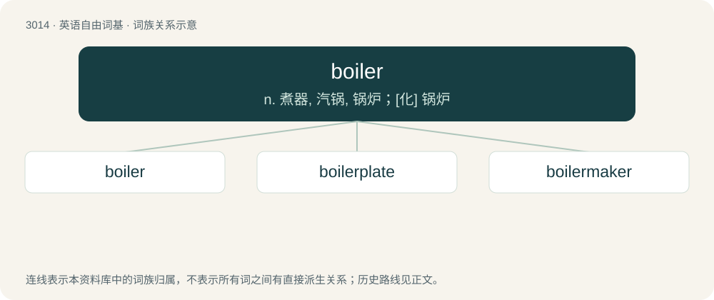

# 3118 · boiler — n. 煮器, 汽锅, 锅炉；\[化\] 锅炉

[总目录](../00_总目录_按常用程度.md)

**类型**：英语自由词基　｜　**来源语言**：见词源记录

## 核心含义与来源

- 核心含义：n. 煮器, 汽锅, 锅炉；\[化\] 锅炉
- 英文含义：A person who boils something.
- 词形：boiler

**多个词源／构词路径**：同一拼写可能有不同来源；以下按词性和含义分别列出。

**来源记录 1**（名词；A person who boils something.）

From boil + -er.

**来源记录 2**（名词；Boilerplate.）

Clipping of boilerplate.

## 词族图

## 单词速览（常用到不常用）

| 单词 | 音标 | 释义 |
|---|---|---|
| [boiler](#w-1) | 英 /ˈbɔɪlə/；美 /ˈbɔɪlɚ/ | n. 煮器, 汽锅, 锅炉；\[化\] 锅炉 |
| [boilerplate](#w-2) | 英 /ˈbɔɪ.ləˌpleɪt/；美 /ˈbɔɪ.ləɹˌpleɪt/ | n. 样板文件 |
| [boilermaker](#w-3) | /ˈbɔɪləɹmeɪkɚ/ | 锅炉制造\[装配、修理\]工 |

## 逐词详解

### 1. boiler

**词性**：名词　｜　**音标**：英 /ˈbɔɪlə/；美 /ˈbɔɪlɚ/

**中文释义**：n. 煮器, 汽锅, 锅炉；\[化\] 锅炉

**英文义项**：A person who boils something. / A steam boiler.

**构词拆分**：boil + -er

**词源与演化**：

From boil + -er.

**例句**：

> I'm afraid I got too carried away throwing passengers into the boiler.

### 2. boilerplate

**词性**：名词　｜　**音标**：英 /ˈbɔɪ.ləˌpleɪt/；美 /ˈbɔɪ.ləɹˌpleɪt/

**中文释义**：n. 样板文件

**英文义项**：A sheet of copper or steel used in the construction of a boiler. / Any metal taking the form of sheets used in the construction of a boiler.

**构词拆分**：boiler + plate

**词源与演化**：

From boiler + plate.

**例句**：

> They put that boilerplate on all the warning labels.

该用例对应义项：Standard text of a legal or official nature added to documents or labels.

### 3. boilermaker

**词性**：名词　｜　**音标**：/ˈbɔɪləɹmeɪkɚ/

**中文释义**：锅炉制造\[装配、修理\]工

**英文义项**：A person qualified to make or repair boilers. / A whiskey with a beer chaser.

**构词拆分**：boiler + maker

**词源与演化**：

From boiler + maker.
