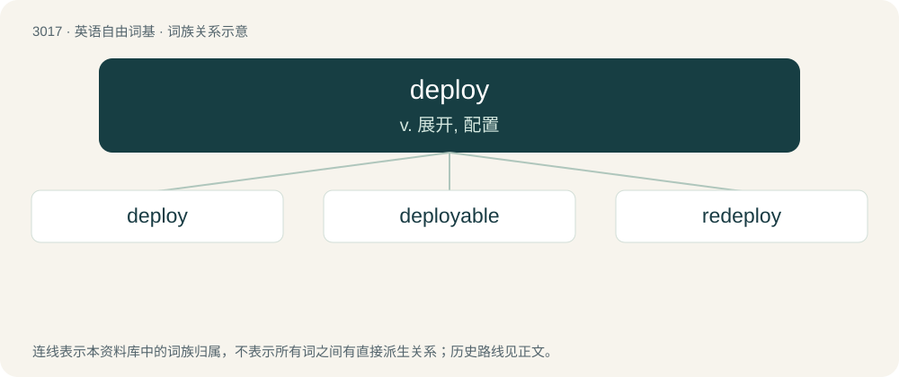

# 3119 · deploy — v. 展开, 配置

[总目录](../00_总目录_按常用程度.md)

**类型**：英语自由词基　｜　**来源语言**：见词源记录

## 核心含义与来源

- 核心含义：v. 展开, 配置
- 英文含义：To prepare and arrange (originally military unit or units, i.e., to array troops) for use.
- 词形：deploy

**来源记录 1**（动词；To prepare and arrange (originally military unit or units, i.e., to array troops) for use.）

Borrowed from French déployer (“to unroll, unfold”), from Old French desploiier, itself from des- + ploiier, or possibly from Late Latin displicāre (“to unfold, display”), from Latin dis- (“apart”) + plicare (“to fold”). Compare Middle English desployen, dysployen (“to unfold, display”). Doublet of display.

## 词族图

## 单词速览（常用到不常用）

| 单词 | 音标 | 释义 |
|---|---|---|
| [deploy](#w-1) | /dɪˈplɔɪ/ | v. 展开, 配置 |
| [deployable](#w-2) |  | a. 可开展的 |
| [redeploy](#w-3) | /riːˈdɪˈplɔɪ/ | vt. 调动, 调换, 重新部署；vi. 重新部署 |

## 逐词详解

### 1. deploy

**词性**：动词　｜　**音标**：/dɪˈplɔɪ/

**中文释义**：v. 展开, 配置

**英文义项**：To prepare and arrange (originally military unit or units, i.e., to array troops) for use. / To unfold, open, or otherwise become ready for use.

**词源与演化**：

Borrowed from French déployer (“to unroll, unfold”), from Old French desploiier, itself from des- + ploiier, or possibly from Late Latin displicāre (“to unfold, display”), from Latin dis- (“apart”) + plicare (“to fold”). Compare Middle English desployen, dysployen (“to unfold, display”). Doublet of display.

**例句**：

> "Deploy two units of infantry along the enemy's flank," the general ordered.

该用例对应义项：To prepare and arrange (originally military unit or units, i.e., to array troops) for use.

### 2. deployable

**词性**：形容词

**中文释义**：a. 可开展的

**英文义项**：Able to be deployed. / Ejectable, separable from the aircraft.

**构词拆分**：deploy + -able

**词源与演化**：

From French déployable, deploy + -able.

### 3. redeploy

**词性**：动词　｜　**音标**：/riːˈdɪˈplɔɪ/

**中文释义**：vt. 调动, 调换, 重新部署；vi. 重新部署

**英文义项**：To deploy again. / To rearrange (military forces).

**构词拆分**：re- + deploy

**词源与演化**：

From re- + deploy.

**例句**：

> The U.S. must redeploy their troops in the Middle East.

该用例对应义项：deploy anew
