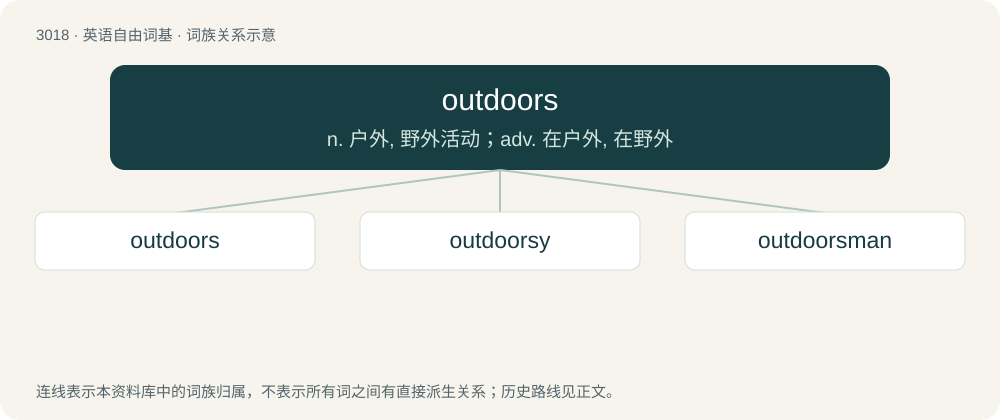

# 3120 · outdoors — n. 户外, 野外活动；adv. 在户外, 在野外

[总目录](../00_总目录_按常用程度.md)

**类型**：英语自由词基　｜　**来源语言**：见词源记录

## 核心含义与来源

- 核心含义：n. 户外, 野外活动；adv. 在户外, 在野外
- 英文含义：Not inside a house or under covered structure; unprotected; in the open air.
- 词形：outdoors

**来源记录 1**（副词；Not inside a house or under covered structure; unprotected; in the open air.）

From out + doors (plural of door), probably as a shortening of out of doors. Alternatively, from outdoor (adjective) + -s (adverbial genitive suffix).

## 词族图

## 单词速览（常用到不常用）

| 单词 | 音标 | 释义 |
|---|---|---|
| [outdoors](#w-1) | /aʊtˈdɔː(ɹ)z/ | n. 户外, 野外活动；adv. 在户外, 在野外 |
| [outdoorsy](#w-2) | 英 /aʊtˈdɔːzi/；美 /aʊtˈdɔɹzi/ | a. 户外的,适用于户外(活动者)的,爱好野外活动的 |
| [outdoorsman](#w-3) | /.autˈdɔːzmən/ | n. 常在野外活动的人 |

## 逐词详解

### 1. outdoors

**词性**：名词　｜　**音标**：/aʊtˈdɔː(ɹ)z/

**中文释义**：n. 户外, 野外活动；adv. 在户外, 在野外

**英文义项**：The environment outside of enclosed structures. / The natural environment in the open air, countryside away from cities and buildings.

**构词拆分**：out + doors；outdoor (adjective) + -s (adverbial genitive suffix)

**词源与演化**：

From out + doors (plural of door), probably as a shortening of out of doors. Alternatively, from outdoor (adjective) + -s (adverbial genitive suffix).

**例句**：

> He won't leave his house: he's afraid of the outdoors.

该用例对应义项：The environment outside of enclosed structures.

### 2. outdoorsy

**词性**：形容词　｜　**音标**：英 /aʊtˈdɔːzi/；美 /aʊtˈdɔɹzi/

**中文释义**：a. 户外的,适用于户外(活动者)的,爱好野外活动的

**英文义项**：Associated with the outdoors, or suited to outdoor life. / Fond of the outdoors.

**构词拆分**：From outdoors + -y.

**词源与演化**：

From outdoors + -y.

**例句**：

> A rugged outdoorsy life.

该用例对应义项：characteristic of or suitable to outdoor life

### 3. outdoorsman

**词性**：名词　｜　**音标**：/.autˈdɔːzmən/

**中文释义**：n. 常在野外活动的人

**英文义项**：A man who spends time in outdoor pursuits or sports.

**构词拆分**：outdoors + -man

**词源与演化**：

From outdoors + -man.

**例句**：

> I'm something of an outdoorsman, in that I occasionally go out of doors.
