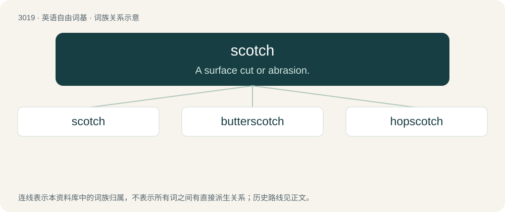

# 3121 · scotch — A surface cut or abrasion.

[总目录](../00_总目录_按常用程度.md)

**类型**：英语自由词基　｜　**来源语言**：见词源记录

## 核心含义与来源

- 核心含义：A surface cut or abrasion.
- 英文含义：A surface cut or abrasion.
- 词形：scotch

**多个词源／构词路径**：同一拼写可能有不同来源；以下按词性和含义分别列出。

**来源记录 1**（名词；A surface cut or abrasion.）

From Middle English scocchen (“to cut”), perhaps from Anglo-Norman escocher (“to notch”), from es- (“intensive prefix”) (from Latin ex-) + Old French coche (“notch”). Not related to Scotch.

**来源记录 2**（动词；To rape.）

From 3M's Scotch tape; the Australian rhyming slang comes from the rhyme between tape and rape.

## 词族图

## 单词速览（常用到不常用）

| 单词 | 音标 | 释义 |
|---|---|---|
| [scotch](#w-1) | 英 /skɒt͡ʃ/；美 /skɑt͡ʃ/ | 【英文】A surface cut or abrasion. |
| [butterscotch](#w-2) | 英 /ˈbʌtəˌskɒtʃ/；美 /ˈbʌtɚˌskɑt͡ʃ/ | n. 奶油糖果 |
| [hopscotch](#w-3) | 英 /ˈhɒpˌskɒt͡ʃ/；美 /ˈhɑpˌskɑt͡ʃ/ | n. "跳房子"游戏 |

## 逐词详解

### 1. scotch

**词性**：名词　｜　**音标**：英 /skɒt͡ʃ/；美 /skɑt͡ʃ/

**英文义项**：A surface cut or abrasion. / A line drawn on the ground, as one used in playing hopscotch.

**词源与演化**：

From Middle English scocchen (“to cut”), perhaps from Anglo-Norman escocher (“to notch”), from es- (“intensive prefix”) (from Latin ex-) + Old French coche (“notch”). Not related to Scotch.

**用法示例／搭配（非完整句）**：

> a scotch for a wheel or a log on inclined ground

该用例对应义项：A block for a wheel or other round object; a chock, wedge, prop, or other support, to prevent slipping.

### 2. butterscotch

**词性**：名词　｜　**音标**：英 /ˈbʌtəˌskɒtʃ/；美 /ˈbʌtɚˌskɑt͡ʃ/

**中文释义**：n. 奶油糖果

**英文义项**：A hard candy made from butter, brown sugar, syrup and vanilla. / A sauce or syrup made of similar ingredients.

**构词拆分**：butter + scotch

**词源与演化**：

From butter + scotch, with the second element deriving (not from scotch whiskey or Scotland, but) from Middle English scocchen (“to score, nick, cut”), in reference to how the candy is boiled and hardened and then usually scored to make breaking it apart easier. The word is usually said to have originally been a trademark of Parkinson's, who is claimed to have invented it.

### 3. hopscotch

**词性**：名词　｜　**音标**：英 /ˈhɒpˌskɒt͡ʃ/；美 /ˈhɑpˌskɑt͡ʃ/

**中文释义**：n. "跳房子"游戏

**英文义项**：A child's game, in which a player, hopping on one foot, drives a stone from one compartment to another of a figure traced or scotched on the ground.

**构词拆分**：hop + scotch (“scratch”)

**词源与演化**：

From hop + scotch (“scratch”).

**例句**：

> In the schoolyard you often see kids playing hopscotch.
