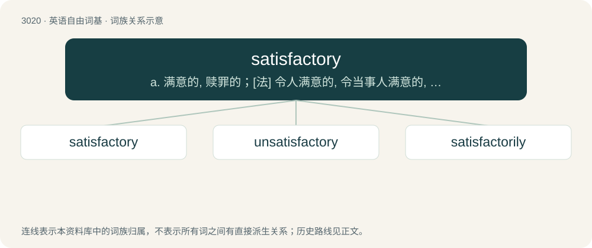

# 3122 · satisfactory — a. 满意的, 赎罪的；\[法\] 令人满意的, 令当事人满意的, 充分的

[总目录](../00_总目录_按常用程度.md)

**类型**：英语自由词基　｜　**来源语言**：见词源记录

## 核心含义与来源

- 核心含义：a. 满意的, 赎罪的；\[法\] 令人满意的, 令当事人满意的, 充分的
- 英文含义：Done to satisfaction; adequate or sufficient.
- 词形：satisfactory

**来源记录 1**（形容词；Done to satisfaction; adequate or sufficient.）

Borrowed from Middle French satisfactoire, from Late Latin satisfactōrius, from Latin satisfactus, past participle of satisfaciō.

## 词族图

## 单词速览（常用到不常用）

| 单词 | 音标 | 释义 |
|---|---|---|
| [satisfactory](#w-1) | /sætɪsˈfækt(ə)ɹi/ | a. 满意的, 赎罪的；\[法\] 令人满意的, 令当事人满意的, 充分的 |
| [unsatisfactory](#w-2) | /ˌʌnsætɪsˈfækt(ə)ɹi/ | a. 不令人满意的 |
| [satisfactorily](#w-3) | /sætɪsˈfækt(ə)ɹɪli/ | adv. 令人满意地 |

## 逐词详解

### 1. satisfactory

**词性**：形容词　｜　**音标**：/sætɪsˈfækt(ə)ɹi/

**中文释义**：a. 满意的, 赎罪的；\[法\] 令人满意的, 令当事人满意的, 充分的

**英文义项**：Done to satisfaction; adequate or sufficient. / Causing satisfaction; agreeable or pleasant; satisfying.

**词源与演化**：

Borrowed from Middle French satisfactoire, from Late Latin satisfactōrius, from Latin satisfactus, past participle of satisfaciō.

**例句**：

> The satisfactory results of the survey led to his promotion.

该用例对应义项：Done to satisfaction; adequate or sufficient.

### 2. unsatisfactory

**词性**：形容词　｜　**音标**：/ˌʌnsætɪsˈfækt(ə)ɹi/

**中文释义**：a. 不令人满意的

**英文义项**：Inadequate, substandard or not satisfactory.

**构词拆分**：From un- + satisfactory.

**词源与演化**：

From un- + satisfactory.

**例句**：

> Shops should take back unsatisfactory goods.

该用例对应义项：not giving satisfaction

### 3. satisfactorily

**词性**：副词　｜　**音标**：/sætɪsˈfækt(ə)ɹɪli/

**中文释义**：adv. 令人满意地

**英文义项**：In a satisfactory manner, in a manner adequate to requirements.

**构词拆分**：satisfactory + -ly

**词源与演化**：

From satisfactory + -ly.

**例句**：

> It's taken us three weeks to fix, but at last our car runs satisfactorily.
