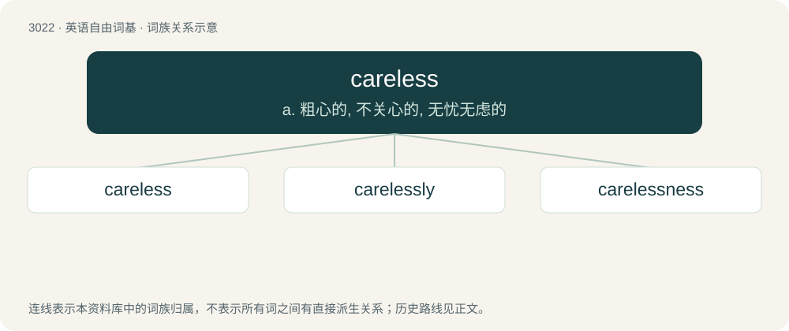

# 3124 · careless — a. 粗心的, 不关心的, 无忧无虑的

[总目录](../00_总目录_按常用程度.md)

**类型**：英语自由词基　｜　**来源语言**：见词源记录

## 核心含义与来源

- 核心含义：a. 粗心的, 不关心的, 无忧无虑的
- 英文含义：Not concerned or worried (about).
- 词形：careless

**来源记录 1**（形容词；Not concerned or worried (about).）

From Middle English careles, from Old English carlēas (“careless, reckless, void of care, free from care, free”), equivalent to care + -less. Cognate with Icelandic kærulaus (“careless, negligent”).

## 词族图

## 单词速览（常用到不常用）

| 单词 | 音标 | 释义 |
|---|---|---|
| [careless](#w-1) | 英 /ˈkɛəlɪs/；美 /kɛɹ.ləs/ | a. 粗心的, 不关心的, 无忧无虑的 |
| [carelessly](#w-2) | 英 /ˈkɛələsli/；美 /ˈkɛɹləsli/ | adv. 不注意地, 粗心地 |
| [carelessness](#w-3) | 英 /ˈkɛələsnəs/；美 /ˈkɛɹləsnəs/ | n. 粗心大意 |

## 逐词详解

### 1. careless

**词性**：形容词　｜　**音标**：英 /ˈkɛəlɪs/；美 /kɛɹ.ləs/

**中文释义**：a. 粗心的, 不关心的, 无忧无虑的

**英文义项**：Not concerned or worried (about). / Not giving sufficient attention or thought, especially concerning the avoidance of harm or mistakes.

**构词拆分**：care + -less

**词源与演化**：

From Middle English careles, from Old English carlēas (“careless, reckless, void of care, free from care, free”), equivalent to care + -less. Cognate with Icelandic kærulaus (“careless, negligent”).

**例句**：

> Jessica was so careless that she put her shorts on backwards.

该用例对应义项：Not giving sufficient attention or thought, especially concerning the avoidance of harm or mistakes.

### 2. carelessly

**词性**：副词　｜　**音标**：英 /ˈkɛələsli/；美 /ˈkɛɹləsli/

**中文释义**：adv. 不注意地, 粗心地

**英文义项**：Giving the appearance of carelessness; relaxedly. / Done without care or attention; inattentively.

**构词拆分**：careless + -ly

**词源与演化**：

From careless + -ly.

**例句**：

> Distracted by the salesperson, he carelessly read the contract.

该用例对应义项：Done without care or attention; inattentively.

### 3. carelessness

**词性**：名词　｜　**音标**：英 /ˈkɛələsnəs/；美 /ˈkɛɹləsnəs/

**中文释义**：n. 粗心大意

**英文义项**：Lack of care; the state or quality of being careless.

**构词拆分**：careless + -ness

**词源与演化**：

From Middle English \*carelesnes, \*carlesnesse, from Old English carlēasnes (“freedom from care, security, carelessness”), equivalent to careless + -ness.

**例句**：

> This accident was caused by carelessness.

该用例对应义项：Lack of care; the state or quality of being careless.
