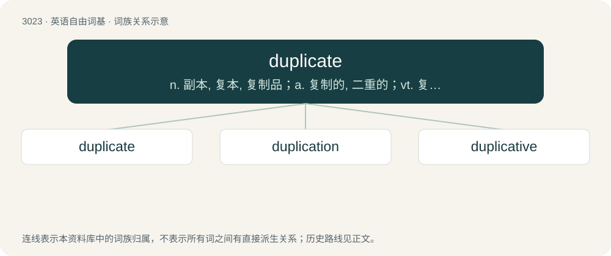

# 3125 · duplicate — n. 副本, 复本, 复制品；a. 复制的, 二重的；vt. 复制, 使加倍

[总目录](../00_总目录_按常用程度.md)

**类型**：英语自由词基　｜　**来源语言**：见词源记录

## 核心含义与来源

- 核心含义：n. 副本, 复本, 复制品；a. 复制的, 二重的；vt. 复制, 使加倍
- 英文含义：Being the same as another; identical, often having been copied from an original.
- 词形：duplicate

**来源记录 1**（形容词；Being the same as another; identical, often having been copied from an original.）

Borrowed from Latin duplicātus, perfect passive participle of duplicō, see -ate.

## 词族图

## 单词速览（常用到不常用）

| 单词 | 音标 | 释义 |
|---|---|---|
| [duplicate](#w-1) | /ˈd(j)uː.plɪ.kət/ | n. 副本, 复本, 复制品；a. 复制的, 二重的；vt. 复制, 使加倍 |
| [duplication](#w-2) | 英 /djuː.plɪˈkeɪ.ʃən/；美 /d(j)u.plɪˈkeɪ.ʃən/ | n. 副本, 复制；\[医\] 重迭, 双折, 复制 |
| [duplicative](#w-3) | 英 /djuːˈplɪkətɪv/；美 /d(j)uˈplɪkətɪv/ | 加倍的 |

## 逐词详解

### 1. duplicate

**词性**：形容词　｜　**音标**：/ˈd(j)uː.plɪ.kət/

**中文释义**：n. 副本, 复本, 复制品；a. 复制的, 二重的；vt. 复制, 使加倍

**英文义项**：Being the same as another; identical, often having been copied from an original. / In which the hands of cards, tiles, etc. are preserved between rounds to be played again by other players.

**词源与演化**：

Borrowed from Latin duplicātus, perfect passive participle of duplicō, see -ate.

**例句**：

> This is a duplicate entry.

该用例对应义项：Being the same as another; identical, often having been copied from an original.

### 2. duplication

**词性**：名词　｜　**音标**：英 /djuː.plɪˈkeɪ.ʃən/；美 /d(j)u.plɪˈkeɪ.ʃən/

**中文释义**：n. 副本, 复制；\[医\] 重迭, 双折, 复制

**英文义项**：The act of duplicating. / A duplicate.

**构词拆分**：duplicate + -ion

**词源与演化**：

From Middle English duplicacioun, from Middle French duplication, from Late Latin duplicātiō, duplicātiōnem, from Latin duplicō. Morphologically duplicate + -ion.

**用法示例／搭配（非完整句）**：

> duplication of cartilage cells

该用例对应义项：The act or process of dividing by natural growth or spontaneous action.

### 3. duplicative

**词性**：形容词　｜　**音标**：英 /djuːˈplɪkətɪv/；美 /d(j)uˈplɪkətɪv/

**中文释义**：加倍的

**英文义项**：Of, related to, or being a duplicate.

**构词拆分**：duplicate + -ive

**词源与演化**：

From duplicate + -ive.
