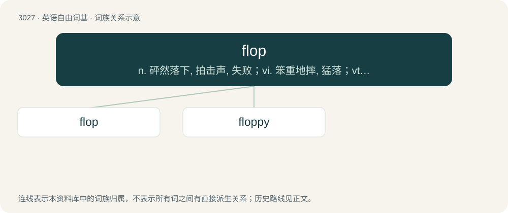

# 3128 · flop — n. 砰然落下, 拍击声, 失败；vi. 笨重地摔, 猛落；vt. 笨拙地抛下

[总目录](../00_总目录_按常用程度.md)

**类型**：英语自由词基　｜　**来源语言**：见词源记录

## 核心含义与来源

- 核心含义：n. 砰然落下, 拍击声, 失败；vi. 笨重地摔, 猛落；vt. 笨拙地抛下
- 英文含义：To fall heavily due to lack of energy.
- 词形：flop

**多个词源／构词路径**：同一拼写可能有不同来源；以下按词性和含义分别列出。

**来源记录 1**（动词；To fall heavily due to lack of energy.）

Recorded since 1602, probably a variant of flap with a duller, heavier sound.

**来源记录 2**（名词；One floating-point operation per second, a unit of measure of processor speed.）

A variant capitalization of FLOP, a syllabic acronym of floating-point operations.

## 词族图

## 单词速览（常用到不常用）

| 单词 | 音标 | 释义 |
|---|---|---|
| [flop](#w-1) | 英 /flɒp/；美 /flɑp/ | n. 砰然落下, 拍击声, 失败；vi. 笨重地摔, 猛落；vt. 笨拙地抛下 |
| [floppy](#w-2) | /ˈflɒ.pi/ | a. 叭嗒叭嗒响的, 松软的 |

## 逐词详解

### 1. flop

**词性**：动词　｜　**音标**：英 /flɒp/；美 /flɑp/

**中文释义**：n. 砰然落下, 拍击声, 失败；vi. 笨重地摔, 猛落；vt. 笨拙地抛下

**英文义项**：To fall heavily due to lack of energy. / To cause to drop heavily.

**词源与演化**：

Recorded since 1602, probably a variant of flap with a duller, heavier sound.

**例句**：

> It starts with Chris Paul, because Blake didn't really used to flop like that, you know, last year.

该用例对应义项：To pretend to be fouled in sports, such as basketball, hockey (the same as to dive in soccer)

### 2. floppy

**词性**：形容词　｜　**音标**：/ˈflɒ.pi/

**中文释义**：a. 叭嗒叭嗒响的, 松软的

**英文义项**：Limp, not hard, firm, or rigid; flexible.

**构词拆分**：flop + -y

**词源与演化**：

From flop + -y.

**例句**：

> The dog's floppy ears twitch at the sounds of the outside world.
