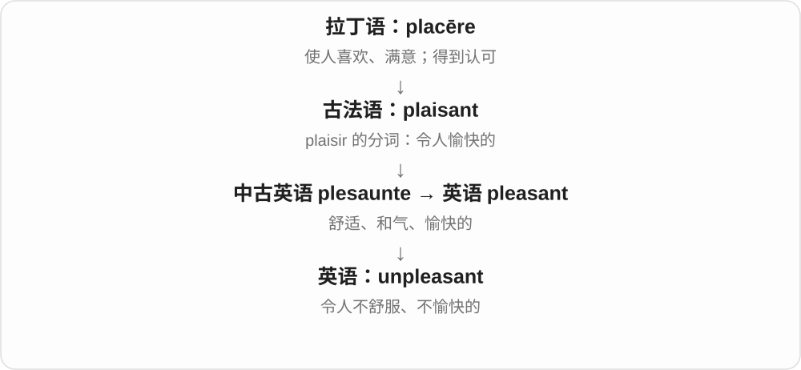
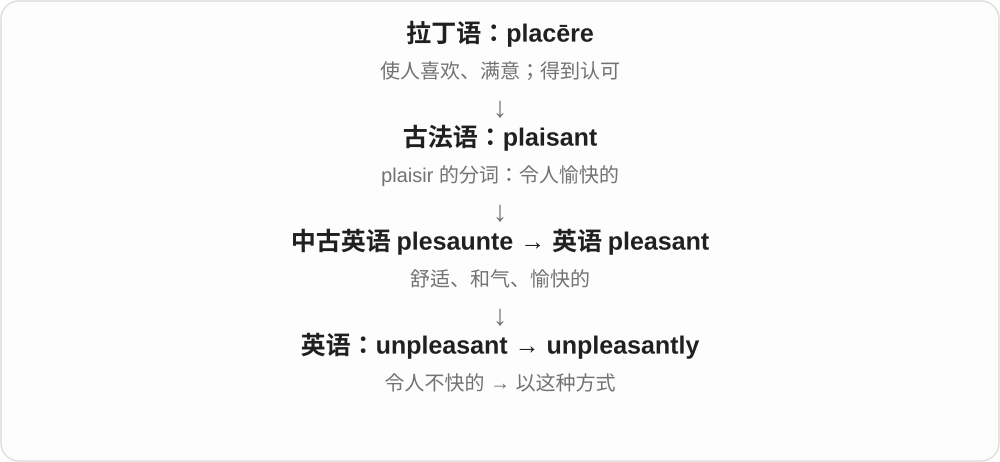

# 3128 · unpleasant — 让人不舒服、不愉快，性质与不快事件均可表达

[逐词精讲目录](../00_逐词精讲目录.md) · [总目录](../00_总目录_按常用程度.md)

## 核心词根与来源

气味、消息、相处体验都可以 unpleasant。unpleasantness 还会把一次口角、冲突委婉地包起来说成不愉快。

**UNPLEASANT：体验让人不想继续待下去**

unpleasant → unpleasantly、unpleasantness，先性质，再方式、状态或事件。

- **性质、方式与名词**：unpleasant · unpleasantly · unpleasantness

## 词形与演化规律

un- + pleasant；-ly 方式；-ness 性质，进一步可具体指不快事件。

## 单词速览（按词族由简到繁）

同一基础词的相关扩展放在一起，先读基础形式，再读扩展；各组之间优先读常用的。具体词源关系见各词讲解。

| 单词 | 音标 | 核心意思 |
|---|---|---|
| [unpleasant](#w-1) | 英 /ʌnˈplezənt/；美 /ʌnˈplezənt/ | 令人不快的；难受的；不友善的 |
| [unpleasantness](#w-2) | /ʌnˈplezəntnəs/ | 不愉快、讨厌之处；不愉快的事、口角 |
| [unpleasantly](#w-3) | 英 /ʌnˈplezəntli/；美 /ʌnˈplezəntli/ | 令人不快地；不友善地 |

## 逐词讲解

### 1. unpleasant — 令人不快的；难受的；不友善的

**音标**：英 /ʌnˈplezənt/；美 /ʌnˈplezənt/

**先抓住这个画面**

让人想躲开、皱眉，或者相处起来感到不舒服。

**怎么拆**

un- 否定 + pleasant。

**怎么变成今天的意思**

可说 unpleasant smell、unpleasant experience、unpleasant person。强度很宽，从不舒服到讨厌都可能。

**常见搭配与例句**

an unpleasant smell；an unpleasant surprise；unpleasant to deal with。

> An unpleasant smell came from the drain.

排水口传来一股难闻的气味。

> The conversation became unpleasant after the accusation.

指责出现后，谈话变得令人不快。

**别混淆**

unpleasant 评价体验让人不舒服；dangerous 说有危险，二者不必同时成立。

### 2. unpleasantness — 不愉快、讨厌之处；不愉快的事、口角

**音标**：/ʌnˈplezəntnəs/

**先抓住这个画面**

不只说闻着不好受，也能把一场尴尬口角轻轻概括成 some unpleasantness。后者常是委婉地说发生了不太好看的冲突。

**怎么拆**

unpleasant + -ness → unpleasantness，性质名词又可具体指令人不快的事情。-ness 不要求永远只能说不可数的抽象性质。

**怎么变成今天的意思**

**un- 不 + pleasant 愉快的 → unpleasant**  
令人不舒服、不愉快

↓

**unpleasant + -ness → unpleasantness**  
不愉快性质，也可指不愉快事件或冲突

avoid unpleasantness 避免不愉快、冲突；some unpleasantness 一些不快；the unpleasantness of a smell 气味的难闻。

**常见搭配与例句**

avoid unpleasantness；some unpleasantness。

> I apologised quickly to avoid further unpleasantness.

我很快道歉，免得再闹出不愉快。

> The unpleasantness of the smell made us open every window.

难闻的气味让我们把所有窗户都打开了。

**别混淆**

unpleasantness 比完整说 quarrel 口角可更委婉，未必每次严重到争吵；要看事情、性质两种名词用法。

### 3. unpleasantly — 令人不快地；不友善地

**音标**：英 /ʌnˈplezəntli/；美 /ʌnˈplezəntli/

**先抓住这个画面**

动作的方式或某种程度已经越过舒服的界线。

**怎么拆**

unpleasant + -ly。

**怎么变成今天的意思**

unpleasantly cold 是冷得难受；answer unpleasantly 是很不友善地回答。

**常见搭配与例句**

unpleasantly cold；unpleasantly surprised；speak unpleasantly。

> The water was unpleasantly cold.

水冷得让人难受。

> He answered unpleasantly and turned away.

他很不友善地回答了一句，就转过身去。

**别混淆**

unpleasantly 修饰动作或程度；unpleasant 修饰人、物或状态。

## 这一组要分清什么

unpleasant 不必严重到可怕；unpleasantness 也不一定都是争吵，不要把委婉说法当唯一义。

## 串起来练习

The unpleasant reply led to more unpleasantness.

那个令人不快的回复又引出了更多不愉快。
