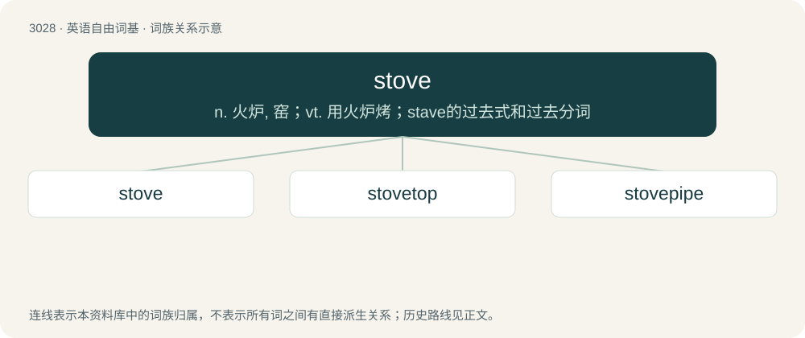

# 3129 · stove — n. 火炉, 窑；vt. 用火炉烤；stave的过去式和过去分词

[总目录](../00_总目录_按常用程度.md)

**类型**：英语自由词基　｜　**来源语言**：见词源记录

## 核心含义与来源

- 核心含义：n. 火炉, 窑；vt. 用火炉烤；stave的过去式和过去分词
- 英文含义：A heater, a closed apparatus to burn fuel for the warming of a room.
- 词形：stove

**来源记录 1**（名词；A heater, a closed apparatus to burn fuel for the warming of a room.）

From Middle Dutch stove and/or Middle Low German stove (compare Dutch stoof (“foot stove”), German Low German Stuve, Stuuv), both from Proto-West Germanic \*stubu (“heated room, bathroom, stove”), further origin uncertain. The Germanic words are very old, and are the source of the Slavic and Romance terms. It is often speculated that the Germanic terms were borrowed from Vulgar Latin \*extūfa, \*extūfāre (“to heat with steam”), from Latin ex- + \*tūfus (“hot vapor”), from Ancient Greek τῦφος (tûphos, “fever”). Cognates Cognate with Old English stofa (“bathroom, bathhouse”), stufbæþ (“hot-air bath”), Old High German stuba (“heated room, bathroom”) (whence German Stube (“living room, room, parlour”), Hungarian szoba (“room”)), Old Norse stofa (whence Danish stue (“living room, room”), Faroese stova (“living room, house”), Icelandic stofa (“living room”), Norwegian Bokmål stue (“cottage, cabin, living room”), Norwegian Nynorsk stove (“cottage, cabin, living room”), Swedish stuga (“cottage, cabin, living room”)). Doublet of stufa.

## 词族图

## 单词速览（常用到不常用）

| 单词 | 音标 | 释义 |
|---|---|---|
| [stove](#w-1) | 英 /stəʊv/；美 /stoʊv/ | n. 火炉, 窑；vt. 用火炉烤；stave的过去式和过去分词 |
| [stovetop](#w-2) | /ˈstəʊvtɒp/ | n. 炉顶面, 炉面；a. 炉面的；适于在炉面烹制的 |
| [stovepipe](#w-3) | /ˈstəuvpaip/ | n. 火炉烟囱, 大礼帽 |

## 逐词详解

### 1. stove

**词性**：动词　｜　**音标**：英 /stəʊv/；美 /stoʊv/

**中文释义**：n. 火炉, 窑；vt. 用火炉烤；stave的过去式和过去分词

**英文义项**：To heat or dry, as in a stove. / To keep warm, in a house or room, by artificial heat.

**词源与演化**：

From Middle Dutch stove and/or Middle Low German stove (compare Dutch stoof (“foot stove”), German Low German Stuve, Stuuv), both from Proto-West Germanic \*stubu (“heated room, bathroom, stove”), further origin uncertain. The Germanic words are very old, and are the source of the Slavic and Romance terms. It is often speculated that the Germanic terms were borrowed from Vulgar Latin \*extūfa, \*extūfāre (“to heat with steam”), from Latin ex- + \*tūfus (“hot vapor”), from Ancient Greek τῦφος (tûphos, “fever”). Cognates Cognate with Old English stofa (“bathroom, bathhouse”), stufbæþ (“hot-air bath”), Old High German stuba (“heated room, bathroom”) (whence German Stube (“living room, room, parlour”), Hungarian szoba (“room”)), Old Norse stofa (whence Danish stue (“living room, room”), Faroese stova (“living room, house”), Icelandic stofa (“living room”), Norwegian Bokmål stue (“cottage, cabin, living room”), Norwegian Nynorsk stove (“cottage, cabin, living room”), Swedish stuga (“cottage, cabin, living room”)). Doublet of stufa.

**用法示例／搭配（非完整句）**：

> to stove orange trees

该用例对应义项：To keep warm, in a house or room, by artificial heat.

### 2. stovetop

**词性**：名词　｜　**音标**：/ˈstəʊvtɒp/

**中文释义**：n. 炉顶面, 炉面；a. 炉面的；适于在炉面烹制的

**英文义项**：The top of a stove; usually specifically the burners.

**构词拆分**：stove + top

**词源与演化**：

From stove + top.

**例句**：

> You make this on the stovetop, not in the oven.

该用例对应义项：The top of a stove; usually specifically the burners.

### 3. stovepipe

**词性**：名词　｜　**音标**：/ˈstəuvpaip/

**中文释义**：n. 火炉烟囱, 大礼帽

**英文义项**：Sheet-metal tubing used as a chimney for a stove or furnace. / A channel for information which is compartmentalized in such a manner that some parties who might be interested in its use or able to make use of it are restricted from accessing it.

**构词拆分**：stove + pipe

**词源与演化**：

From stove + pipe. The firearms sense is due to the trapped cartridge case resembling a stovepipe of the stove sense.
