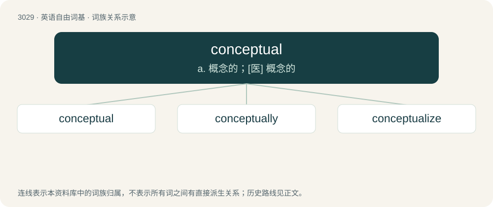

# 3130 · conceptual — a. 概念的；\[医\] 概念的

[总目录](../00_总目录_按常用程度.md)

**类型**：英语自由词基　｜　**来源语言**：见词源记录

## 核心含义与来源

- 核心含义：a. 概念的；\[医\] 概念的
- 英文含义：Of, or relating to concepts or mental conception.
- 词形：conceptual

**来源记录 1**（形容词；Of, or relating to concepts or mental conception.）

Borrowed from Medieval Latin conceptuālis, from Latin conceptus, perfect passive participle of concipiō (“take hold of; conceive”); see concept and -al.

## 词族图

## 单词速览（常用到不常用）

| 单词 | 音标 | 释义 |
|---|---|---|
| [conceptual](#w-1) | 英 /kənˈsɛp.tjʊəl/；美 /kənˈsɛp.t͡ʃu.əl/ | a. 概念的；\[医\] 概念的 |
| [conceptually](#w-2) | 英 /kənˈsɛp.tjʊə.li/；美 /kənˈsɛp.t͡ʃu.ə.li/ | adv. 概念地 |
| [conceptualize](#w-3) | /kənˈseptjuəlaiz/ | vt. 使概念化；\[计\] 概念表达 |

## 逐词详解

### 1. conceptual

**词性**：形容词　｜　**音标**：英 /kənˈsɛp.tjʊəl/；美 /kənˈsɛp.t͡ʃu.əl/

**中文释义**：a. 概念的；\[医\] 概念的

**英文义项**：Of, or relating to concepts or mental conception. / Existing only in the imagination.

**词源与演化**：

Borrowed from Medieval Latin conceptuālis, from Latin conceptus, perfect passive participle of concipiō (“take hold of; conceive”); see concept and -al.

**例句**：

> We defined a conceptual model before designing the real thing.

该用例对应义项：Existing only in the imagination.

### 2. conceptually

**词性**：副词　｜　**音标**：英 /kənˈsɛp.tjʊə.li/；美 /kənˈsɛp.t͡ʃu.ə.li/

**中文释义**：adv. 概念地

**英文义项**：In a conceptual manner.

**构词拆分**：conceptual + -ly

**词源与演化**：

From conceptual + -ly.

**例句**：

> He can no longer think conceptually.

该用例对应义项：in a conceptual manner

### 3. conceptualize

**词性**：动词　｜　**音标**：/kənˈseptjuəlaiz/

**中文释义**：vt. 使概念化；\[计\] 概念表达

**英文义项**：To interpret a phenomenon by forming a concept. / To conceive the idea for something.

**构词拆分**：conceptual + -ize

**词源与演化**：

From conceptual + -ize.

**例句**：

> The best way to conceptualize looting is as similar to pollution, a byproduct of the economics of the antiquities trade.
