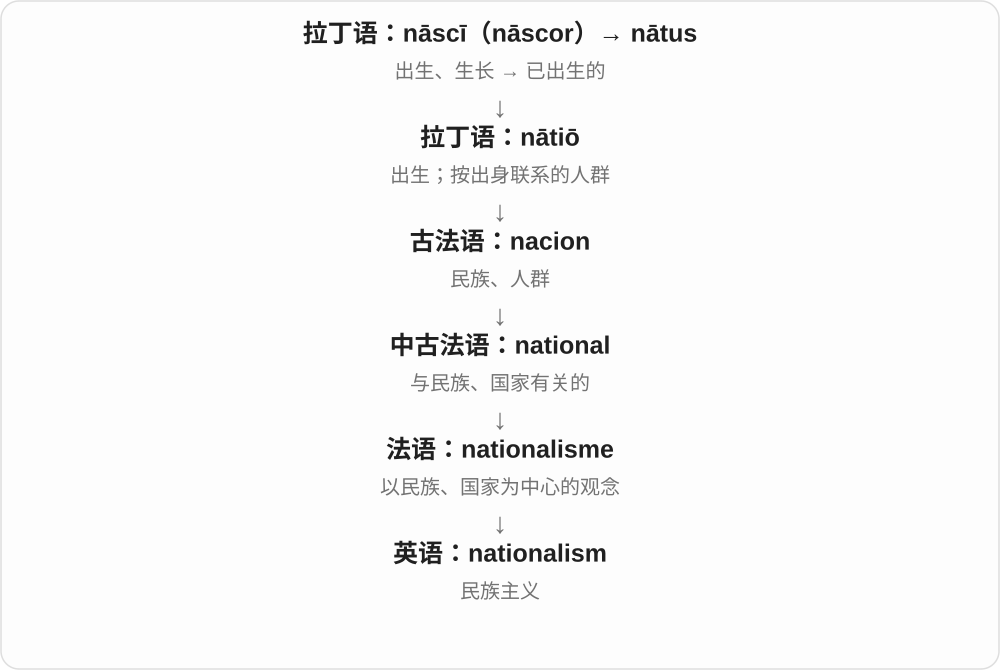

# 3131 · nationalism — 民族主义；国家认同相关立场

[逐词精讲目录](../00_逐词精讲目录.md) · [总目录](../00_总目录_按常用程度.md)

## 核心词根与来源

nationalism 由 national 与 -ism 形成，是近代政治思想名称。它的历史表现和评价随人物、地区、年代而异，不能只用爱国两个字说明全部。

**NATIONALISM：把民族或国家共同体置于政治认同的中心**

人们如何理解共同身份、自治和国家利益，是具体语境的关键。

- **政治认同和思想名称**：nationalism

## 词形与演化规律

a form of nationalism、nationalism and identity；-ism 表思想或倾向，不能自动推出一组固定政策。

## 单词速览（按词族由简到繁）

同一基础词的相关扩展放在一起，先读基础形式，再读扩展；各组之间优先读常用的。具体词源关系见各词讲解。

| 单词 | 音标 | 核心意思 |
|---|---|---|
| [nationalism](#w-1) | /ˈnæʃənəlɪzəm/ | 民族主义；国家主义倾向 |

## 逐词讲解

### 1. nationalism — 民族主义；国家主义倾向

**音标**：/ˈnæʃənəlɪzəm/

**先抓住这个画面**

nationalism 是围绕民族或国家认同组织起来的一套情感和政治观念，强调共同体的利益、独立或地位。

**怎么拆**

与法语 nationalisme 相连，现代对应 national + -ism。

**怎么变成今天的意思**

不同历史情境下，它可关联独立运动、认同建设或排他性政治，不能把各种情况压成一种行为。

**常见搭配与例句**

the rise of nationalism；cultural nationalism；debates about nationalism。

> The lecture traced the development of nationalism in Europe.

讲座追溯了欧洲民族主义的发展。

> The book distinguishes cultural nationalism from political programmes.

这本书区分了文化民族主义与具体政治纲领。

**别混淆**

nationality 是身份归属；nationalism 是情感、立场或思想体系。

## 这一组要分清什么

nationalism 与 patriotism 有联系而不完全同义；阅读时要看作者采用的概念范围。

## 串起来练习

阅读一段 nationalism 的具体论述，先找出作者讨论的群体与年代。
