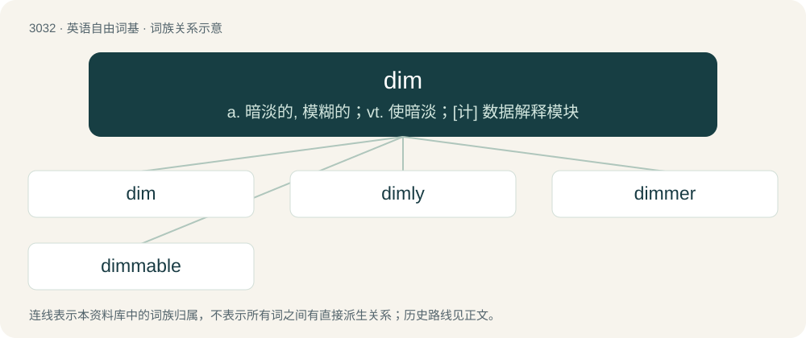

# 3132 · dim — a. 暗淡的, 模糊的；vt. 使暗淡；\[计\] 数据解释模块

[总目录](../00_总目录_按常用程度.md)

**类型**：英语自由词基　｜　**来源语言**：见词源记录

## 核心含义与来源

- 核心含义：a. 暗淡的, 模糊的；vt. 使暗淡；\[计\] 数据解释模块
- 英文含义：Not bright or colorful.
- 词形：dim

**来源记录 1**（形容词；Not bright or colorful.）

From Middle English dim, dym, from Old English dim, dimm (“dim, dark, gloomy; wretched, grievous, sad, unhappy”), from Proto-West Germanic \*dimm, from Proto-Germanic \*dimmaz (“dark”), from Proto-Indo-European \*dʰem- (“to whisk, smoke; obscure”). Compare Faroese dimmur (“dark”), Icelandic dimmur (“dark”) and dimma (“darkness”).

## 词族图

## 单词速览（常用到不常用）

| 单词 | 音标 | 释义 |
|---|---|---|
| [dim](#w-1) | /dɪm/ | a. 暗淡的, 模糊的；vt. 使暗淡；\[计\] 数据解释模块 |
| [dimly](#w-2) | /ˈdɪmli/ | adv. 微暗, 朦胧 |
| [dimmer](#w-3) | 英 /ˈdɪməː/；美 /ˈdɪmɚ/ | n. 调光器；\[化\] 衰减器 |
| [dimmable](#w-4) | /ˈdɪmmeɪbl/ | a. 阴暗的, 昏暗的, 不明亮的 |

## 逐词详解

### 1. dim

**词性**：形容词　｜　**音标**：/dɪm/

**中文释义**：a. 暗淡的, 模糊的；vt. 使暗淡；\[计\] 数据解释模块

**英文义项**：Not bright or colorful. / Not smart or intelligent.

**词源与演化**：

From Middle English dim, dym, from Old English dim, dimm (“dim, dark, gloomy; wretched, grievous, sad, unhappy”), from Proto-West Germanic \*dimm, from Proto-Germanic \*dimmaz (“dark”), from Proto-Indo-European \*dʰem- (“to whisk, smoke; obscure”). Compare Faroese dimmur (“dark”), Icelandic dimmur (“dark”) and dimma (“darkness”).

**例句**：

> The lighting was too dim for me to make out his facial features.

该用例对应义项：Not bright or colorful.

### 2. dimly

**词性**：副词　｜　**音标**：/ˈdɪmli/

**中文释义**：adv. 微暗, 朦胧

**英文义项**：In a dim manner; not clearly.

**构词拆分**：dim + -ly

**词源与演化**：

From dim + -ly.

**例句**：

> We perceived the change only dimly.

该用例对应义项：in a dim indistinct manner

### 3. dimmer

**词性**：名词　｜　**音标**：英 /ˈdɪməː/；美 /ˈdɪmɚ/

**中文释义**：n. 调光器；\[化\] 衰减器

**英文义项**：A rheostat that is used to vary the intensity of a domestic electric light / A switch used to select between the low and high headlamp beam on a road vehicle. (usually as "dimmer switch", primarily in North America; elsewhere "dipswitch" or "dipper switch")

**构词拆分**：dim + -er

**词源与演化**：

From dim (verb) + -er.

**例句**：

> The stars in Canis Minor are dimmer than the stars in Canis Major.

### 4. dimmable

**词性**：形容词　｜　**音标**：/ˈdɪmmeɪbl/

**中文释义**：a. 阴暗的, 昏暗的, 不明亮的

**英文义项**：Able to be dimmed: able to have illumination decreased in brightness without blowing out or degrading the service life of the LED or light bulb.

**构词拆分**：dim + -able

**词源与演化**：

From dim + -able.

**例句**：

> The store is having a sale on dimmable chandeliers.

该用例对应义项：Able to be dimmed: able to have illumination decreased in brightness without blowing out or degrading the service life of the LED or light bulb.
