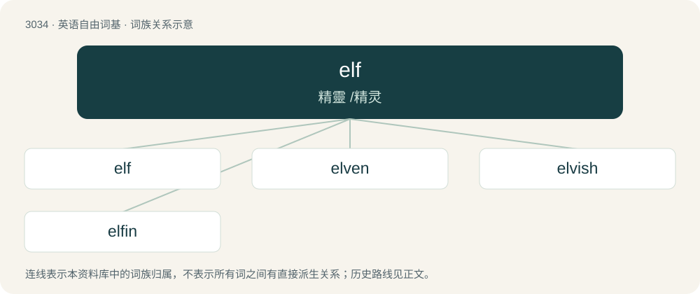

# 3134 · elf — 精靈 /精灵

[总目录](../00_总目录_按常用程度.md)

**类型**：英语自由词基　｜　**来源语言**：见词源记录

## 核心含义与来源

- 核心含义：精靈 /精灵
- 英文含义：A supernatural being or spirit associated with illness, mischief, and harmful or dangerous magical influence; in later Norse sources, sometimes divided into benevolent light elves (inhabiting Álfheimr) and malevolent dark elves.
- 词形：elf

**来源记录 1**（名词；A supernatural being or spirit associated with illness, mischief, and harmful or dangerous magical influence; in later Norse sources, sometimes divided into benevolent light elves (inhabiting Álfheimr) and malevolent dark elves.）

From Middle English elf, from Old English ielf, ælf, from Proto-West Germanic \*albi, from Proto-Germanic \*albiz. Ultimately probably derived from Proto-Indo-European \*h₂elbʰós (“white”). Doublet of alf, awf, and oaf. The modern fantasy literature sense was popularised by the works of J.R.R. Tolkien.

## 词族图

## 单词速览（常用到不常用）

| 单词 | 音标 | 释义 |
|---|---|---|
| [elf](#w-1) | /ɛlf/ | 精靈 /精灵 |
| [elven](#w-2) | 英 /ˈɛlv(ə)n/ | 小精灵, 精灵族 |
| [elvish](#w-3) | /ˈɛlvɪʃ/ | a. 小精灵的, 淘气的 |
| [elfin](#w-4) | /ˈɛlfɪn/ | a. 小妖精的, 象小妖精的；n. 小精灵, 矮人, 淘气鬼 |

## 逐词详解

### 1. elf

**词性**：名词　｜　**音标**：/ɛlf/

**中文释义**：精靈 /精灵

**英文义项**：A supernatural being or spirit associated with illness, mischief, and harmful or dangerous magical influence; in later Norse sources, sometimes divided into benevolent light elves (inhabiting Álfheimr) and malevolent dark elves. / A small, magical creature similar to a fairy, often mischievous, playful, or occasionally helpful.

**词源与演化**：

From Middle English elf, from Old English ielf, ælf, from Proto-West Germanic \*albi, from Proto-Germanic \*albiz. Ultimately probably derived from Proto-Indo-European \*h₂elbʰós (“white”). Doublet of alf, awf, and oaf. The modern fantasy literature sense was popularised by the works of J.R.R. Tolkien.

**例句**：

> In contrast to Mary, a forest elf, Jeanne was a dark elf.

### 2. elven

**词性**：形容词　｜　**音标**：英 /ˈɛlv(ə)n/

**中文释义**：小精灵, 精灵族

**英文义项**：Belonging or relating to, or characteristic of, elves; elfin, elflike.

**构词拆分**：elf + -en (suffix with the sense ‘pertaining to; having the qualities of; resembling’ forming adjectives)

**词源与演化**：

From the attributive use of Middle English elven (“elf or fairy of either sex”) (see etymology 1), like English elfin, reinterpreted as elf + -en (suffix with the sense ‘pertaining to; having the qualities of; resembling’ forming adjectives). The word first appears in the English author and philologist J. R. R. Tolkien’s works The Hobbit (1937) and The Lord of the Rings (1954–1955): see the quotations.

**例句**：

> The quickest way to the elven neighborhood is through the orc neighborhood.

### 3. elvish

**词性**：形容词　｜　**音标**：/ˈɛlvɪʃ/

**中文释义**：a. 小精灵的, 淘气的

**英文义项**：Of or having to do with elves; elven.

**构词拆分**：elf + -ish

**词源与演化**：

Inherited from Middle English elvisch, from Old English ielfisċ. Equivalent to elf + -ish.

**例句**：

> My Elvish is rusty, but I think he's saying he means us no harm.

### 4. elfin

**词性**：名词　｜　**音标**：/ˈɛlfɪn/

**中文释义**：a. 小妖精的, 象小妖精的；n. 小精灵, 矮人, 淘气鬼

**英文义项**：An elf; an inhabitant of fairy-land. / A little urchin or child.

**构词拆分**：elf + -in

**词源与演化**：

From Middle English elven, from Old English elfen, ælfen (“nymph, spirit, fairy”), feminine of elf, ælf (“elf”), equivalent to elf + -in. Cognate with Middle High German elbinne (“a fairy, nymph”).

**例句**：

> The tinkles of sleigh bells among the snowy hills came like elfin chimes through the frosty air.
