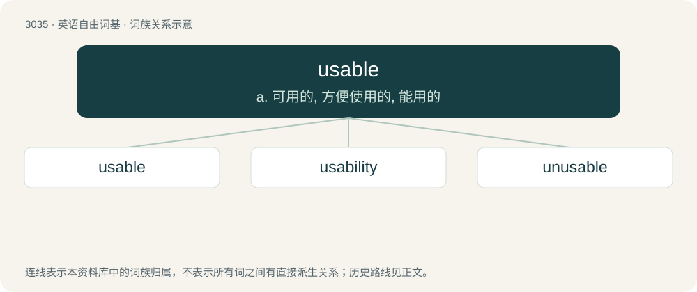

# 3135 · usable — a. 可用的, 方便使用的, 能用的

[总目录](../00_总目录_按常用程度.md)

**类型**：英语自由词基　｜　**来源语言**：见词源记录

## 核心含义与来源

- 核心含义：a. 可用的, 方便使用的, 能用的
- 英文含义：Capable of being used.
- 词形：usable

**来源记录 1**（形容词；Capable of being used.）

From Old French usable, from the verb user (“to use”).

## 词族图

## 单词速览（常用到不常用）

| 单词 | 音标 | 释义 |
|---|---|---|
| [usable](#w-1) | /ˈjuː.zə.bəl/ | a. 可用的, 方便使用的, 能用的 |
| [usability](#w-2) | /ˌjuːzəˈbɪlɪti/ | n. 可用性；\[化\] 工艺性 |
| [unusable](#w-3) |  | \[计\] 不可用的 |

## 逐词详解

### 1. usable

**词性**：形容词　｜　**音标**：/ˈjuː.zə.bəl/

**中文释义**：a. 可用的, 方便使用的, 能用的

**英文义项**：Capable of being used. / Easy to use; exhibiting good usability.

**词源与演化**：

From Old French usable, from the verb user (“to use”).

**例句**：

> 2000 square feet of usable office space.

该用例对应义项：convenient for use or disposal

### 2. usability

**词性**：名词　｜　**音标**：/ˌjuːzəˈbɪlɪti/

**中文释义**：n. 可用性；\[化\] 工艺性

**英文义项**：The state or condition of being usable. / The degree to which an object, device, software application, etc. is easy to use with no specific training.

**构词拆分**：usable + -ity；use + -ability

**词源与演化**：

From usable + -ity or use + -ability.

**例句**：

> Usability testing should include feedback from users with disabilities.

### 3. unusable

**词性**：形容词

**中文释义**：\[计\] 不可用的

**英文义项**：Not usable.

**构词拆分**：From un- + usable.

**词源与演化**：

From un- + usable.

**例句**：

> The toilet was unusable because it was blocked.

该用例对应义项：Not usable.
