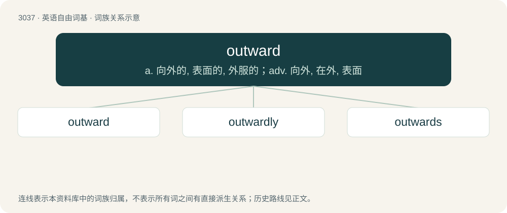

# 3136 · outward — a. 向外的, 表面的, 外服的；adv. 向外, 在外, 表面

[总目录](../00_总目录_按常用程度.md)

**类型**：英语自由词基　｜　**来源语言**：见词源记录

## 核心含义与来源

- 核心含义：a. 向外的, 表面的, 外服的；adv. 向外, 在外, 表面
- 英文含义：Outer; located towards the outside.
- 词形：outward

**来源记录 1**（形容词；Outer; located towards the outside.）

From Middle English outward, from Old English ūtweard, equivalent to out + -ward.

## 词族图

## 单词速览（常用到不常用）

| 单词 | 音标 | 释义 |
|---|---|---|
| [outward](#w-1) | 英 /ˈaʊt.wəd/；美 /ˈaʊt.wɚd/ | a. 向外的, 表面的, 外服的；adv. 向外, 在外, 表面 |
| [outwardly](#w-2) | 英 /ˈaʊtwədli/；美 /ˈaʊtwɚdli/ | adv. 表面上, 在外, 外表上 |
| [outwards](#w-3) | 英 /ˈaʊtwədz/；美 /ˈaʊtwɚdz/ | adv. 向外地 |

## 逐词详解

### 1. outward

**词性**：形容词　｜　**音标**：英 /ˈaʊt.wəd/；美 /ˈaʊt.wɚd/

**中文释义**：a. 向外的, 表面的, 外服的；adv. 向外, 在外, 表面

**英文义项**：Outer; located towards the outside. / Visible, noticeable.

**构词拆分**：out + -ward

**词源与演化**：

From Middle English outward, from Old English ūtweard, equivalent to out + -ward.

**例句**：

> By all outward indications, he's a normal happy child, but if you talk to him, you will soon realize he has some psychological problems.

该用例对应义项：Visible, noticeable.

### 2. outwardly

**词性**：副词　｜　**音标**：英 /ˈaʊtwədli/；美 /ˈaʊtwɚdli/

**中文释义**：adv. 表面上, 在外, 外表上

**英文义项**：Externally or on the outside, or on the surface. / Toward the outside

**构词拆分**：outward + -ly

**词源与演化**：

From Middle English outwardly, outwardli, utwardliche, equivalent to outward + -ly.

**例句**：

> The terrorist was outwardly a bank clerk.

该用例对应义项：Externally or on the outside, or on the surface.

### 3. outwards

**词性**：副词　｜　**音标**：英 /ˈaʊtwədz/；美 /ˈaʊtwɚdz/

**中文释义**：adv. 向外地

**英文义项**：From the interior toward the exterior; in an outward direction.

**构词拆分**：outward + -s；out + -wards

**词源与演化**：

From Middle English outwardes, from Old English ūtweardes; equivalent to outward + -s or out + -wards. Cognate with German auswärts.

**例句**：

> His body type is born balanced! Wide shoulders, slim waist, belly not popping outwards.
