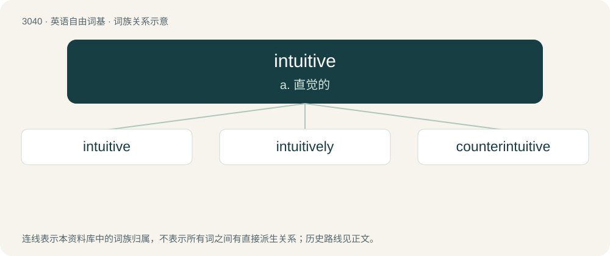

# 3139 · intuitive — a. 直觉的

[总目录](../00_总目录_按常用程度.md)

**类型**：英语自由词基　｜　**来源语言**：见词源记录

## 核心含义与来源

- 核心含义：a. 直觉的
- 英文含义：Spontaneous, without requiring conscious thought.
- 词形：intuitive

**来源记录 1**（形容词；Spontaneous, without requiring conscious thought.）

Borrowed from Middle French intuitif, from Medieval Latin intuitivus, from Latin intueri.

## 词族图

## 单词速览（常用到不常用）

| 单词 | 音标 | 释义 |
|---|---|---|
| [intuitive](#w-1) | 英 /ɪnˈtjuːɪtɪv/；美 /ɪnˈt(j)uɪtɪv/ | a. 直觉的 |
| [intuitively](#w-2) |  | \[计\] 直觉地 |
| [counterintuitive](#w-3) | 英 /ˌkaʊntəɹɪnˈtjuːɪtɪv/；美 /ˌkaʊntəɹɪnˈtuɪtɪv/ | a. 违反直觉的 |

## 逐词详解

### 1. intuitive

**词性**：形容词　｜　**音标**：英 /ɪnˈtjuːɪtɪv/；美 /ɪnˈt(j)uɪtɪv/

**中文释义**：a. 直觉的

**英文义项**：Spontaneous, without requiring conscious thought. / Easily understood or grasped by intuition.

**词源与演化**：

Borrowed from Middle French intuitif, from Medieval Latin intuitivus, from Latin intueri.

**例句**：

> Designing software with an intuitive interface can be difficult.

该用例对应义项：Easily understood or grasped by intuition.

### 2. intuitively

**词性**：副词

**中文释义**：\[计\] 直觉地

**英文义项**：By intuition; with skill or accuracy, but without special training or planning; instinctively.

**构词拆分**：intuitive + -ly

**词源与演化**：

From intuitive + -ly.

**例句**：

> Though he had never been to art school, he intuitively painted vivid landscapes.

该用例对应义项：By intuition; with skill or accuracy, but without special training or planning; instinctively.

### 3. counterintuitive

**词性**：形容词　｜　**音标**：英 /ˌkaʊntəɹɪnˈtjuːɪtɪv/；美 /ˌkaʊntəɹɪnˈtuɪtɪv/

**中文释义**：a. 违反直觉的

**英文义项**：Contrary to intuition or common sense.

**构词拆分**：counter- + intuitive

**词源与演化**：

From counter- + intuitive. Coined by Noam Chomsky in 1955 as “counter-intuitive”.

**例句**：

> Now I have to admit, when I read this, this sounded totally wrong and counterintuitive.
