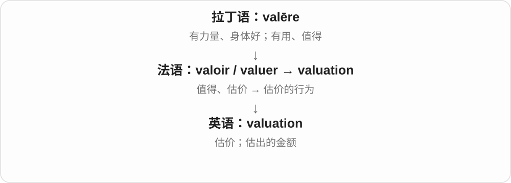
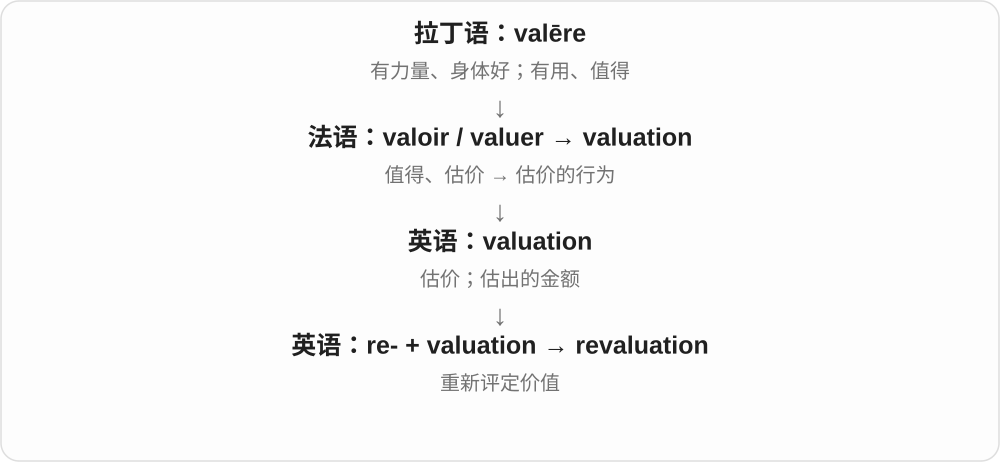

# 3139 · valuation — 估价；价值评定；币值调整

[逐词精讲目录](../00_逐词精讲目录.md) · [总目录](../00_总目录_按常用程度.md)

## 核心词根与来源

valuation 联系 value 的价值一支，revaluation 是重新评估或上调币值等具体义，devaluation 是价值下调或贬值。每种领域的技术含义须由语境确认。

**VALUATION：把价值拿来估计或设定**

可以评定资产，也可以在货币语境说重新定值。

- **价值评定**：valuation
- **再次评定与下降**：revaluation · devaluation

## 词形与演化规律

valuation of an asset、currency devaluation、a revaluation；re- 在一般义是重新，不保证每次都是增加。

## 单词速览（按词族由简到繁）

同一基础词的相关扩展放在一起，先读基础形式，再读扩展；各组之间优先读常用的。具体词源关系见各词讲解。

| 单词 | 音标 | 核心意思 |
|---|---|---|
| [valuation](#w-1) | 英、美 /ˌvæljuˈeɪʃən/ | 估价；评估价值；估出的金额 |
| [devaluation](#w-2) | 英、美 /ˌdiːvæljuˈeɪʃən/ | 贬值；价值或评价的降低 |
| [revaluation](#w-3) | 英、美 /ˌriːvæljuˈeɪʃən/ | 重新估价；重新评价；货币升值调整 |

## 逐词讲解

### 1. valuation — 估价；评估价值；估出的金额

**音标**：英、美 /ˌvæljuˈeɪʃən/

**先抓住这个画面**

请人看一看这件东西，再给出“它大概值多少”的判断。

**怎么拆**

借自法语 valuation，属于 valuer / valoir 词族；现代能联系 value 与 -ation。

**怎么变成今天的意思**

a property valuation 可以指评估过程，也可以指给出的金额。估价依赖时间、用途与方法，不是一个永远不变的标签。

**常见搭配与例句**

a property valuation；an independent valuation；a valuation of…。

> We requested an independent valuation of the painting.

我们请独立人士给这幅画估价。

> The two valuations differed by several thousand pounds.

两份估价相差几千英镑。

**别混淆**

evaluation 更广，可以评表现和质量；valuation 常尤其指经济价值。

### 2. devaluation — 贬值；价值或评价的降低

**音标**：英、美 /ˌdiːvæljuˈeɪʃən/

**先抓住这个画面**

把价值往下调这件事，作为一次变化或一种过程来谈。

**怎么拆**

de- + valuation；与 devalue 配套。

**怎么变成今天的意思**

经济报道常用来指货币的正式贬值；更广泛地也可指某种工作、技能的价值被降低。

**常见搭配与例句**

currency devaluation；a sharp devaluation；the devaluation of…。

> The article examines the effects of the currency devaluation.

文章考察货币贬值产生的影响。

> She criticized the gradual devaluation of practical skills.

她批评了实用技能逐渐被轻视的现象。

**别混淆**

devaluation 常强调有意下调；depreciation 可指市场贬值或资产随时间折旧，具体看领域。

### 3. revaluation — 重新估价；重新评价；货币升值调整

**音标**：英、美 /ˌriːvæljuˈeɪʃən/

**先抓住这个画面**

过去给过一次估价，现在换了时间、证据或标准，再算一遍。

**怎么拆**

re-“重新” + valuation。

**怎么变成今天的意思**

资产 revaluation 可能上调，也可能下调；特定货币制度中的 revaluation 通常指官方上调汇率价值。不要把所有“重新估价”都等于涨价。

**常见搭配与例句**

a revaluation of assets；a property revaluation；currency revaluation。

> The museum arranged a revaluation of its collection for insurance purposes.

博物馆为保险用途安排了藏品重新估价。

> The revaluation produced a lower figure than the previous estimate.

重新估价得到的金额低于先前估计。

**别混淆**

reevaluation 是更广的重新评估；revaluation 常更集中于价值，尤其金额。

## 这一组要分清什么

valuation 是估值过程或结果，price 是实际或提出的价格；二者可能不同。

## 串起来练习

The revaluation produced a different valuation of the collection.

重新评估得出了这批藏品的不同估值。
