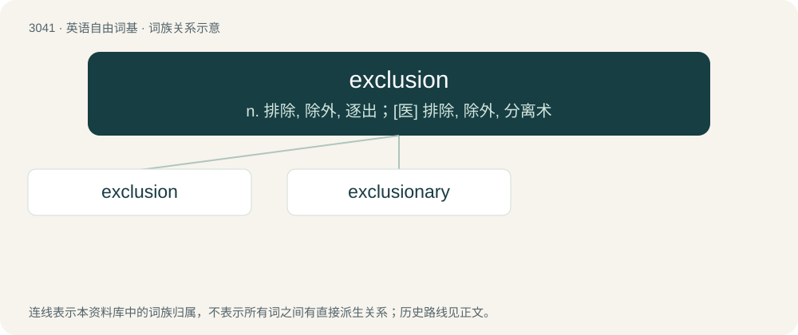

# 3140 · exclusion — n. 排除, 除外, 逐出；\[医\] 排除, 除外, 分离术

[总目录](../00_总目录_按常用程度.md)

**类型**：英语自由词基　｜　**来源语言**：见词源记录

## 核心含义与来源

- 核心含义：n. 排除, 除外, 逐出；\[医\] 排除, 除外, 分离术
- 英文含义：The act of excluding or shutting out; removal from consideration or taking part.
- 词形：exclusion

**来源记录 1**（名词；The act of excluding or shutting out; removal from consideration or taking part.）

From Middle English exclusion, exclusioun, from Old French \[Term?\] and Latin exclusiō, from exclūdō. By surface analysis, exclude + -sion.

## 词族图

## 单词速览（常用到不常用）

| 单词 | 音标 | 释义 |
|---|---|---|
| [exclusion](#w-1) | /ɪksˈkluːʒən/ | n. 排除, 除外, 逐出；\[医\] 排除, 除外, 分离术 |
| [exclusionary](#w-2) | /ɪkˈskluːʒənri/ | a. &lt;正&gt;排斥（性）的, 排除在外的 |

## 逐词详解

### 1. exclusion

**词性**：名词　｜　**音标**：/ɪksˈkluːʒən/

**中文释义**：n. 排除, 除外, 逐出；\[医\] 排除, 除外, 分离术

**英文义项**：The act of excluding or shutting out; removal from consideration or taking part. / An item not covered by an insurance policy.

**词源与演化**：

From Middle English exclusion, exclusioun, from Old French \[Term?\] and Latin exclusiō, from exclūdō. By surface analysis, exclude + -sion.

**例句**：

> The exclusion of mathematics from the field of culture is like intellectual castration.

### 2. exclusionary

**词性**：形容词　｜　**音标**：/ɪkˈskluːʒənri/

**中文释义**：a. &lt;正&gt;排斥（性）的, 排除在外的

**英文义项**：Acting to exclude something

**构词拆分**：exclusion + -ary

**词源与演化**：

From exclusion + -ary.

**例句**：

> Social groups are often exclusionary.

该用例对应义项：Acting to exclude something
