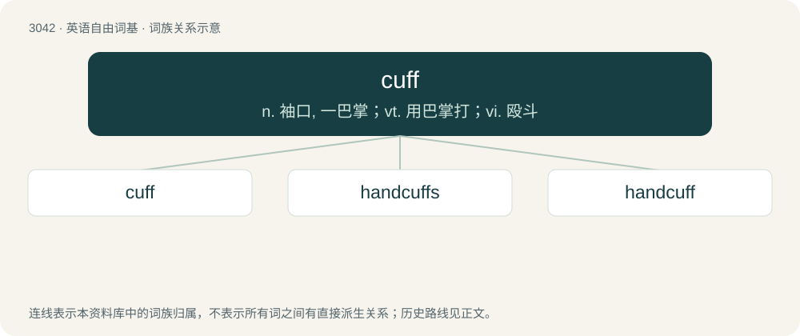

# 3142 · cuff — n. 袖口, 一巴掌；vt. 用巴掌打；vi. 殴斗

[总目录](../00_总目录_按常用程度.md)

**类型**：英语自由词基　｜　**来源语言**：见词源记录

## 核心含义与来源

- 核心含义：n. 袖口, 一巴掌；vt. 用巴掌打；vi. 殴斗
- 英文含义：The end of a shirt sleeve that covers the wrist.
- 词形：cuff

**多个词源／构词路径**：同一拼写可能有不同来源；以下按词性和含义分别列出。

**来源记录 1**（名词；The end of a shirt sleeve that covers the wrist.）

From Middle English cuffe, coffe (“glove, mitten”), of obscure origin. Perhaps from Old English cuffie (“hood, cap”), from Medieval Latin cofia, cofea, cuffa, cuphia (“helmet, headdress, hood, cap”), from Frankish \*kuf(f)ja (“headdress”), from Proto-West Germanic \*kuffju, from Proto-Germanic \*kupjō (“cap”). Cognate with Middle High German kupfe (“cap”).

**来源记录 2**（名词；A handcuff.）

Clipping of handcuff.

**来源记录 3**（动词；To hit, as a reproach, particularly with the open palm to the head; to slap.）

1520, “to hit”, apparently of North Germanic origin, from Norwegian kuffa (“to push, shove”) or Swedish kuffa (“to knock, thrust, strike”), from the Proto-Germanic base \*skuf- (skuƀ), from Proto-Indo-European \*skewbʰ-, see also Lithuanian skùbti (“to hurry”), Polish skubać (“to pluck”), Albanian humb (“to lose”). Germanic cognates include Low German kuffen (“to box the ears”), German kuffen (“to thrash”). More at scuff, shove, scuffle.

## 词族图

## 单词速览（常用到不常用）

| 单词 | 音标 | 释义 |
|---|---|---|
| [cuff](#w-1) | 英 /kʌf/ | n. 袖口, 一巴掌；vt. 用巴掌打；vi. 殴斗 |
| [handcuffs](#w-2) | /ˈhændˌkʌfs/ | n. 手铐；\[法\] 手铐 |
| [handcuff](#w-3) | /ˈhændˌkʌf/ | vt. 给...戴上手铐；n. 手铐 |

## 逐词详解

### 1. cuff

**词性**：名词　｜　**音标**：英 /kʌf/

**中文释义**：n. 袖口, 一巴掌；vt. 用巴掌打；vi. 殴斗

**英文义项**：The end of a shirt sleeve that covers the wrist. / The end of a pants leg when folded up.

**词源与演化**：

From Middle English cuffe, coffe (“glove, mitten”), of obscure origin. Perhaps from Old English cuffie (“hood, cap”), from Medieval Latin cofia, cofea, cuffa, cuphia (“helmet, headdress, hood, cap”), from Frankish \*kuf(f)ja (“headdress”), from Proto-West Germanic \*kuffju, from Proto-Germanic \*kupjō (“cap”). Cognate with Middle High German kupfe (“cap”).

**例句**：

> He lifted the cuff of his shirt and looked at his watch.

### 2. handcuffs

**词性**：名词　｜　**音标**：/ˈhændˌkʌfs/

**中文释义**：n. 手铐；\[法\] 手铐

**英文义项**：A fastening consisting of two metal rings, designed to go around a person's wrists, and connected by a chain or hinge. / Any abstract constraint, such as rules, regulations, or lack of resources.

**构词拆分**：hand + cuff (“end of shirtsleeve”)

**词源与演化**：

1775, from hand + cuff (“end of shirtsleeve”). Possibly influenced by Old English handcops, from hand + cops (“fetter, chains”), but due to lack of continuity (centuries between Old English and modern term), generally analyzed as a re-invention.

**例句**：

> They complained that their rules of engagement were handcuffs that guaranteed counterproductivity.

该用例对应义项：Any abstract constraint, such as rules, regulations, or lack of resources.

### 3. handcuff

**词性**：动词　｜　**音标**：/ˈhændˌkʌf/

**中文释义**：vt. 给...戴上手铐；n. 手铐

**英文义项**：To apply handcuffs to someone. / to restrain or restrict.

**构词拆分**：hand + cuff (“end of shirtsleeve”)

**词源与演化**：

From hand + cuff (“end of shirtsleeve”). Possibly an adaptation of Middle English handcops (“shackles for the hand, handcuffs”), from Old English handcops, from hand + cops, cosp (“fetter, chains”), but due to a lack of continuity (centuries between Old English and the modern term), generally analyzed as a re-invention. Nominal form first appears c. 1591 in the publications of John Florio. Verbal form first appears c. 1649.

**例句**：

> Dang, I’m handcuffed by these regulations. I’d like to help but it’d be illegal.

该用例对应义项：to restrain or restrict.
