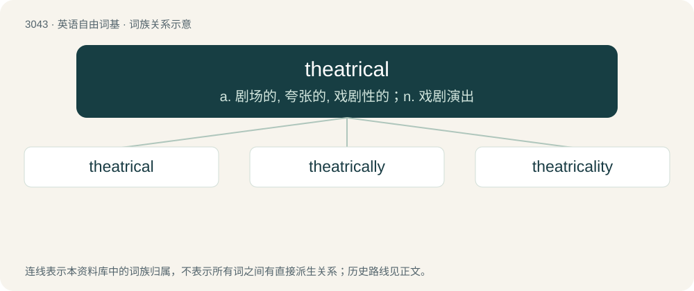

# 3143 · theatrical — a. 剧场的, 夸张的, 戏剧性的；n. 戏剧演出

[总目录](../00_总目录_按常用程度.md)

**类型**：英语自由词基　｜　**来源语言**：见词源记录

## 核心含义与来源

- 核心含义：a. 剧场的, 夸张的, 戏剧性的；n. 戏剧演出
- 英文含义：Of or relating to the theatre.
- 词形：theatrical

**来源记录 1**（形容词；Of or relating to the theatre.）

From Latin theātricus + -al. By surface analysis, theatre + -ical.

## 词族图

## 单词速览（常用到不常用）

| 单词 | 音标 | 释义 |
|---|---|---|
| [theatrical](#w-1) | 英 /θiːˈætɹɪkəl/；美 /θiˈætɹɪkəl/ | a. 剧场的, 夸张的, 戏剧性的；n. 戏剧演出 |
| [theatrically](#w-2) | /θɪˈætrɪklɪ/ | adv. 戏剧化地 |
| [theatricality](#w-3) | /θi.ætriˈkæləti/ | n. 戏剧风格, 不自然 |

## 逐词详解

### 1. theatrical

**词性**：形容词　｜　**音标**：英 /θiːˈætɹɪkəl/；美 /θiˈætɹɪkəl/

**中文释义**：a. 剧场的, 夸张的, 戏剧性的；n. 戏剧演出

**英文义项**：Of or relating to the theatre. / Fake and exaggerated.

**构词拆分**：Latin theātricus + -al

**词源与演化**：

From Latin theātricus + -al. By surface analysis, theatre + -ical.

**例句**：

> The theatrical troupe’s skits were often quirky, but their comedic instincts were unquestionably brilliant.

### 2. theatrically

**词性**：副词　｜　**音标**：/θɪˈætrɪklɪ/

**中文释义**：adv. 戏剧化地

**英文义项**：In a theatrical or dramatic manner. / In theaters, or in terms of the theater.

**构词拆分**：theatrical + -ly

**词源与演化**：

From theatrical + -ly.

**例句**：

> The story was a great success in novel form, but did not perform well theatrically.

该用例对应义项：In theaters, or in terms of the theater.

### 3. theatricality

**词性**：名词　｜　**音标**：/θi.ætriˈkæləti/

**中文释义**：n. 戏剧风格, 不自然

**英文义项**：Theatrical behaviour and mannerisms.

**构词拆分**：theatrical + -ity

**词源与演化**：

From theatrical + -ity.
